# blit


* Note: This is a fairly completly vibe coded project that only exists for the fun of the idea, basically its just a highly opinionated IDE to match the speed of something like NeoVim with the features of a JetBrains IDE. I have only manually verified some of the code and cannot say for certain it wont be buggy in some way.

A code editor drawn by its own GPU renderer, for C++, C, HIP and Python
(and the CMake, Markdown, shell and the rest around them): Vim's modes,
language servers, Git, a debugger and a profiler, all built in and all in
C++, on macOS (Metal) and Linux (Vulkan). Every change to it is measured
before it stays; [BENCH.md](BENCH.md) has the numbers.

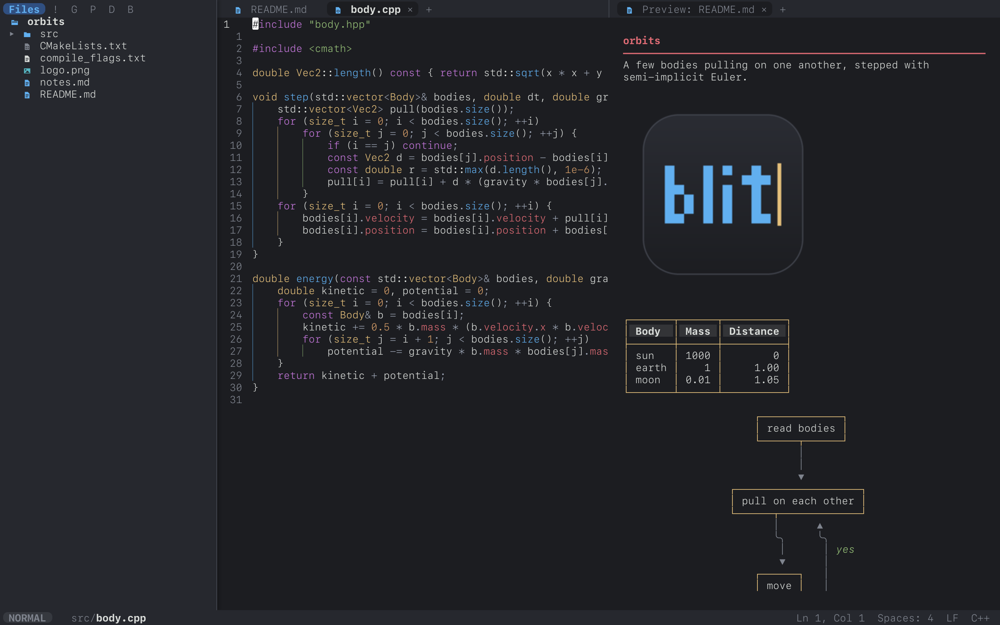

## Code that knows what it is

clangd, pyright and any other language server, several at once (each file
to the server of its language and project): completions with their types,
problems underlined with their messages, parameter names and deduced types
between the code, colours from the server over tree-sitter's, rename across
files, references, implementations, the file's outline, the project's
symbols, header and source, formatting and fixes. And from the syntax
tree alone, for any language with a grammar: folding, breadcrumbs, sticky
scroll, brackets coloured by depth, and the selection grown node by node.

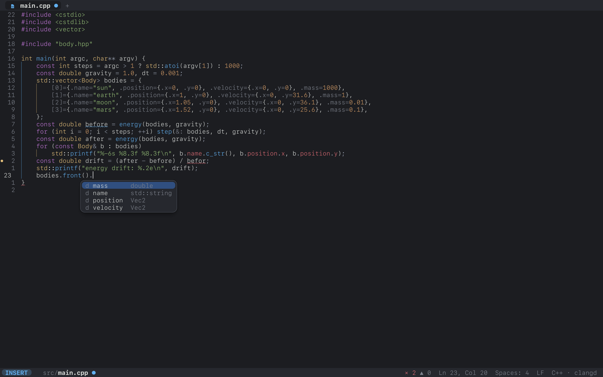

## Vim, as Neovim has it

Normal, Insert, Replace, Visual, Visual Line and Visual Block, the command
line, registers, macros, marks, text objects and dot-repeat, with Neovim's
keys. Search and `:s` take Vim's own regular expressions, back-references
and look-around included. Or switch the modes off and edit as anywhere else.

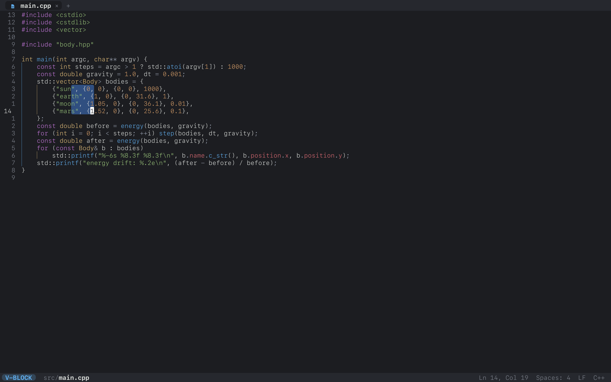

## Find anything

Go to file narrows the project's files as letters are typed; Search in files
reads a gigabyte for a word it does not have in about 5 ms; replace across
files is one undo step a file.

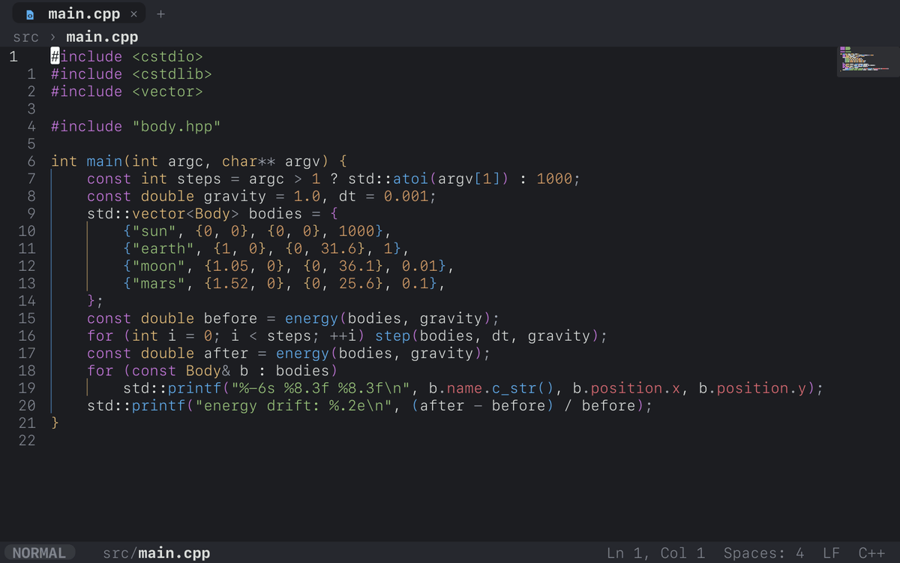 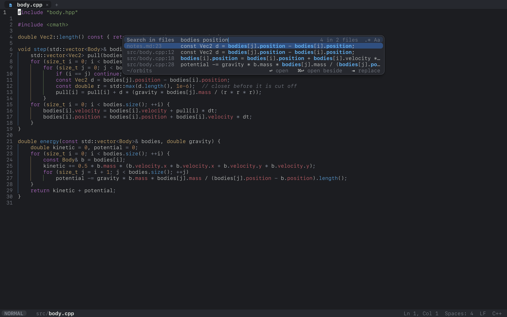

## Splits, tabs and terminals

Sixteen splits, each with its own tabs, dragged where they should go; the
side panel's tree, problems, Git, profile and debugger; terminals that speak
xterm, with the mouse, re-wrapping on resize, and sixel and kitty pictures.

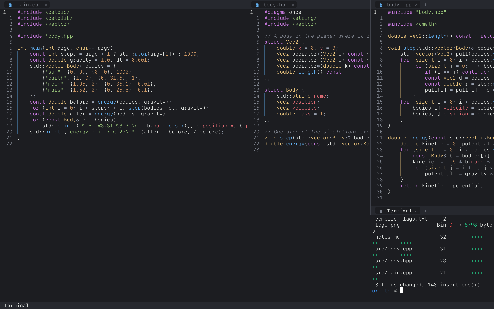

## Git

The changed lines beside the text, blame, a Git tab for everything else:
stage a hunk or the lines chosen, diffs in one column or two, branches,
merges with their conflicts, stash, rebase, cherry-pick, tags.

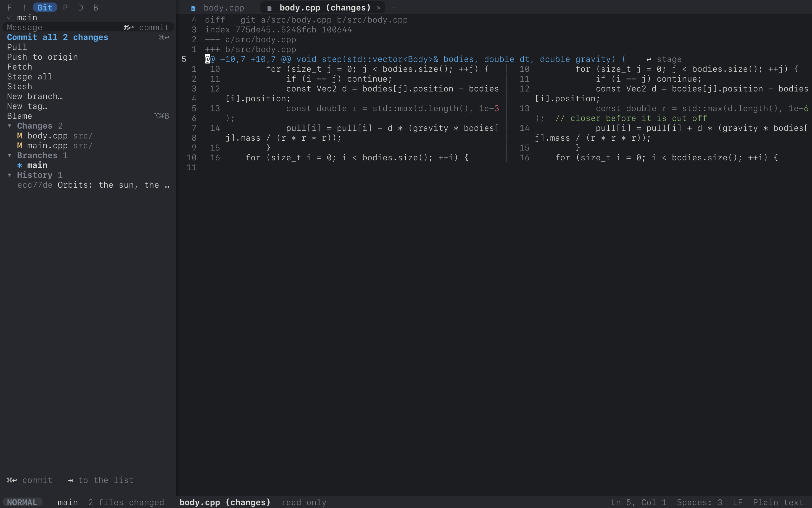

## A debugger and a profiler

F5 runs the program under lldb-dap, gdb or debugpy: breakpoints with
conditions and hit counts that move with their lines, a watch list, every
thread's stack. A recording with xctrace or perf becomes a flame graph, by
thread if you like, and each line's cost beside the code.

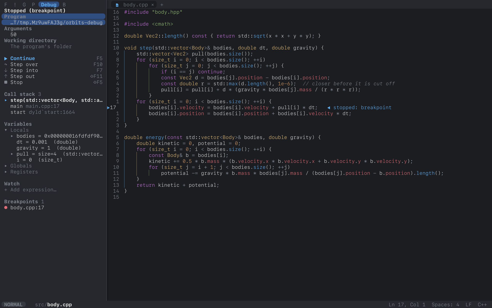 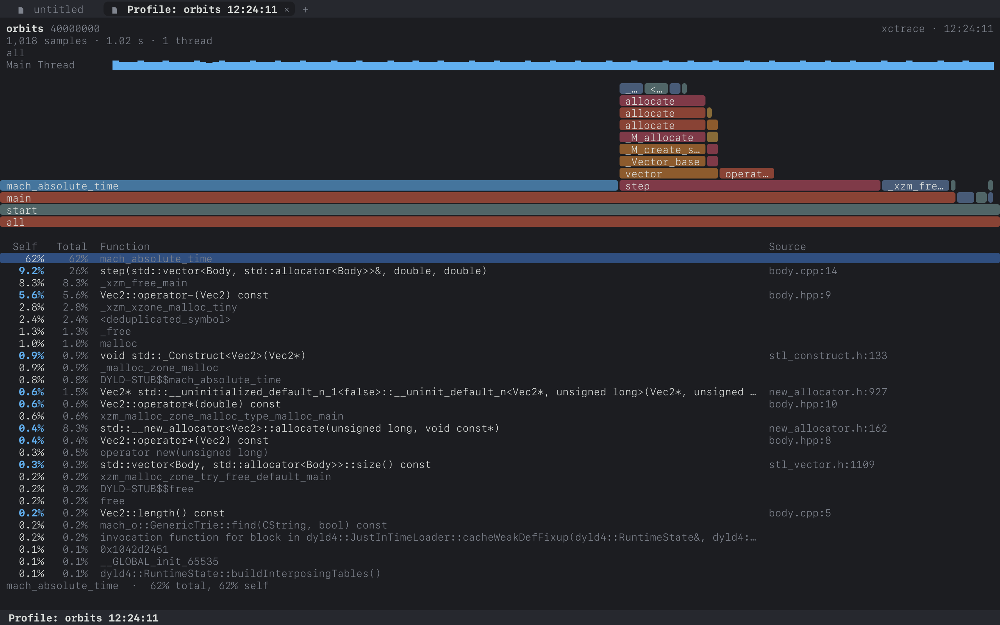

## Markdown, pictures and PDFs

A preview drawn as the file is typed, with Mermaid diagrams, tables and
coloured code; pictures in tabs of their own, animations and SVG too; PDFs
with their text to choose, copy and search, their links and outline.

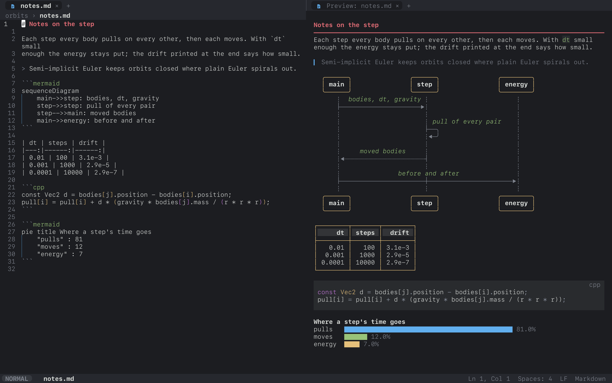 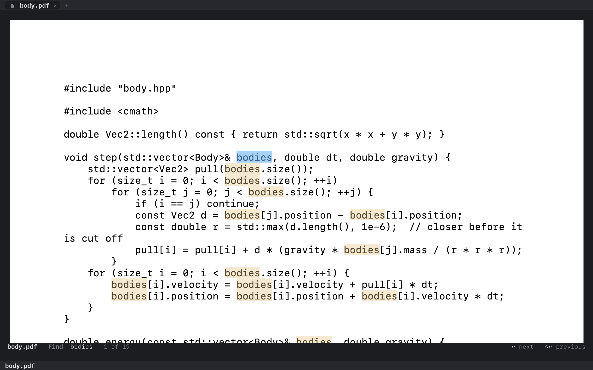

## Another machine's files

`blit ssh://host/path` works on a file or a folder somewhere else as if it
were here: its tree, saves, Search in files, terminals, builds, the
debugger and the profiler all run there, through a small agent blit
carries and starts over ssh.

## Make it yours

Settings, keys, commands and plugins in `~/.config/blit/init.lua` (Lua 5.5;
blit itself ships no Lua), themes previewed as the list is walked, a
command search with every command and its keys, Search everywhere (files,
symbols, commands and settings in one box), and new projects (CMake,
Meson, uv, with tests and libraries) from a form.

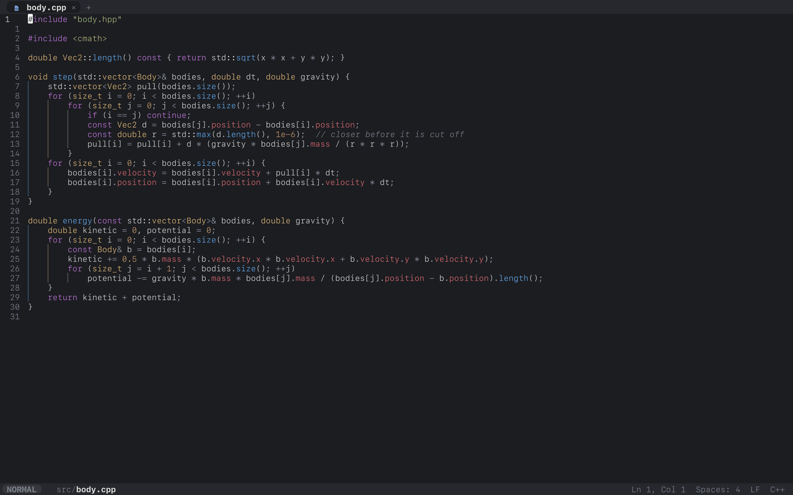 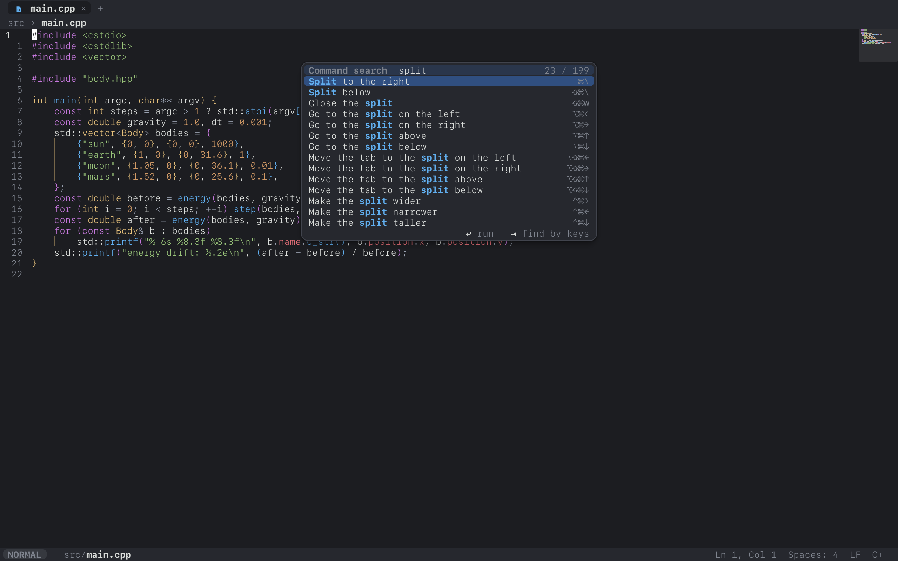
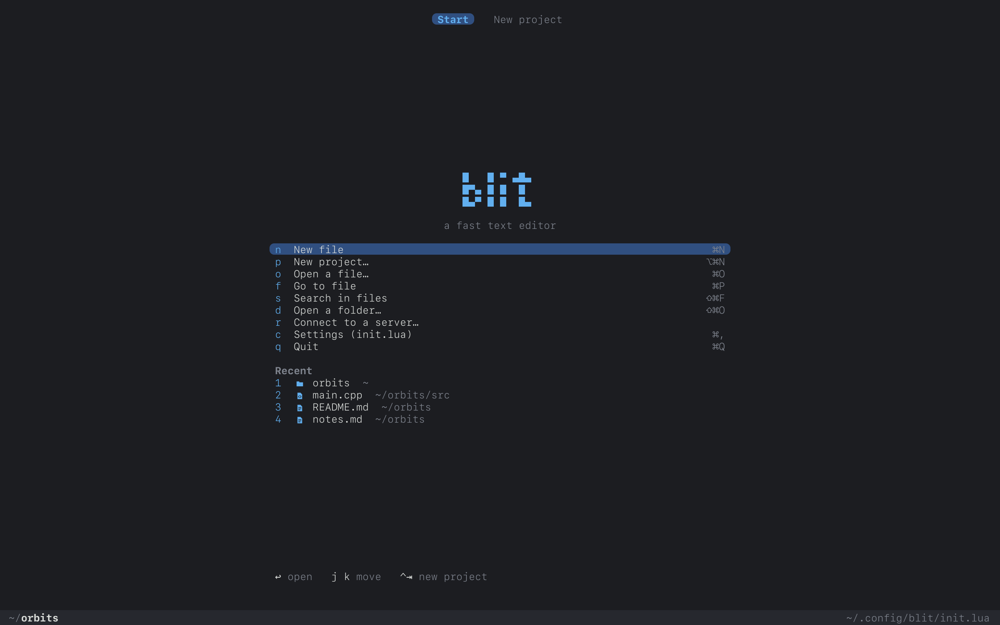 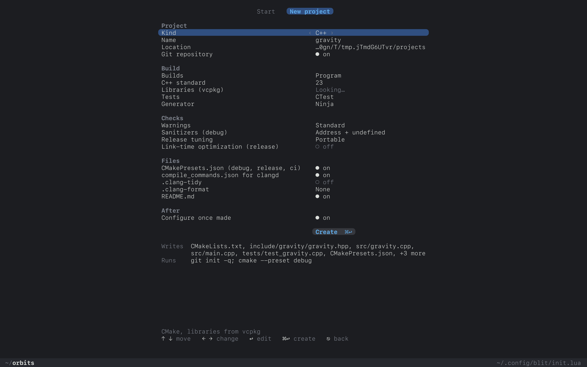

## Fast

Measured on an M5 Pro MacBook (and, where it says so, a Ryzen 9 9950X3D with
a Radeon RX 7900 XT on Linux); [BENCH.md](BENCH.md) has how, and every
round since the first.

| | |
|---|---:|
| Frames a second scrolling at 2560×1600, drawing every frame | 17,800 to 20,700 (Linux: 25,500 to 26,900) |
| CPU per frame | 43 µs |
| A key, from the event to the frame on its way to the screen | 247 µs |
| The visible text made into cells, a whole 4K frame | 1.2 µs |
| Typing at the far end of a 64 MB line | under 0.3 ms a key |
| Opening a 1 GB file | 17.7 ms |
| Search in files, a word not there, 1 GB | about 5 ms |
| Launch to the first frame | 114 ms (Linux: 25 ms) |
| Idle | no frames, 0.04% of a core |

## Get it

- **[Releases](https://github.com/ESiegman/blit/releases)**: blit.app for
  Apple silicon Macs, and an AppImage and a tarball for x86-64 Linux.
- **Homebrew**: `brew tap ESiegman/blit https://github.com/ESiegman/blit`
  and `brew install --HEAD ESiegman/blit/blit`.
- **From source**, with GCC 16, CMake and Ninja:

  ```bash
  cmake -S . -B build -G Ninja -DCMAKE_CXX_COMPILER=g++-16   # g++ on Linux
  cmake --build build
  ./build/blit path/to/file
  ```

  On macOS `brew install sdl3 freetype tree-sitter lua harfbuzz gcc`; on Linux
  the same libraries from the system, Vulkan and fontconfig.
  [The manual](docs/manual.md#getting-it) has the details.

## More

- [docs/manual.md](docs/manual.md): every feature and every key, section by
  section.
- [BENCH.md](BENCH.md): every speed decision, with its numbers.
- [docs/media/make.sh](docs/media/make.sh) makes every picture above from a
  Debug build, on the demo project beside it.

## License

blit is free software under the [GNU General Public License, version 3 or
later](LICENSE), with one added term ([NOTICE](NOTICE)): forks and modified
versions keep the line "Based on blit by Eren Siegman" and say what they
changed. The libraries the releases carry keep their own licenses, listed in
[THIRD_PARTY_NOTICES.md](THIRD_PARTY_NOTICES.md).
