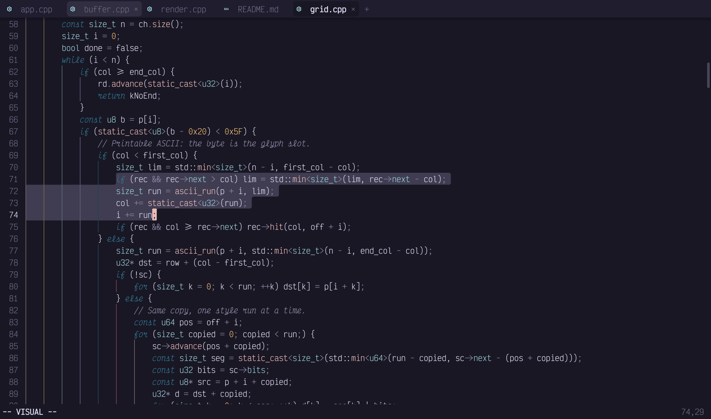
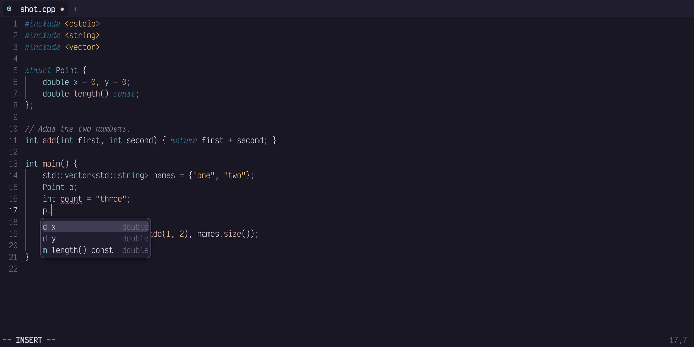
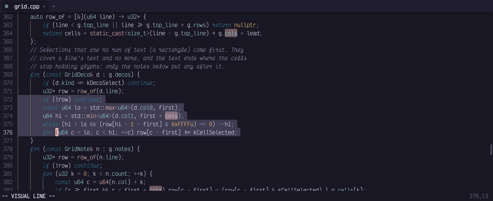
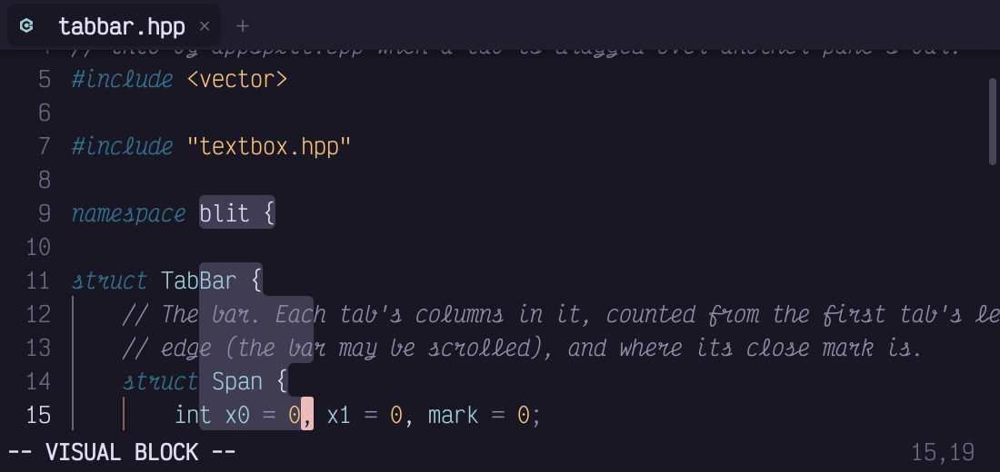
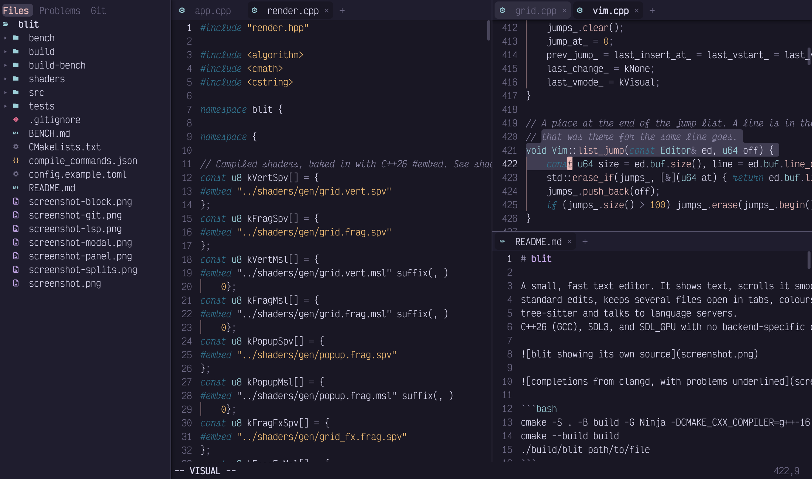
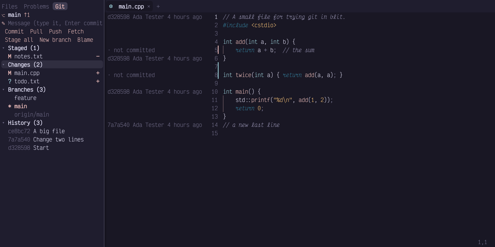
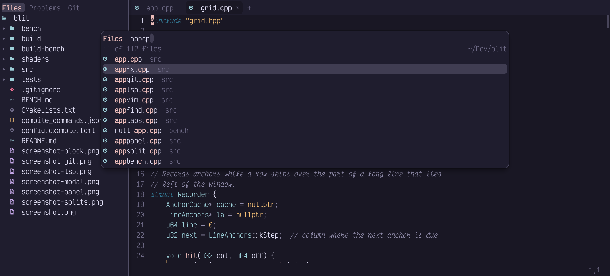
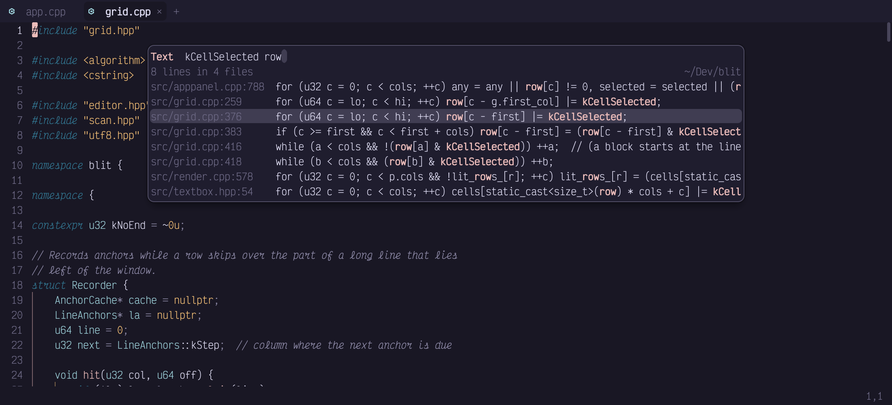
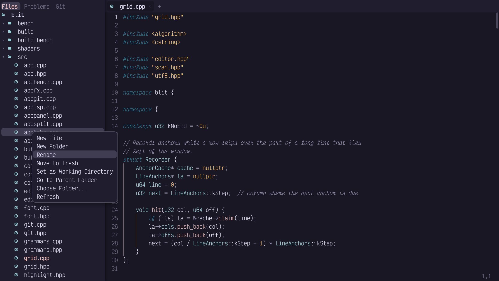
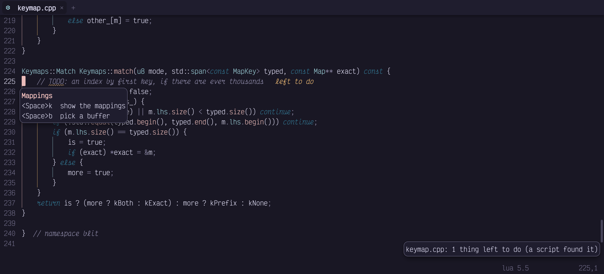

# blit

A small, fast text editor. It shows text, scrolls it smoothly, does the
standard edits, keeps several files open in tabs, colours code with
tree-sitter, talks to language servers, runs scripts and plugins in Lua,
profiles programs, and works on another machine's files over ssh.
C++26 (GCC); SDL3 for the window and input, and a renderer of its own on
Metal (the Vulkan side, for other systems, is not written yet).





```bash
cmake -S . -B build -G Ninja -DCMAKE_CXX_COMPILER=g++-16
cmake --build build
./build/blit path/to/file
```

Needs SDL3, FreeType, tree-sitter and Lua 5.5, and HarfBuzz for ligatures.
On macOS: `brew install sdl3 freetype tree-sitter lua harfbuzz gcc`, and
Apple's Command Line Tools (`xcode-select --install`), whose clang builds
the Metal side. Without HarfBuzz everything else still works.

Syntax colours need grammars, which blit installs itself when asked:
`./build/blit --install-grammar all` (see [Syntax highlighting](#syntax-highlighting)).

That build is the editor and nothing else. The tests, the benchmark tools and
the editor's own benchmark and screenshot modes are compiled only in a Debug
build; see [Testing](#testing).

## Using it

Started with no file, blit shows its start screen: its name, what can be
done first, and the files and folders opened lately (Recent, with their
icons). Each has a key, in one column at the left, and its shortcut at the
right: `n` a new file (or Cmd+N), `p` a new project (the New project tab:
see [New projects](#new-projects)), `o` a file opened by its path, `f` Go
to file, `s` Search in files, `d` a folder to work in, `r` a server to
connect to, `c` the settings (init.lua), `q` quit, and `1` to `9` what was
opened lately (a folder becomes the project folder and the side panel shows
it). The arrows (or `j` and `k`) and Enter, or the mouse, do the same; Esc
leaves an empty file to type into. The status bar shows the project folder
and the settings file (a click opens it). It goes once something is
opened. The files and folders opened lately (up to 30) are kept in
`recent` in blit's data folder (`~/.local/share/blit`, or under
`$XDG_DATA_HOME`). `blit.opt.editor.start_screen = false` starts with an
empty file instead. Ctrl+Tab goes between its two tabs, Start and New
project.

Everything blit does can be done from the keyboard. **Cmd+Shift+P**
(Ctrl+Shift+P elsewhere) searches every command by its name or its keys,
shows the keys of each, and runs the one chosen; typing `cmd+b` finds what
Cmd+B does, and Tab, then any keys, looks those keys up. The scripts'
commands are there too.

blit is a modal editor: it starts in Normal mode, where keys are commands,
and `i` is what makes typing type. The modes and keys are Neovim's defaults;
[Modal editing](#modal-editing) says what is there. `blit.opt.editor.modal = false`
in init.lua makes it an editor without modes, where the table below is
all there is to know. With modes on, the table is still true of Insert mode,
and everything in it that has Cmd in it (Ctrl elsewhere) works in every mode.

| | macOS | elsewhere |
|---|---|---|
| Move | arrows, Home/End, Page Up/Down | same |
| By word | Option+Left/Right | Ctrl+Left/Right |
| Line start/end | Cmd+Left/Right | Home/End |
| Document start/end | Cmd+Up/Down | Ctrl+Home/End |
| Select | Shift with any movement, drag, double-click (word), triple-click (line) | same |
| Delete word | Option+Backspace/Delete | Ctrl+Backspace/Delete |
| Delete to line start | Cmd+Backspace | |
| Copy / cut / paste | Cmd+C / X / V | Ctrl+C / X / V |
| Undo / redo | Cmd+Z / Shift+Cmd+Z | Ctrl+Z / Ctrl+Y |
| Select all | Cmd+A | Ctrl+A |
| Save / open (in a new tab) | Cmd+S / Cmd+O | Ctrl+S / Ctrl+O |
| Save as… / save all | Cmd+Shift+S / Cmd+Option+S | Ctrl+Shift+S / Ctrl+Alt+S |
| Open a folder | Cmd+Shift+O | Ctrl+Shift+O |
| Command search: every command, by its name or its keys | Cmd+Shift+P | Ctrl+Shift+P |
| Go to file / Search in files | Cmd+P / Cmd+Shift+F | Ctrl+P / Ctrl+Shift+F |
| Find in this file; the next / previous match | Cmd+F; Cmd+G / Cmd+Shift+G | Ctrl+F; F3 / Shift+F3 |
| The next / previous hit of Search in files | F4 / Shift+F4 | F4 / Shift+F4 |
| New file / close tab | Cmd+N (or Cmd+T) / Cmd+W | Ctrl+N (or Ctrl+T) / Ctrl+W |
| Next / previous tab | Ctrl+Tab / Ctrl+Shift+Tab, or Cmd+Shift+] / [ | Ctrl+Tab / Ctrl+Shift+Tab, or Ctrl+PageDown / PageUp |
| Tab 1 to 8, last tab | Cmd+1 ... Cmd+8, Cmd+9 | Ctrl+1 ... Ctrl+8, Ctrl+9 |
| Move the tab left / right | Ctrl+Shift+PageUp / PageDown | |
| Split right / split down | Cmd+\ / Cmd+Shift+\ | Ctrl+\ / Ctrl+Shift+\ |
| Keyboard to the split on that side | Cmd+Option+arrow | Ctrl+Alt+arrow |
| The tab to the split on that side (a new one if there is none) | Cmd+Option+Shift+arrow | Ctrl+Alt+Shift+arrow |
| The split wider / narrower, taller / shorter | Cmd+Ctrl+Right / Left, Down / Up | |
| A terminal, in the working folder | Ctrl+` | Ctrl+` |
| The Problems / Git / Profile tab of the side panel (again: the keyboard back to the text) | Cmd+Shift+M / Ctrl+Shift+G / Cmd+Shift+R | Ctrl+Shift+M / G / R |
| The Build tab; run its chosen task (the Run button); stop it | Cmd+Shift+U; Cmd+Shift+B; Cmd+. | Ctrl+Shift+U; Ctrl+Shift+B |
| A new project (the start screen's New project tab, in a tab of its own) | Cmd+Option+N | Ctrl+Alt+N |
| Markdown preview, beside the file | Cmd+Shift+V | Ctrl+Shift+V |
| Blame column on or off | Cmd+Option+B | Ctrl+Alt+B |
| Font size | Cmd+= / Cmd+- / Cmd+0 | Ctrl+= / Ctrl+- / Ctrl+0 |
| Open init.lua (the settings) | Cmd+, | Ctrl+, |
| Quit | Cmd+Q | Ctrl+Q |

The [side panel](#side-panel):

| | macOS | elsewhere |
|---|---|---|
| Show or hide it | Cmd+B | Ctrl+B |
| Keyboard to the file tree, and back | Cmd+Shift+E (Esc goes back) | Ctrl+Shift+E |
| In the tree | Up/Down, Page Up/Down, Home/End; Right opens a folder, Left closes it; Enter opens | same |
| New file / new folder | Cmd+N / Cmd+Shift+N | Ctrl+N / Ctrl+Shift+N |
| Rename | F2 | F2 |
| Move to Trash | Delete or Cmd+Backspace | Delete |
| Read the folders again | Cmd+R | Ctrl+R |
| The menu a right click opens (then Up/Down, Enter) | Shift+F10 or the Menu key | same |
| The folder above the working folder | Cmd+Up | Ctrl+Up |
| Next tab of the panel (while it has the keyboard) | Ctrl+Tab | Ctrl+Tab |

With a [language server](#language-servers) running:

| | macOS | elsewhere |
|---|---|---|
| Complete here | Ctrl+Space or Option+Esc | Ctrl+Space or Alt+Esc |
| In the list | Up/Down, Page Up/Down; Enter or Tab accepts; a click picks | same |
| Describe what is under the cursor | Cmd+I | Ctrl+I |
| Signature of the call being typed | Ctrl+Shift+Space | same |
| Go to definition | F12 or Cmd+click | F12 or Ctrl+click |
| Back to where the jump came from | Ctrl+- | Alt+Left |
| Close popups | Esc | Esc |

In a profile's tab: Up/Down choose a function, Enter opens its source,
Space zooms the flame graph into it (again: back out), Esc zooms out. In a
terminal: Cmd+A selects all of it, history included, for Cmd+C.

Scroll with the wheel or touchpad, or drag the bar at the right edge. Drop a
file on the window to open it in a tab. `blit --help` lists the options
(`--config`, `--font`, `--size`, `--line`, `--info`).

## Modal editing



Normal, Insert, Replace, Visual, Visual Line and Visual Block modes and a
command line, with the keys Neovim has out of the box. The status bar
starts with the mode (NORMAL, INSERT, VISUAL…; without the status bar the
bottom line says `-- INSERT --`), and the bottom line of the window shows
the command line while one is typed (`:`, `/`, `?`), messages, the keys of a command under way, and the
cursor's line and column. The cursor is a block on a character in Normal and
Visual mode, a bar in Insert mode, and a line under the character in Replace
mode or while an operator waits for its motion.

**Where Neovim's defaults are not Vim's**, blit follows Neovim. `G`, `gg`,
`H M L` and `:{number}` keep the cursor's column, and so do `dd`, `>>` and
`<<` (Neovim's `'startofline'` is off; Vim goes to the first character of
the line). Space and Backspace go on to the next line and back to the one
before. `Y` is `y$`, `&` does the last `:s` again with its flags, `Q` plays
the macro recorded last, Ctrl-L puts out the search highlight, `*` and `#`
in Visual mode look for what is selected, `@` and `Q` in Visual Line mode
run a macro on each line. Ctrl-A and Ctrl-X count in hexadecimal after `0x`
and in binary after `0b`, and keep zeros in front (`007` to `008`).

**Counts and registers** come first, as in Vim: `3dw`, `d3w`, `"ayy`, `"Ayy`
(append), `"_dd` (to nowhere), `"+y` and `"+p` (the system clipboard; `"*`
is the same). Yanks also go to `"0`; deleted lines go to `"1` and push what
was there along to `"2` ... `"9`; a delete of less than a line goes to `"-`.
`".` is what was last typed, `"/` the last search, `":` the last command.

**Motions**: `h j k l` and the arrows, `w W b B e E ge gE`, `0 ^ $ g_ |`,
`gg G` and `{count}G`, `f F t T` with `;` and `,`, `%`, `{ }`, `( )`
(sentences), `H M L`, `+ -` and Enter, `n N * #` and `g* g#`, `[( [{ ]) ]}`
(out to the bracket around the cursor), `[[ ]] [] ][` (to a `{` or `}` in
the first column), and the marks: `` `a `` and `'a` (set with `ma`), and the
ones Vim keeps, ``` `` ``` and `''` (where the last jump started), `` `. ``
(the last change; `g;` goes there too), `` `^ `` (where Insert mode was
last left), `` `< `` and `` `> `` (the last selection). Marks move with their
text when text before them changes.

**The jump list**: `G`, `gg`, a search, `%`, `( ) { }`, `[[ ]]`, `H M L`, a
mark and `gd` remember where they started. Ctrl-O goes back through those
places and Ctrl-I (or Tab) forward again, a line being in the list once, as
in Vim. Each file has its own list, kept while another file is in front.
When there is nowhere to go back to in the file, Ctrl-O asks the language
server's "go to definition" history, which can lead back to another file.

**Operators**: `d c y`, `> <`, `g~ gu gU g?`, each with a motion or a text
object, doubled for whole lines (`dd`, `3>>`, `guu`, `g??`), or on a Visual
selection. A search is a motion too (`d/word` Enter), and `gn` is the next
match of the last search (`cgn`, then `.` for each one after). Text
objects: `iw aw iW aW`, `is as` (sentences), `ip ap`, `i( a(` (also `)` and
`b`), `i[ a[`, `i{ a{` (also `B`), `i< a<`, `it at` (tags), `i" a" i' a'`
and the backtick ones. A count takes more of them (`d2aw`) or goes further
out (`d2i(`).

**Comments**: `gc` with a motion or on a selection, and `gcc` for the line
(`3gcc` for three), turn lines into comments or back, the way Neovim's own
`gc` does: if every line that is not blank is a comment already the markers
come off, otherwise they go on, lined up at the smallest indentation among
the lines. After an operator `gc` is the comment the cursor is in (`gcgc`
takes the markers off all of it, `dgc` deletes it). The markers are the
language's (`// `, `# `, `-- `, `<!-- -->`, ...); a file of no known
language has none and says so.

**Other Normal-mode commands**: `i a I A o O` and `gi` (insert where Insert
mode was last left), `x X s S D C Y` (`Y` is `y$`, as in Neovim), `r` and
`R`, `J` and `gJ`, `~`, `p P gp gP`, `u` and Ctrl-R, `.`, Ctrl-A and Ctrl-X
on numbers, `q` and `@` for macros (`@@` again, `Q` the one recorded last),
`v V` Ctrl-V and `gv`, `&` and `g&` (the last `:s` again), `gt gT` and
`[b ]b` (the tab before and after; `[B ]B` the first and last), `gf` (the
file named under the cursor), `[<Space>` and `]<Space>` (an empty line
above or below), `ZZ ZQ`, Ctrl-D Ctrl-U Ctrl-F Ctrl-B Ctrl-E Ctrl-Y,
`zz zt zb`, Ctrl-L (as `:noh`), Ctrl-W with `h j k l w` (to another split),
`v s` (split) and `c q` (close), and with a language server `gd` (or
Ctrl-], and Ctrl-T back), `K`, and `]d [d` to the next and the previous
diagnostic (`]D [D` the last and first), going round at the ends of the
file.

**Insert mode**: Esc (or Ctrl-[ or Ctrl-C) leaves it; Ctrl-W, Ctrl-U and
Ctrl-H delete a word, to the start of the line, a character; Ctrl-T and
Ctrl-D indent the line a level more or less; Ctrl-R and a register's name
puts its text in, Ctrl-A what was typed last time; Ctrl-V (or Ctrl-Q) takes
the next key as it is (a real tab); Ctrl-Y and Ctrl-E copy the character
above or below; Ctrl-O does one Normal-mode command; Ctrl-S asks the
language server for the signature of the call being typed. Ctrl-U and
Ctrl-W start an undo step of their own, as Neovim's do, so `u` brings back
what they took. A new line starts as
far in as the one before (autoindent). Everything typed in one stay in
Insert mode is one step for `u`. A count repeats the text (`3ix` Esc, `3o`).
In Replace mode Backspace puts back what was typed over.

**Visual mode**: `v`, `V` and Ctrl-V (each changes to the other kind, or
ends it), any motion, search or text object to extend (`viwiw`, `vi(i(`
take the next one, or the one around), `o` for the other end, then an
operator, or `x s r J gJ p ~ u U`, `X D Y` (whole lines), `S R C` (change
whole lines), `I` and `A` (insert before the first line, after the last),
`*` and `#` (search for what is selected), `gc` (comments), or `:` for a
command on those lines. After `$` the selection takes the end of the line
with it, as in Vim (`v$d` joins the next line on). `P` puts over the
selection without losing what the register holds; `p` leaves what was
replaced in it. A selection dragged out with the mouse is a Visual selection. Cmd+C,
Cmd+X and Cmd+V copy, cut and paste it by way of the system clipboard.



**Visual Block mode** (Ctrl-V) selects a rectangle; `$` takes it to the end
of every line, `o` and `O` move the cursor to another corner. `d x y c s r`
`~ u U g?` work on the rectangle, `D` and `C` from its left edge to the end
of each line, `>` and `<` shift what is right of its left edge. `I` and `A`
type on the first line and Esc puts the same text on the others (`A`
fills out lines that stop short). What a block operation yanks or deletes
goes back in as a rectangle: `p` and `P` put its rows on the lines from the
cursor down, at the cursor's column.

**Search**: `/` and `?` find as you type (the cursor goes to the first
match; Esc puts it back), Enter keeps it, `n` and `N` go on, `*` and `#`
look for the word under the cursor. Matches stay lit until `:noh` or Ctrl-L.
What is typed is looked for as it stands, not as a regular expression; `\c`
anywhere in it ignores case, `\<word\>` finds whole words and `\n` is the
end of a line. A search goes through a large file on several threads; one
for something that is not there takes about 5 ms in 1 GB.

**The command line**: `:w`, `:q` (closes the tab), `:q!`, `:wq`, `:x`, `:wa`,
`:qa`, `:wqa`, `:e FILE`, `:bn :bp :bd`, `:tabnew`, `:sp`, `:vs`, `:noh`,
`:{number}`, `:d`, `:y`, `:>`, `:<`, `:u`, `:red`, and `:s/this/that/` with
the flags `g` and `i`, `&` for what was found, `\r` for a new line and `\n`
in what is looked for to take a line's end (`:%s/\n/,/` joins every line;
`:s` or `:&` alone does the last one again, `:&&` with its flags). A `:s`
changes only the lines it matched, all in one undo step. Lines are
given as numbers, `.`, `$`, `%` or `'<,'>` (which `:` in Visual mode fills
in). Up and Down recall earlier lines.

What Neovim has and this does not, yet: regular expressions in searches and
`:s`; `=`, `!`, `gq` and `gw`; folds; `:g`, `:normal`; the change list beyond its last entry
(`g;` goes to the last change only); `U`; digraphs and Ctrl-X completion in
Insert mode (completion is the language server's); Select mode and
`virtualedit`; a motion forced to another kind (`dv}`); Ctrl-A and Ctrl-X
on a selection; some seldom used `g` and `z` commands (`gI`, `ga`, `g,`,
`gx`, `zh`, `zl`); Ctrl-W beyond the keys named above. Of the keys newer
versions of Neovim set up by default, those that need something blit does
not have are missing: `grn gra grr gri grt gO` (renaming, code actions,
references and the rest are not in blit's language-server client yet), `[q ]q [l ]l [t ]t [a ]a` (there are no quickfix, location, tag or
argument lists), Ctrl-W `d`, and the tree-sitter selections `an in`. `gd`
asks the language server; Neovim's looks for a declaration in the file.
On the command line the cursor stays at the end (no moving back into what
was typed, no Tab completion). A block that cuts through a tab or a wide character takes
the whole character. Marks with capital letters belong to their file like
the others. `>` and `<` shift by the file's own indentation (the same step
the indent lines use), a tab where the file uses tabs. Where Ctrl is the
key for the application's own shortcuts (everywhere but on a Mac), Ctrl-V
stays paste.

## Tabs, line numbers, indent lines, the status bar

Every open file has a tab in the bar along the top. Click a tab to bring it
to the front, drag it along the bar to move it, and close it with the cross
at its right (a dot there instead means unsaved changes, which are asked
about first) or a middle click. The `+` at the end, or a double click on the
empty part of the bar, starts a new file. When the tabs do not all fit, the
bar slides: turn the wheel over it. Two files with the same name show their
folders too. Opening a file that is already open goes to its tab. Each tab
keeps its own undo history, selection and place in the file. Closing the
last tab leaves a new empty file; Cmd+W never closes blit itself (Cmd+Q
does, and Vim's `:q` in the last window).

Line numbers run down the left of the text, with the cursor's line picked
out; a click on a number selects its line. As Vim has them with `number`
and `relativenumber`, the cursor's line shows its own number and every
other line how far it is from the cursor, the count to put before `j` or
`k` to get there (with Vim's modes on; without them every line has its own
number); `blit.opt.editor.relative_numbers = false` (or `:set nornu`) gives
every line its own.

A status bar runs along the bottom of the window, under the splits and the
side panel. On its left, the repository and the file: the branch (and how
many commits it is ahead of and behind the branch it follows), this file's
lines added, changed and taken out since the last commit (`+3 ~4 −1`, as
the marks beside the line numbers count them, saved or not), how many files
differ from the last commit (saved ones: what git sees), then the file's
path in the repository, with a dot while it has unsaved changes. On its
right: what a script put there (`blit.ui.status`), the language server's
errors and warnings, the cursor's line and column (and what is selected:
characters, or lines), the indentation, the line endings, and the language
with its server. A click on the repository part opens the side panel's Git
tab, one on the problems its Problems tab. When the window is narrow a
long path is shortened from its start first, then the least needed parts
go. With Vim's modes on, the command line is just above it.

Each level of indentation has a thin coloured line down it, a different
colour per level, carried through the blank lines inside a block. How many
columns make a level is worked out from each file (two spaces, four, a
tab...); `indent_width` sets it by hand. The colours are the theme's
`guides`.

```lua
blit.opt.editor.tab_bar = true         -- each of these can be switched off
blit.opt.editor.status_bar = true
blit.opt.editor.line_numbers = true
blit.opt.editor.relative_numbers = true  -- false: every line its own number
blit.opt.editor.indent_guides = true
blit.opt.editor.indent_width = 0       -- 0: from the file
blit.opt.themes["rose-pine"].guides = { "#786168", "#7c6449", "#546a75" }   -- one to six colours, first level first
```

## Splits



The window can be divided into splits, side by side or one above the other,
and each of those divided again (up to eight in all). Every split has its
own tabs, line numbers and scroll position; the side panel is shared.
Cmd+\ makes a split to the right of the one with the keyboard and
Cmd+Shift+\ one below it, each starting with a new file. A click gives a
split the keyboard (its front tab is the one in bold), and Cmd+Option with
an arrow moves the keyboard to the split on that side. The wheel scrolls
whichever split the mouse is over. Drag the line between two splits to
resize them. A split goes when its last tab is closed.

Things are moved by dragging them. While something is being dragged, the
place it would land is washed with colour: one half of a split means "a new
split here", the whole of it means "in with this split's tabs". Esc puts it
back.

- **A tab** dragged out of its bar goes to another split's tabs (drop it on
  the bar to choose its place among them, or anywhere in the middle), or
  becomes a new split at whichever edge of a split it is dropped on.
- **A whole group of tabs** is dragged by the empty part of its tab bar, or
  by any tab with Option (Alt) held. Dropped on an edge of another split,
  the group moves there as a split; dropped in the middle, its tabs join
  that split's.
- **A file from the tree** in the side panel can be dragged onto a split to
  open it there, or onto an edge to open it in a new split.

A file shows in one split at a time: opening or dropping one that is
already open moves to its tab, or moves its tab.

## Git



blit shows what git knows about the files it has open, and does the
everyday things from the side panel. It runs the `git` program for all of
it, so whatever your git does in a terminal (credential helpers, ssh keys,
hooks, your settings) it does here. Nothing git does ever holds up the
editor: a push that takes ten seconds takes them on a thread of its own.

**In the text.** Lines changed since the last commit have a mark beside
their number: one colour for added lines, one for changed ones, and a dash
where lines were taken out. The marks follow the text as you type; nothing
has to be saved first. Blame is shown only when asked for: Cmd+Option+B
(or Blame in the Git tab) turns it on for the file in front, and again
off. It is a column beside the line numbers (commit, author and age, once
for each run of lines from one commit) and, quietly at the end of the
cursor's line, who last changed it and when, with the commit's summary.

**The Git tab** (Ctrl+Shift+G, or click "Git" at the top of the side panel)
is for the repository the working directory is in: the folder the Files tab
shows. Choose another folder there and git follows. (Before the panel has
ever been opened, that is the project of the file in front.) A file open
from outside that repository gets no marks and no blame. From the top:

- The branch, with how many commits it is ahead (↑) of and behind (↓) the
  branch it follows.
- The commit message, a field that has the keyboard when the tab opens;
  Tab goes between it and the list below, and Cmd+Enter commits.
- **Commit**, which says what it will commit: "Commit 3 staged" with files
  staged, "Commit all 54 changes" with none (every change to files git
  already knows). Then **Pull, Push, Fetch, Stage all, New branch…** and
  **Blame**, each a row that Up and Down reach. While one runs its name
  shows there, with Cancel. A branch that follows nothing yet is pushed to
  `origin` under its own name and follows that from then on. How it went
  (or git's complaint, if it did not) appears on the line below. A folder
  that is not a repository gets a row that makes it one.
- **Conflicts**, **Staged** and **Changes**: the files, each with git's
  letter for what happened to it, in git's colours (changed, added,
  removed). Click `+` at the end of the row picked or under the mouse to
  stage the file and `−` to unstage it. Pick a file to get **Stage / Unstage**,
  **Discard** (throws away what is not staged, after asking), **Diff** and
  **Open**; a double click opens its diff.
- **Branches**: the one checked out is starred. Pick another for **Switch**,
  **Merge** (into the one checked out) and **Delete**; a double click
  switches. Switching to a branch on the server makes a local one that
  follows it.
- **History**: the last forty commits. A double click shows one, with its
  diff.

From the keyboard: Up and Down (or `j` and `k`) pick, Enter does the usual
thing with what is picked (a file's diff, switch to a branch, show a
commit), `o` opens the file and `m` merges the branch, Right stages and
Left unstages, Delete discards a file's changes or deletes a branch,
Cmd+Enter commits, Cmd+R looks again, Esc goes back to the text. The line
at the bottom says the keys for what is picked. The command search has
them too: "Git: Commit", "Git: Pull", "Git: Push", "Git: Fetch", "Git:
Stage all", "Git: New branch…", "Git: Switch branch…".

**Diffs** open in a tab of their own, coloured, to read and copy from. A
merge or pull that conflicts leaves the files under Conflicts and "merging"
beside the branch: open each, settle it, stage it and commit; or **Abort
merge**.

**Files that change on disk** under an open tab (git switched branches,
pulled, merged or discarded; or another program wrote them) are read again
when that happens and when the window gets focus, keeping the cursor's
place. A tab with unsaved changes of its own is left alone.

```lua
blit.opt.git.enabled = false   -- no git at all
```

## Finding files and text



**Cmd+P**, Go to file, finds a file by name. With nothing typed it lists
the files open (Open, the one in front last) and those opened lately
(Recent). Type some of its letters, in order but not necessarily together (`appcp` finds `app.cpp`, `rcpp` finds `render.cpp`):
the list narrows as you type and the best match is first. Letters that
follow one another, and letters at the start of a word (after a slash, a
dot, an underscore, a capital after a small letter) count for more than
letters scattered about; a match in the file's own name counts for more
than one that needs its folders. Several words may be typed, separated by
spaces, and every one has to match (`src grid`). Small letters match
either case; a capital matches only itself. Among matches as good as each
other, files open or opened lately come first. `name:120` (or `name:120:5`)
opens the file at that line (and column); `:120` alone goes to line 120 of
the file in front. Enter opens the file chosen, Cmd+Enter opens it in the
split to the right (making one if there is none).



**Cmd+Shift+F**, Search in files, finds text in files: the lines that have
every word typed on them, in any order, with the file and line number of
each. It opens with what was searched for last (or what is selected),
selected, so that typing replaces it; F4 and Shift+F4 then go to the next
and the previous hit without the box, and the bottom line says which ("Hit
4 of 37"). The words
are looked for as they stand, not as patterns; small letters match either
case, and one letter alone is not searched for. Enter opens the file at
that line with the cursor on the first of the words, and Ctrl-O (or
Option+Left) comes back. The search runs on several threads and shows what
it has found so far while it goes on; it stops at 3,000 lines.

Both look under the working directory (the folder the [side
panel](#side-panel) shows). Files a `.gitignore` leaves out are left out,
and so, whatever `.gitignore` says, are `.git`, `node_modules`, `target`,
`build`, `build-*` and compiled files; `blit.opt.search.ignore` adds more, in
`.gitignore`'s syntax. A search for text also passes over files that are
not text and files over 8 MB. The folder is read again in the background
when the box opens, if the last reading is more than 2 seconds old, the
window has come back to the front since, or the file tree has seen a
change; the list as it was is searched meanwhile, and again when the new
one is in (switching between names and text reads nothing).

In the box: Up and Down (or Ctrl-P and Ctrl-N, Ctrl-K and Ctrl-J) choose,
Page Up and Page Down go by a page, Enter opens, Esc (or a click beside the
box, or the key that opened it) shuts it. Tab turns a search for names
into one for text and back, keeping what is typed. Option+Backspace (or
Ctrl-W) takes a word back, Cmd+Backspace (or Ctrl-U) all of it, Cmd+V puts
in what the clipboard holds. A row can be clicked, and the wheel turns the
list. In Vim's command line, `:find NAME` and `:grep WORDS` open the box
with that typed.

**No system file dialogs.** Opening a file (Cmd+O), naming a new file when
it is first saved, and choosing a folder to work in (the side panel's
menu) all happen in the same box: a path is typed, starting from the
working directory, and what is in the folder typed so far is listed under
it, narrowed by the rest of what is typed. Enter on a folder goes into it
and Tab completes the row chosen; `..` is the first row, and `~` is the
home folder. Enter on a file opens it; a name that is not there opens a
new file of that name (or, when saving, is the name saved under: saving
over a file that is there asks first). To choose a folder, go into it and
take its first row, "Use this folder".

```lua
blit.opt.search.ignore = { "*.log", "/dist/" }  -- more to leave out, as in a .gitignore
blit.opt.search.gitignore = true                -- false: .gitignore files are not heeded
blit.opt.search.hidden = true                   -- false: names that start with a dot are left out
```

## Scrolling

A wheel notch moves three lines (`blit.opt.scroll.lines`) and eases into place. A
touchpad moves the text exactly with the fingers; on macOS a flick then
glides on and slows to a stop, as it does in other applications
(`momentum = false` turns that off, at the next start). The view stops at
the text's edges.

Sideways, the view goes as far as the widest line in the file and no
further. With no line wider than the window it does not move sideways at
all.

## Looks



Every box is laid out by the same rules (`src/look.hpp`): text starts 11
points from the edge of its box or of the window, in every box and bar; a
lit row's rounded bar reaches to 4 points from its box's edge, and a
floating box is rounded by that bar's radius and those 4 points, so the two
curves share a centre. The accent colour means "you are here, or yours":
the caret, matched letters, the item in front, the active tab of a panel,
the one button that does it. Headings are muted and bold, secondary text
muted, and keys are written as macOS writes them (⇧⌘P) where the font, or a
fallback, has the symbols; a box's hints are a line of keys and what they
do. Nothing is cut off without an ellipsis, and the chrome has no italics.

The status bar starts with the mode, while Vim's modes are on: NORMAL on a
quiet tone, INSERT, VISUAL and REPLACE on the accent. The line above it, the
command line, takes the bar's colour while it shows something.

Everything that floats (completion lists, hover text, the side panel's
menu, the name of a tab being dragged) has round corners and casts a soft
shadow, darker on a dark theme than on a light one so that it shows. The
row lit in a list is a rounded bar; so is the tab in front, in the colour
of the text under it, and so are the tab, the row of the side panel and the
panel's own tab that the mouse is over, in a fainter tone. A tab shows its
cross only when it is in front or under the mouse.

In the text, what is selected has round corners: outward ones at its ends,
and inward ones where a longer line meets a shorter. That goes for Visual
Block mode's rectangle and for the matches of a search. The cursor's
corners are a little round too, and the scroll thumb is a bar with round
ends.

Shadows also say that something has slid under something: the tab bar
casts one on the text once the view is scrolled down, and the line numbers
cast one once it is scrolled sideways. The side panel casts one on what is
beside it.

And things move. A popup fades in and rises a few pixels as it does. The
cursor glides from one place to the next instead of jumping (it still jumps
when it comes to another file, or would have further to go than the view is
wide or high). The scroll thumb shows while the view moves or the mouse is
by it, and fades away when left alone. The place where a dragged tab would
land is a rounded box with a rim.

```lua
blit.opt.look.rounding = 6          -- corner radius in points that all of it is sized from; 0 = square corners
blit.opt.look.shadows = true
blit.opt.look.animations = true     -- popups fade in, the scroll thumb fades away
blit.opt.look.cursor_glide_ms = 60  -- how long the cursor takes from one place to the next; 0 = it jumps
blit.opt.look.dim_inactive = 0      -- how far a split without the keyboard is dimmed (0 to 0.6)
```

With `rounding = 0`, `shadows = false`, `animations = false` and
`cursor_glide_ms = 0` blit draws as it did before any of this, and as fast:
[How it is fast](#how-it-is-fast) and BENCH.md say what each part costs
when it is on.

## Settings

There is no settings file: settings are made in `init.lua`
(`~/.config/blit/init.lua`; `$XDG_CONFIG_HOME` is honoured, and
`--config FILE` or `$BLIT_INIT` names another), with `blit.opt` and the
same names throughout. Without an `init.lua` everything is at its default.
Cmd+, opens it in blit, making it the first time from a template in which
every setting is listed with its default and commented out. Saving it in
blit applies it at once; edits made in another program apply the next
time a blit window gets focus.

```lua
blit.opt.font.family = "Victor Mono"   -- a family name, or the path of a font file
blit.opt.font.size = 14
blit.opt.font.ligatures = true
blit.opt.theme.dark = "rose-pine"       -- while the system is in dark mode
blit.opt.theme.light = "rose-pine-dawn" -- while it is in light mode
```

[init.example.lua](init.example.lua), the template, documents every
setting: font family, style, size, line height, ligatures and OpenType
features; themes and token styles; tab width, the tab bar, line numbers
and indent lines; scrolling; window size. The same file holds mappings,
commands and anything else that needs a program; see
[Scripts and plugins](#scripts-and-plugins). `:set` changes a setting
while blit runs (`:set tab_width=2`), until it starts again.

**Fonts** are found by family name in the system font folders, so the name
you would type in any other editor works; close matches count ("Victor Mono"
finds "VictorMono Nerd Font Mono"). The font has to be monospace.

**Themes** built in: `blit-dark`, `blit-light`, `rose-pine`, `rose-pine-moon`,
`rose-pine-dawn`. `blit.opt.themes.NAME = { ... }` defines your own from
five colours (background, foreground, selection, cursor, scrollbar), or
changes single colours of a built-in one.

**Ligatures** are shaped with HarfBuzz, which is loaded only when a font asks
for them. `blit.opt.font.features = { "ss01", "zero" }` turns on other OpenType features.

**Syntax colours and styles** come from tree-sitter (see below). Each theme
says, per kind of token, a colour and whether it is italic or bold:

```lua
blit.opt.themes["rose-pine"].syntax = {          -- one theme
  comment = "#908caa italic",
  ["keyword.return"] = "bold",                   -- keeps the colour it had
}
blit.opt.syntax.styles = {                       -- every theme (a theme's own wins)
  keyword = "italic",
  variable = "regular",                          -- neither italic nor bold
}
```

A dotted name takes whatever it does not set itself from its parent
(`keyword.return` from `keyword`). `blit.opt.syntax.italic = false` or
`bold = false` switches one of them off everywhere. The Rosé Pine themes use the styles the
theme's editor ports use: italic comments, variables, parameters and properties, bold builtins.

**Italic and bold** use the font family's own faces ("Victor Mono Italic"),
found next to the regular one. Where a family has no bold face but the font
has a weight axis, the axis is used; failing that, the regular outlines are
slanted or thickened. `blit --info` says which it was. Ligatures work in
every style.

## Scripts and plugins

blit runs Lua 5.5. At startup it runs `init.lua`
(`~/.config/blit/init.lua`; `$BLIT_INIT` names another), then every file in
`plugin/` there, then each plugin's. Modules are required from `lua/`
beside `init.lua` and from each plugin's `lua/`. Without any of these there
is no Lua in the process at all, and nothing costs anything.



```lua
-- ~/.config/blit/init.lua
blit.opt.font.size = 14                 -- every setting (init.example.lua lists them)
blit.opt.keys.leader = " "

blit.map("i", "jk", "<Esc>")            -- keys to keys
blit.map("n", "<leader>w", ":w<CR>")
blit.map("n", "<leader>t", function()   -- keys to a function
  print(blit.info().name .. ", line " .. (blit.cursor()))
end, { desc = "where am I" })

blit.command("Upper", function(a)       -- :Upper, :'<,'>Upper
  local lines = blit.lines(0, a.line1, a.line2)
  for i, l in ipairs(lines) do lines[i] = l:upper() end
  blit.set_lines(0, a.line1, a.line2, lines)
end, { range = true })

blit.on("BufWritePre", { pattern = "*.lua" }, function(e)   -- trailing spaces go on save
  local lines = blit.lines(e.buf)
  for i, l in ipairs(lines) do lines[i] = l:gsub("%s+$", "") end
  blit.set_lines(e.buf, 1, -1, lines)
end)

blit.plug("someone/a-plugin")           -- :PlugInstall fetches it
```

Saving `init.lua` (or anything in `lua/` and `plugin/`) in blit runs it all
again from the start, and so do `:Reload` and an `init.lua` edited elsewhere
once the window has focus again. Each time, settings start from their
defaults and what `blit.opt` sets goes on top.

**Mappings** work as Neovim's do: a run of keys in some modes (`n`, `i`,
`v` or `x`, `o`, `c`; `""` for n, v and o) stands for other keys or calls
a function. Keys are written in Vim's notation: `<leader>`, `<C-s>`,
`<M-j>` (Option), `<D-k>` (Cmd), `<S-Tab>`, `<F5>`, `<Space>`, `<CR>`,
`<Esc>`. The first keys of a mapping wait up to `keys.timeout_ms` for the
rest, and go through as typed if the rest does not come. A count typed
before a mapping is `blit.count()`. Keys a mapping types are not mapped
again unless `{ remap = true }`. With `modal = false` the `i` mappings are
the ones that apply. All the changes a function makes to a document are
one undo step.

**The API**, in the table `blit` (lines are numbered from 1, -1 is the
last; columns are bytes from 1; `buf` is a number, 0 or nil for the file in
front):

| | |
|---|---|
| `blit.opt.SECTION.NAME` | read and set any setting (`blit.opt.lsp.servers.x = { command = {...} }`) |
| `blit.map(mode, lhs, rhs, opts)`, `blit.unmap(mode, lhs)`, `blit.maps()` | mappings; opts: `desc`, `remap` |
| `blit.command(name, fn_or_line, opts)`, `blit.delcommand(name)` | `:Name`; opts: `nargs` (`0`, `1`, `?`, `+`, `*`), `bang`, `range`, `desc`; fn gets `args`, `fargs`, `bang`, `line1`, `line2` |
| `blit.on(events, opts, fn)` → id, `blit.off(id or group)`, `blit.group(name)`, `blit.emit(name, data)` | events; opts: `pattern`, `once`, `group`; fn gets `event`, `buf`, `file`, `match`, `data` |
| `blit.cmd(line)`, `blit.normal(keys)`, `blit.feed(keys, remap)` | a command line, Vim keys, keys as if typed |
| `blit.mode()`, `blit.count()` | `n`, `no`, `i`, `R`, `v`, `V`, `"\x16"`, `c` |
| `blit.buf()`, `blit.bufs()`, `blit.info(buf)` | info: `id`, `path`, `name`, `language`, `lines`, `bytes`, `modified`, `readonly` |
| `blit.lines(buf, first, last)`, `blit.set_lines(buf, first, last, lines)`, `blit.text(buf)` | `set_lines` with `last = first - 1` puts lines in before `first` |
| `blit.cursor()`, `blit.set_cursor(line, col)`, `blit.selection()`, `blit.insert(text)` | |
| `blit.open(path)`, `blit.save(buf)`, `blit.close(buf, force)` | |
| `blit.workdir()`, `blit.set_workdir(dir)`, `blit.fs.list(dir)`, `blit.fs.exists(path)` | |
| `blit.fs.read(path, most)`, `blit.fs.write(path, text)`, `blit.fs.mkdir(path)` | a file's text, written, a folder made (with those above it); here or `ssh://`; nil and why when they cannot |
| `blit.build.add(name, spec)`, `blit.build.remove(name)`, `blit.build.systems()`, `blit.build.tasks()`, `blit.build.run(name)` | build systems for the Build tab; see [Building](#building) |
| `blit.project.add(name, spec)`, `blit.project.remove(name)` | kinds of project for the New project tab; see [New projects](#new-projects) |
| `blit.defer(ms, fn)`, `blit.every(ms, fn)`, `blit.schedule(fn)`, `blit.stop(id)` | timers |
| `blit.system(argv, opts, on_exit)`, `blit.kill(id)` | a program in the background; opts: `cwd`, `stdin`, `env`, `stdout` and `stderr` (functions: output as it comes), `timeout`; on_exit gets `code`, `stdout`, `stderr`. Without on_exit it is waited for and that is returned |
| `blit.notify(text, level)`, `print(...)`, `blit.messages()` | levels `info`, `warn`, `error`; `:messages` shows the last ones |
| `blit.ui.float(text_or_lines, opts)` → id, `blit.ui.set(id, text)`, `blit.ui.close(id)` | a box; opts: `title`, `at` (`cursor`, `center`, `editor` with `row`/`col`, `top-right`, `bottom-right`), `width`, `height`, `close` (`esc`, `move`, `never`), `timeout`, `ink` |
| `blit.ui.select(items, opts, fn)`, `blit.ui.input(opts, fn)` | the finder box as a picker (fuzzy, as Cmd+P) or a line to type; opts: `prompt`, `format`, `default` |
| `blit.ui.status(text)` | text on the right of the status bar (of Vim's bottom line, with the bar off) |
| `blit.ns(name)`, `blit.mark(buf, ns, line, col1, col2, opts)`, `blit.clear_marks(buf, ns)` | marks over the text; opts: `kind` (`match`, `select`, `error`, `warning`, `info`, `hint`), `note` (text after the end of the line), `note_ink` |
| `blit.plug(spec)`, `blit.reload()`, `blit.inspect(v)`, `blit.split(s, sep)`, `blit.trim(s)`, `blit.g` | |

**Events**, by Neovim's names: `BufReadPost`, `BufNewFile`, `BufEnter`,
`BufLeave`, `BufWritePre`, `BufWritePost`, `BufDelete`, `FileType`,
`ModeChanged` (`match` is `"n:i"`), `InsertEnter`, `InsertLeave`,
`TextChanged`, `TextChangedI`, `CursorMoved`, `CursorMovedI`, `VimEnter`,
`VimLeavePre`, `FocusGained`, `FocusLost`, `DirChanged`, `User` (from
`blit.emit`). A pattern is a glob on the file's name (`*.lua`), on its path
if it has a slash, on the language for `FileType` and on the name for
`User`. `BufWritePre` runs before the file is written, so what it changes
is saved; the others run just after the input that caused them.

**Commands on the `:` line**: `:lua CODE`, `:lua =EXPR` and `:=EXPR`
(prints it), `:'<,'>lua` (runs those lines), `:luafile FILE`, `:source
FILE`, `:messages`; `:set name=value` (`:set tab_width=2`, `:set
noligatures`, `:set font.size?`, and Vim's `ts`, `sw`, `nu`); `:map`,
`:nmap`, `:inoremap`, `:nunmap` and the rest; `:command Name line`.

**Plugins** are folders in `~/.local/share/blit/plugins/` (beside the
grammars), each with `plugin/*.lua` to run and `lua/` to require from.
`blit.plug("owner/name")` (GitHub), `blit.plug("https://…")` or
`blit.plug({ "owner/name", rev = "v1.2" })` names one; `:PlugInstall`
clones the ones that are not there with git (in the background) and runs
them, `:PlugUpdate` pulls them all, `:PlugList` shows them. Plugins are
trusted as init.lua is: they can do anything Lua and blit can.

**When a script goes wrong** the editor carries on. An error is shown at
the bottom right with where it happened, and the traceback is in
`:messages`. A script that runs longer than `script.timeout_ms` (3 s) in
one go is stopped. A mapping that types itself is stopped 20 deep. Things
`init.lua` asks for that need the window (`blit.open`, `blit.cmd`) happen
once the window is there.

## Syntax highlighting

Files are coloured with [tree-sitter](https://tree-sitter.github.io) when a
grammar for their type is installed. blit ships no grammars; it fetches and
builds them itself. A grammar comes from its own repository on GitHub at a
fixed commit, is compiled with the system's C compiler, and is kept with its
highlight query under `~/.local/share/blit`:

```bash
blit --grammars                      # what blit knows where to get, and what is installed
blit --install-grammar cpp,python    # fetch and build these ("all" for every one)
```

or from the settings, where the editor does it in the background and colours
the file when the grammar arrives:

```lua
blit.opt.syntax.install = { "cpp", "python", "lua" }   -- have these installed
blit.opt.syntax.auto_install = true                    -- and the grammar of any file that is opened
```

Nothing is fetched unless one of these asks for it. It needs `curl`, `tar`
and a C compiler (`cc`), which macOS has once the command line tools are
installed.

Built in are only C, C++, HIP and Python, and what the files around them
are written in: CMake, Make, JSON, TOML, YAML, Markdown, shell scripts
(Bash) and Lua (init.lua). These are the 11 grammars blit knows where to
get (`c`, `cpp`, `python`, `cmake`, `make`, `json`, `toml`, `yaml`,
`markdown`, `bash`, `lua`) and the only file types it recognises by itself.
HIP files (`.hip`) are C++ to blit. A file of any other type, a `.rs` or a
`.ts` say, opens as plain text.

Any other language is added in init.lua: where its grammar comes from, and
which file endings are that language.

```lua
blit.opt.syntax.grammars.rust = {
  repo = "tree-sitter/tree-sitter-rust",   -- "owner/name" on GitHub
  rev = "v0.24.2",                         -- a commit or a tag
  extensions = { "rs" },                   -- files ending in .rs are Rust
}
-- Two more fields when a grammar needs them: path, the folder in the
-- repository that holds src/parser.c when it is not the top, and inherits,
-- the languages whose highlight queries come before its own.
blit.opt.syntax.grammars.c = { extensions = { "h" } }   -- .h files as C rather than C++
```

The name (`rust`) is the language's name everywhere in blit: a language
server's `languages` use it, and `blit --install-grammar rust` gets the
grammar. A grammar named like a built-in one changes only what it
lists. Endings from init.lua win over the built-in ones. Once init.lua
names a language, `extensions` alone is enough to have its files picked
out, even with no grammar: that is all a language server needs.

Grammars put by hand into `~/.config/blit/parsers` (`LANGUAGE.so`) and
`~/.config/blit/queries` (`LANGUAGE/highlights.scm`), beside `init.lua`, or
into folders listed in `blit.opt.syntax.parser_dirs` and `query_dirs`, are
found too; for a language that is not built in, `extensions` in init.lua
still say which files it is for. The language is picked from the file name
(or a `#!` line for Python, shell and Lua scripts). `blit --info FILE` shows
what was found.

The colours come from each grammar's own `queries/highlights.scm`. Queries
may use `; inherits:` lines, the `#eq?`, `#any-of?`, `#match?`,
`#lua-match?`, `#contains?`, `#has-parent?` and `#has-ancestor?` tests and
their `not-` forms, and `#set! priority`. A pattern that uses a test blit
does not know is left out rather than guessed.

`blit --info` prints which `init.lua`, theme and font were picked, the
cell size, which characters the font can join, and where the italic and bold
faces come from. A setting that is wrong is reported with the line of
`init.lua` it is on, and the default is used.

## Side panel

Cmd+B opens a panel down the left side of the window (pictured under
[Looks](#looks), with its menu open). A row of tabs runs
along its top; when their names do not all fit, the others shrink to their
icons and the active one keeps its name, always in view. Ctrl+Tab and
Ctrl+Shift+Tab go to the next and the previous tab. Every list in it moves
with Up and Down, `j` and `k`, Home and End (`gg` and `G`), and the row
picked stays lit, more quietly, while the panel does not have the keyboard.
Drag the panel's edge to change its width.

**Files** is a tree of the working directory. Folders come first, each kind
of file has its icon, and the file in front is picked out. Click a file to
open it in a tab (or go to the tab it already has); click a folder to open
or close it. A right click offers New file, New folder, Rename, Move to
Trash, Make it the project folder, Go to the parent folder, Choose a
folder… and Refresh, each with its key.
A new name is typed right in the tree: Enter keeps it, Esc gives up.

The working directory starts as the project the open file belongs to: the
nearest folder above it under version control, else the nearest one with a
build file (`CMakeLists.txt`, `meson.build`, `Makefile`, `configure.ac`,
`pyproject.toml` or `setup.py`), else the
file's own folder. The home folder is never picked this way. Click its
name at the top of the tree, or use the right-click menu, to choose another.
Deleting moves to the system's Trash (macOS and Linux), so it can be undone
from there. `.git` and `.DS_Store` are not shown.

**Problems** lists what the language server reports for the open file;
click one to go to it.

Icons come from the font when it is a [Nerd Font](https://www.nerdfonts.com);
with any other font blit draws a small set of its own.

```lua
blit.opt.panel.open = true   -- show it when blit starts
blit.opt.panel.width = 32    -- in characters
```

## Language servers

When a language server for the file's type is installed, blit starts it and
shows what it says:

- **Problems** get a wavy underline in the colour of their kind (error,
  warning, information, hint). The line the cursor is on shows its most
  serious problem in words at its end; resting the mouse on an underline, or
  Cmd+I with the cursor there, shows all of it.
- **Completions** appear while typing and narrow as more is typed; the
  letters that matched are picked out, and the selected item's type and
  documentation show beside the list. An item that needs something added
  elsewhere, such as an import, adds it.
- **Hover**: rest the mouse on a name (or press Cmd+I) for its type and
  documentation.
- **Signature help** appears after `(` and follows the argument being typed.
- **Go to definition** with F12 or Cmd+click, and Ctrl+- to come back. A
  definition in another file opens that file.

blit knows how to start the servers for the languages it has built in, and
uses the first one for the file's language that it finds on `PATH` or in
`/opt/homebrew/bin`, `/usr/local/bin`, `~/.local/bin`, `~/.cargo/bin` or
`~/go/bin`. `blit --info FILE` says which. Nothing is downloaded or
installed.

| Language | Servers, the first one found is used |
|---|---|
| C, C++, HIP | `clangd` |
| Python | `pyright`, `basedpyright`, `pylsp` |
| CMake | `neocmakelsp`, `cmake-language-server` |
| JSON | `vscode-json-language-server` |
| TOML | `taplo` |
| YAML | `yaml-language-server` |
| Markdown | `marksman` |
| Shell | `bash-language-server` |
| Lua | `lua-language-server` |

In init.lua a built-in server can be changed or switched off, and a server
for any other language described. That language is named in
`blit.opt.syntax.grammars` (see [Syntax highlighting](#syntax-highlighting)),
which also says which files are that language:

```lua
-- blit.opt.lsp.enabled = false   -- no language servers at all

blit.opt.lsp.servers.clangd = {   -- change a built-in server: only what is listed
  command = { "clangd", "--background-index", "--clang-tidy" },
  init_options = '{"fallbackFlags": ["-std=c++23"]}',
}
blit.opt.lsp.servers.marksman = { enabled = false }   -- never start this one

-- A language blit does not have built in: its files, then its server.
blit.opt.syntax.grammars.rust = { extensions = { "rs" } }   -- (add repo and rev for colours too)
blit.opt.lsp.servers["rust-analyzer"] = {
  command = { "rust-analyzer" },
  languages = { "rust" },
  roots = { "Cargo.toml", ".git" },
}
```

The server is told the language by that name, so name a language the way
the protocol does when the server cares (`typescript`, `typescriptreact`,
`javascript`, `csharp`, ...); blit's one translation is `bash` to
`shellscript`.

The project folder handed to the server is the nearest one above the file
that holds one of the server's `roots`. clangd is started with
`--background-index=false`: indexing a whole project on every core is a lot
of work for an editor that shows one file, and the example above turns it
back on.

The server's own output goes nowhere; `BLIT_LSP_LOG=/some/file blit ...`
keeps it for when a server misbehaves.

## Working on another machine

blit edits files on another machine over ssh, with the tree, the finder,
git and the language server all working there, and nothing to install on
it first:

```bash
./build/blit ssh://devbox/home/me/project      # a folder there: the working directory
./build/blit ssh://devbox/home/me/notes.txt    # or one file
```

The host is anything `ssh` itself takes (a name from `~/.ssh/config`, or
`user@host`). From the start screen, `r` (Connect to a server…) opens the
box that chooses a folder at `ssh://`, which lists the hosts
`~/.ssh/config` names; one it does not name is typed (`ssh://me@devbox`)
and offered as it is. Going into a host (Enter or Tab) connects and lists
its home folder, and Enter on its first row ("this folder") works there. In that box, and
in the one that opens files, `ssh://` typed anywhere starts the path again
there, and `~` is the home folder on the other machine.

The first time it connects, blit copies its agent (a small static program,
about 2 MB) to `~/.cache/blit` on that machine and starts it; after that
it is only started. A new build of blit brings a new agent, kept next to
the old one. Everything blit does with those files goes through the agent,
over the one ssh connection:

- **Files** are read and written whole by the agent. The tab appears at
  once, read only and marked *loading*, and fills in when the text has
  come; nothing on the main thread waits for the network but saving, which
  is one round trip. Writing goes through a temporary file and keeps the
  file's permissions. A file changed there (a `git pull` in a terminal on
  that machine) is read again when blit's window comes back to the front,
  as a local one is.
- **The tree** lists folders there; new, rename and delete work as they do
  here (delete moves to the freedesktop Trash of the user the agent runs
  as).
- **Finding files and text** (Cmd+P, Cmd+Shift+F): the agent walks the
  folder and searches the files on that machine, on as many threads as it
  has cores, and sends back the names and the lines found; the files
  themselves never cross the connection.
- **Git** is that machine's own git, run there.
- **Language servers** are found and run there: the first server for the
  file's language that is on the `PATH` a login shell there would have, and
  the project folder is found there too. The status bar names it with its
  host (`clangd@devbox`).

The status bar starts with the host, and says while it is connecting
(and copying the agent, the first time). A connection that is lost says
so in red; click it to connect again (it is also made again by itself the
next time something is opened or saved there, after a few seconds).

What it needs:

- ssh. Without a key, what ssh asks (a password, a key's passphrase,
  whether to trust a new host) is asked in a box in blit, the typing
  hidden for secrets; Esc cancels connecting. (A `ControlMaster` in
  `~/.ssh/config` makes connecting again quicker.)
- A Linux machine (x86-64 or ARM64) or a Mac of the same kind as this one.
  The Linux agents are built with GCC 16 in Docker by `src/agent/build.sh`
  and kept in `src/agent/bin/`; blit carries them inside itself (`#embed`).
  The Mac's own is built with blit.
- `/bin/sh`, `uname`, `head` and `mkdir` there, which every such machine has.

## Profiling

The side panel's **Profile** tab records a program with the system's
sampling profiler and shows where its time went:

- **perf** on Linux, **xctrace** (Instruments' Time Profiler) on macOS.
  Nothing else is needed; on a Mac, xctrace comes with Xcode.
- **Program**: chosen in the box that opens files. An `ssh://host/path`
  program is recorded on that machine, with that machine's profiler (see
  [Working on another machine](#working-on-another-machine)).
- **Arguments** and **Working directory** (the program's folder unless
  set), then **Record**. **Stop** ends the recording early and keeps what
  was recorded.
- **Call stack**: frame pointers (the default) or DWARF, for perf and
  programs built without frame pointers.
- **Inline performance labels**: on or off.

Each recording opens in a tab of its own:

- A **flame graph**: each function above what called it, as wide as its
  share of the time. Click a frame to zoom into it; Esc zooms back out.
  The line at the bottom names the frame under the mouse with its total
  and self time.
- The **functions**, by self time, with total time and source line. Up
  and Down choose one (its frames light up in the graph); Enter or a
  double click opens its source.

The profile shown also labels the code: a function that took time gets
`◆ 52% total, 48% self` after its definition, and a line that took more
than half a percent gets `● 52%`. Labels need debug information (build
with `-g`); without it the tab still shows the functions.

perf records user-space call stacks only (`--user-callchains`), which
works at the default `perf_event_paranoid` of 2 without root.

## Terminal

**Ctrl+`** opens a terminal in a new tab, in the folder being worked in.
It is a tab like a file's: reorder it, close it, or drag it into a split
(a terminal along the bottom is a split there).

- The shell is your login shell. When the folder is on another machine
  (`ssh://host/...`), the terminal runs there, through blit's agent, on
  the same connection as the files; it connects by itself if it has to.
- Programs see an xterm (`TERM=xterm-256color`, 24-bit colour): full-screen
  programs (vim, htop, less) work, and the tab's size follows the split.
  `LANG` is set to UTF-8 when nothing sets it.
- Keys go to the program, Vim's keys included. The editor keeps its Cmd
  shortcuts (switching tabs, closing one), except: **Cmd+C** copies what is
  selected, **Cmd+V** pastes, **Cmd+K** clears the history. (On Linux:
  Ctrl+Shift+C and Ctrl+Shift+V.)
- Drag to select; double-click a word, triple-click a line; middle or
  right click pastes.
- The wheel and **Shift+PageUp/PageDown** scroll back through the last
  10,000 lines. In a full-screen program the wheel is its arrow keys.
- The tab is named after the program's title (or the shell's folder), and
  closes when the shell exits; if it exits with an error, the tab stays
  and says so.

## Debugging

**F9** puts a breakpoint on the cursor's line (a red dot in the gutter),
or takes it away. **F5** starts debugging: the first time it asks which
program, and the side panel's **Debug** tab (Cmd+Shift+D) keeps it, with
its arguments and working directory.

| | |
|---|---|
| Start, or continue | F5 |
| Stop | Shift+F5 |
| Pause | F6 |
| Step over / into / out | F10 / F7 or F11 / Shift+F11 (F11 is macOS's Show Desktop unless that is turned off) |
| Breakpoint on this line, or not | F9 |
| Evaluate an expression where it stopped | Cmd+Shift+Y |
| The Debug tab | Cmd+Shift+D |

Where it stops, the line has an arrow in the gutter and says why, and its
file comes to the front. The Debug tab shows the call stack (Enter on a
frame shows its source and its variables), the variables (Right or Enter
opens one a level, Left shuts it), the breakpoints (Delete takes one
away), and what the program printed.

The debugger is the one the machine has: Xcode's `lldb-dap` on a Mac
(full Xcode), gdb 14 or later (which speaks the Debug Adapter Protocol
itself) or `lldb-dap` on Linux, and debugpy for a `.py` program (`pip
install debugpy`). A program on another machine (`ssh://host/...`) is
debugged there, with that machine's debugger, its source opened from
there. Build what is debugged with `-g` (and `-O0` to step through it as
written).

## Building

The side panel's **Build** tab (Cmd+Shift+U) lists what the working
folder builds with, found from its files: CMake (its presets, and each
folder it was configured in: `build*`, `cmake-build-*`, `out`), Meson,
make (with its targets), autotools and Ninja for C, C++ and HIP, and uv
or pip for Python (its `.venv`, `pytest` when there are tests, `python -m`
for a package with a `__main__`). Other languages' build systems are
init.lua's to add, with `blit.build.add` (below).

Each task is a command run by the shell. Enter runs the one chosen; Space
makes it the one the **Run button** at the window's top right runs
(`▶ Build (debug)`, or `■ Stop` while it runs), and **Cmd+Shift+B** runs
that one from anywhere. The output is in a terminal tab in a split below
the text, used again by the next run (a run still going there is ended),
and the keyboard stays where it was. When it ends the tab says how, and
the folder is looked at again (a configure makes a build folder, whose
tasks then show). Each task's row says how its last run went ("running…",
"done", "failed: exited with code 2"), and Cmd+. stops a run. Cmd+R in the
tab looks again by hand; with nothing found the tab says so, and how to
add a system (below). On another
machine (`ssh://`) the folder is looked at, and the tasks run, there.

```lua
-- In init.lua: a system of your own (files that say it is there, its tasks).
blit.build.add("Cargo", {
  detect = {"Cargo.toml"},             -- or function(root, files) return true end
  tasks = {
    {name = "Build", cmd = "cargo build", default = true},
    {name = "Test", cmd = "cargo test"},
    "cargo clippy",                     -- a command alone is its own name
  },                                    -- or function(root, files) return {...} end
  first = false,                        -- true: before the built-in ones
})
blit.build.remove("Autotools")          -- a built-in one (or your own) not looked for
blit.map("n", "<leader>t", function() blit.build.run("Test") end)
```

`files` is the folder's entries (`{name =, type = "file" | "dir"}`). A
task's `cwd` (relative to the folder) is where it runs.

## New projects

The start screen's **New project** tab (`p`, or Ctrl+Tab) makes a project
from a form; once the start screen has gone, Cmd+Option+N (or "New
project…" in the command search) brings it back in a tab of its own. The
form has its kind, name, location (any folder, or `ssh://host/...` to
make it on another machine), whether it is a git repository, and the
kind's own choices. Up and Down move, Left and Right (or Space) change a
choice or a switch, Enter types into a line or looks up libraries, and
Cmd+Enter (or Enter on Create) makes it. Under the form it says which
files it writes and what it runs once they are written.

| Kind | What it is | Its choices |
|---|---|---|
| C++ | CMake | program or library (static, shared, header-only), standard, libraries from vcpkg, tests (CTest, Catch2, GoogleTest, doctest), warnings, sanitizers, release tuning, link-time optimization, generator, presets, install rules, clangd, clang-tidy, clang-format |
| HIP | CMake with `LANGUAGES HIP` | program or library, GPU targets (those of the machine's GPUs, from `rocm_agent_enumerator`), standard, ROCm libraries (those installed), host libraries from vcpkg, GPU tests (skipped where there is no GPU), sanitizers, a rocprofv3 script |
| C | CMake, Meson or make | program or library, standard, libraries from vcpkg (CMake) or pkg-config, tests, warnings, sanitizers, hardening |
| Python | uv or pip | application, library or script (PEP 723), Python version, layout, build backend, dependencies and dev dependencies from PyPI, a command, pytest or unittest, Ruff, a type checker |

Headers go in `include/NAME/`, sources in `src/`; a program is a library
of what it does and a small `main`, so its tests have something to link.
Flags are a target's own (never global), and a CMake project has presets
(debug with the sanitizers, release, and ci with warnings as errors).
Once the files are written blit runs `git init` and the configure (or
the venv, or `uv add`) in the Build tab's output terminal, opens the main
file, and makes the folder the working folder.

**Libraries are looked up, not ticked from a list of a few.** Enter on a
Libraries row opens a search of them; choosing one adds it (or takes it
away) and the search comes back for the next. Where they come from:

- **vcpkg**: its ports, from its folder (`VCPKG_ROOT`, or `~/vcpkg`,
  `~/Dev/vcpkg`, `/opt/vcpkg`, the one on the `PATH`). Each chosen port
  goes in `vcpkg.json` (with the commit vcpkg is at as its baseline), and
  its `find_package` and `target_link_libraries` come from the port's
  usage notes; a port without them gets a line saying vcpkg will say what
  to write when it installs it. The CMakeLists uses vcpkg's toolchain when
  `VCPKG_ROOT` is set.
- **ROCm**: the packages in its `lib/cmake` (`ROCM_PATH`, `/opt/rocm`, the
  newest `/opt/rocm-*`), each linked by the targets its targets file
  makes, to the GPU code alone.
- **pkg-config**: its modules (`pkg-config --list-all`), as
  `pkg_check_modules`, Meson's `dependency()`, or make's flags.
- **PyPI**: its 15,000 most downloaded packages (fetched once a week into
  blit's data folder), and any other by its exact name.

On another machine all of this is that machine's: its vcpkg, ROCm, GPUs,
uv and pkg-config.

```lua
-- In init.lua: a kind of your own, and a built-in one taken away.
blit.project.add("Notes", {
  description = "Markdown notes",
  fields = {
    {key = "title", label = "Title", default = "untitled"},
    {key = "toc", label = "Contents", kind = "switch", default = true},
    {key = "style", label = "Style", kind = "choice", choices = {"plain", "fancy"},
     when = {toc = true}},              -- shown only while Contents is on
  },
  create = function(dir, values)        -- dir is made already; values.name, values.git too
    blit.fs.write(dir .. "/notes.md", "# " .. values.title .. "\n")
    return "notes.md", "echo made"      -- the file to open, a command to run there
  end,
})
blit.project.remove("Python")
```

A field's `kind` is `text` (the default), `switch`, `choice`, or
`libraries` with a `source` (`vcpkg`, `rocm`, `pkg-config`, `pypi`).

## Markdown preview

**Cmd+Shift+V** in a Markdown file opens its preview in a split to the
right: the file drawn, in the theme's colours. It is drawn again as the
file is typed in, and scrolls to where the file's cursor is. Cmd+Shift+V
again brings it to the front; from the preview, it (or Esc) goes back to
the file. In the preview the arrows, `j` and `k`, Page Up and Page Down
(or Space and `b`), Home and End (or `g` and `G`) and the wheel scroll it;
a click on a link opens a web address in the browser, another file beside
this one in a tab, and `#heading` goes to that heading.

It draws headings (the top two underlined), **bold**, *italic*, `code`,
~~struck~~ text, links and autolinks (and links defined elsewhere with
`[name]: url`), lists (nested, numbered from any number, `- [ ]` tasks),
quotes (nested), tables (aligned as their `:--:` says, cells wrapped to
fit), fenced and indented code (on a tinted band, the language at its
top right), rules, line breaks, HTML (its text without the tags; comments
left out), and leaves out front matter.

**Pictures** that are a paragraph of their own (``, or a
row of them; one inside a link too) and HTML's ``
are drawn, from files beside the Markdown file or anywhere on its machine
(another machine's, for a file opened over ssh): one pixel of the picture
to a point, or the size `width`/`height` ask for, made smaller to fit
across the preview and within its height, in the middle where the HTML
says `align="center"`. A click opens the picture in its own tab (or
follows the link it is in). Pictures on the web are not fetched: their alt
text shows, as a link. So does a picture in the middle of a sentence, and
one that cannot be read.

**Mermaid diagrams** (` ```mermaid ` blocks) are drawn in box-drawing
characters, laid out by blit itself (no browser, no JavaScript):

- `graph` / `flowchart`, in any direction (TD, BT, LR, RL): every node
  shape (`[ ]`, `( )`, `{ }` as a slanted box, `[[ ]]` doubled, `(( ))`
  ...), arrows plain, dotted (`-.->`), thick (`==>`), without heads
  (`---`), with circles or crosses, both ways (`<-->`), with text
  (`-->|yes|`, `-- yes -->`), chains (`A --> B --> C`) and `&`. Nodes go
  in ranks, ordered to cross as little as they can; an arrow back up a
  loop is drawn back up. One too wide across for the view is drawn down.
- `stateDiagram`: states, `[*]` as start and end dots, transitions with
  what they say, `state "..." as X`, choices.
- `sequenceDiagram`: participants (and `as` names), messages (`->>`,
  `-->>`, `->`, `-x`), to oneself, notes (left of, right of, over),
  `loop`/`alt`/`opt`/`par` blocks, `autonumber`.
- `pie`: as bars, with each slice's share.

Other kinds show as code, with a line that says so.

## Pictures

An image file (PNG, JPEG, GIF, BMP, TIFF, WebP, HEIC, AVIF, ICO, PSD and
the other kinds macOS reads) opens in a tab of its own, from the side
panel, the finder, a drop, the command line or a link in the Markdown
preview, here or on another machine. The picture is fitted to the tab; a
small one (an icon, pixel art) is drawn larger by whole steps, its pixels
sharp squares, to about half the room; see-through parts show over a
checkerboard; the row at the bottom says what it is, how large, and how
far it is zoomed.

| | |
|---|---|
| Zoom in / out | `+` / `-` (or Cmd+= / Cmd+-), a pinch, Cmd+wheel (about the mouse) |
| Fit it to the tab / its actual size | `0` (or Cmd+0) / `1`; a double click switches between them |
| Move it (zoomed in) | drag it, the wheel, the arrows or `h` `j` `k` `l` |

Zoomed in far, its pixels show as squares. Pictures are read on a thread
of their own (the system's ImageIO), turned the right way up as the camera
says, and drawn by the GPU from textures of their own, with smaller copies
for when they are drawn small. A picture whose file changes is read again
when blit comes back to the front. A picture larger than 4096 pixels on a
side is read at 4096 (the row at the bottom says its own size), and one
not drawn for a minute is let go.

## PDFs

A PDF opens in a tab of its own too (here or on another machine): its
pages one under another, fitted to the width of the widest, on the
theme's background. The row at the bottom says which page is in the
middle of the view, of how many, and the zoom.

| | |
|---|---|
| Scroll | the wheel or touchpad, `j` `k` and the arrows, Space and `b` (or Page Down and Page Up) a screen, `g` / `G` (or Home / End) the start and the end |
| The next / previous page | `n` / `p` |
| Zoom in / out | `+` / `-` (or Cmd+= / Cmd+-), a pinch, Cmd+wheel (about the mouse) |
| Fit the width / the whole page / its own size | `0` (or Cmd+0) / `9` / `1` |
| Move it | drag it; `h` `l` and Left / Right sideways when it is wider than the tab |

A thread of its own reads the document and draws the pages as they come
into view, at the size they are shown (macOS's own PDF drawing): a page
not drawn yet is white, and one drawn at another zoom stands in, stretched,
until it is drawn again. A page is drawn whole up to 4096 pixels on a side;
zoomed in further, the part of it on show is drawn again, sharp, over it.
Pages more than three away from the view are let go. A PDF whose file
changes is read again (keeping the page) when blit comes back to the front.

## How it is fast

**Text is never copied.** The file is memory mapped and the document is a
tree of pieces, each a pointer and a length into the mapped file or into an
append-only block of typed text ([src/buffer.hpp](src/buffer.hpp)). The tree
carries byte and newline counts, so finding a line, inserting and deleting
are O(log n) on any size of file. A 1 GB file opens in 18 ms and its tree
takes 4 MB.

**A frame is one draw call.** The CPU turns the visible text into a grid of
32-bit cells ([src/grid.cpp](src/grid.cpp)), uploads it, and draws a single
triangle. The fragment shader ([shaders/grid.frag](shaders/grid.frag)) finds
each pixel's cell, reads the glyph slot, and blends from a glyph atlas. For
ASCII the cell value is the byte itself, so filling the grid is close to a
widening copy: about 1 µs for a full 4K window.

**The looks are paid for only where they show.** Round corners, shadows
and rounded highlights are drawn by the same two shaders, each built more
than once: a view with nothing selected and a box with nothing rounded get
the plain build, which is the shader as it was. Where a selection's
outline turns, and where a lit row starts and ends, is marked in spare bits
of the cells by the CPU, so that no pixel has to look at its neighbours. A
box that casts a shadow is written straight and only the strips of shadow
around it are blended. With the default look a scrolling frame costs 3.8%
more than with square corners and no shadows; with the look switched off
it costs what it did.

**Nothing happens unless something changed.** The loop blocks in the OS
until an event arrives. Idle is zero frames and zero CPU. Scrolling eases
toward its target and stops drawing when it gets there.

**Never more frames than the display shows.** While something is moving,
blit draws one frame per refresh of the monitor the window is on (it asks
again when the window changes monitor) and no more. Normally the window
system does the holding back; where it does not, blit waits out the rest of
the refresh itself. A frame costs well under a millisecond, so the rest of
each refresh the program is asleep.

**A key is on the screen in about 15 ms.** The window has two images to draw
into, not the usual three, so that a frame drawn after a pause (a key typed,
the cursor moved) is shown at the next refresh or the one after, not two
later: 15 against 40 ms from the frame being handed over to it being on
the screen. While the view scrolls it has three again, so that frames drawn
one after another keep the display's pace. And the wait for the display
comes before input is read, not after, so a key typed while something
moves is in the frame drawn next.

**An operation on many lines is a few edits, not one a line.** A `:%s`,
`>`, `<` or `J` over thousands of lines changes them a megabyte at a time
(lines close together in one edit), so that a whole large file is hundreds
of edits and undo records, not millions.

**Undo keeps pieces, not text.** Removed text stays where it was in memory;
undo and redo swap piece lists in and out of the tree.

**Highlighting never runs on the main thread.** A worker thread owns the
tree-sitter parser. After an edit the main thread hands it a snapshot of the
document, which is just a copy of the piece list (the text itself is never
copied, and never changes under the worker). The worker reparses, recolours
the lines on screen first, and sends back a list of style runs. Until that
arrives, a millisecond or so later, the previous colours are kept lined up
with the text. Typing and scrolling cost the same with highlighting on.

**A language server cannot slow the editor down.** The server is a child
process, and one thread does all the talking to it: starting it, writing
messages, reading and parsing the answers ([src/lsp.cpp](src/lsp.cpp)). The
main thread queues a small message per edit (under a microsecond) and picks
up results that are already parsed. A server that takes a second to answer,
or never does, costs nothing; the popup just arrives later or not at all.
The server is started after the first frame is on screen, so launch time is
the same with or without one. The document goes over as the list of pieces
it is made of and is turned into JSON on that thread, so opening a large
file does not copy it on the main thread either.

**Popups are more cell grids.** A completion list is a small grid of cells
drawn by one more triangle, cut to the popup's box, reading its cells from
the same buffer as the text. The text view's shader is untouched by them:
squiggles ride on the "this cell needs more than a glyph" bit the cursor
already used, so a pixel of ordinary text does the same work as before.

**The tab bar and the line numbers are grids too.** Each is one more
triangle over its own strip of the window, and the text view is cut to what
is left, so again no pixel is shaded twice. The tab bar's cells are rebuilt
when a tab changes; the numbers when the top line does. The numbers' grid is
shifted by the same part of a row as the text is scrolled by, which keeps
the two level while scrolling smoothly. A file in a tab that is not in front
costs nothing per frame: its text is a memory-mapped file and a small tree,
and its highlighter is asleep.

**Git costs the editor nothing.** Every `git` runs on one background
thread, which also does the comparing: a document's text is handed over as
its list of pieces (not copied), turned into a number per line and compared
with the committed text's numbers (18 µs for a 1 MB file with twenty
changes). The editor asks one question at a time per document and draws a
frame only when an answer changes something on screen. Idle in a repository
is still zero frames.

**A split is one more text view.** Each split's text is its own grid of
cells in the same buffer, drawn by the same triangle and the same shader as
an unsplit window's, cut to the split's rectangle. Nothing is composited and
no pixel is shaded twice, so four splits draw within a few percent of the
speed of one. What a
frame makes for each split is kept apart (which lines are long, how they are
indented), and each file's colours come from its own worker, so the splits
do not get in each other's way.

**Indent lines cost a third of a microsecond.** A line's indentation is read
off the cells the frame has just made (leading spaces are cells holding a
space), not from the text, and a cell that carries a line is flagged with the
"more than a glyph" bit that the cursor and squiggles already use. The
shader's path for ordinary text is unchanged.

**The widest line is found when it is wanted.** Limiting sideways scrolling
needs the width of the widest line in the file. Nothing measures it until
the view is first scrolled sideways; then a small file is measured on the
spot (30 µs for 100 KB) and a big one on a thread of its own (a 1 GB log in
90 ms) while scrolling carries on.

**The side panel is one more grid.** It is drawn like a popup, by one extra
triangle, and the text view is cut to the area beside it, so no pixel is
shaded twice. Its cells are rebuilt only when something it shows changes.
Folders are read on a thread of their own: opening one with ten thousand
entries does not hold up a frame. Closed, the panel costs one comparison a
frame.

**Ligatures stay on the grid.** A ligature font draws `->` as a blank glyph
followed by one wide glyph reaching back over it. blit cuts such a glyph into
cell-wide slices in the atlas, so a cell still shows exactly one slot and the
shader does not change. Only runs of characters the font says can join are
shaped, and each distinct run is shaped once and then served from a cache.

**Italic and bold are free in the frame.** Each style has its own block of
128 atlas slots after the regular one, so an ASCII character in style `s` is
slot `byte | s << 7`. The grid already ors a colour into each run of cells;
the style rides in the same value, and the shader does not know styles exist.
The extra faces are loaded on the font thread during startup, which finishes
long before the window is up.

## Layout

```
src/buffer.*    piece tree, loading, saving
src/editor.*    cursor, selection, movement, edits, undo
src/scan.hpp    newline and ASCII scanning (portable vector code)
src/config.*    settings: their defaults, checking what init.lua sets, built-in themes
src/font.*      finding fonts, FreeType glyph atlas, italic/bold faces, ligature slices
src/shape.*     HarfBuzz, loaded on demand
src/json.*      JSON reader and writer
src/lsp.*       language server client: process, messages, document sync
src/applsp.cpp  squiggles, completion list, hover and signature popups
src/tree.*      the file tree: reading folders in the background, new, rename, trash, icons
src/apppanel.cpp  the side panel: tabs, the tree, the problems list
src/apptabs.cpp   the open files: the tab bar, switching, closing, reordering; line numbers
src/appsplit.cpp  splits: placing them, dividers, dragging tabs, groups and files between them
src/tabbar.hpp    a split's tab bar and line numbers as cells
src/vim.*         modal editing: modes, counts, operators, motions, text objects, registers, marks and jumps, the command line
src/appvim.cpp    keys on their way to Vim, what it asks of the application, the bottom line, search matches, the block selection
src/git.*         git: running it on a thread of its own, reading what it prints, comparing lines
src/appgit.cpp    the Git tab, marks beside changed lines, blame, diff tabs, files read again
src/textbox.hpp text as cells, for popups and the panel
src/grammars.*  fetching and building tree-sitter grammars
src/syntax.*    tree-sitter worker: loading grammars and queries, parsing, highlighting
src/highlight.hpp  style runs, shared between the worker and the renderer
src/match.*     Lua-pattern and regex matchers for query predicates
src/grid.*      visible text -> cell grid
src/render.*    a frame: the cells of each view and box, the uniforms and the draws
src/gpu.h       the GPU interface (C): window or offscreen image, atlas, cells, draws
src/gpu_metal.m the Metal side (Objective-C, built by Apple's clang)
src/gpu_vulkan.cpp  the Vulkan side, not written yet (every call fails)
src/app.*       window, input, scrolling, the frame loop
src/appfx.cpp   looks and motion: radii and shadows, what the mouse is over, fades, the cursor's glide
src/fuzzy.*     the fuzzy matcher: scores a name against the letters typed; finding a word with its rarest byte
src/threads.*   work spread over several threads, for code that would rather not include <thread>
src/qos.hpp     how soon a worker thread's work is wanted, told to the scheduler
src/finder.*    the list of files under a folder (.gitignore heeded), names ranked, text searched; on its own threads
src/appfind.cpp the box that finds files and text, and the path typed where file dialogs used to be
src/appstatus.cpp  the status bar: the repository, the file, the cursor, problems, the language
src/appstart.cpp   the start screen, and the files and folders opened lately
src/remote.*       another machine's files over ssh: the connection, starting blit's agent there, its calls
src/appremote.cpp  files from another machine in the editor: read on a thread, the tab there at once
src/profile.*      profiles: recording with perf or xctrace (here or on another machine), reading what they record
src/appprofile.cpp the Profile tab, a profile's tab (flame graph, functions), inline performance labels
src/term.*         a terminal's screen: an xterm-compatible parser, colours, the history
src/pty.*          programs under a pseudo-terminal (built into the agent too)
src/appterm.cpp    terminal tabs: the shell (here or remote), drawing, keys, selection, scrollback
src/appcommands.cpp every command and its keys: the command search, the keys for what had none
src/dap.*          the Debug Adapter Protocol: the debugger's process (here or remote) and its messages
src/appdebug.cpp   debugging: breakpoints, the session, the Debug tab, the stopped line
src/build.*        what a folder builds with: CMake, Meson, make, autotools, Ninja, uv and pip, and their tasks
src/appbuild.cpp   the Build tab, the Run button, the output terminal; the folder looked at on a thread
src/project.*      new projects: the kinds (C++, HIP, C, Python), their fields, the files and commands they make
src/libraries.*    where libraries are looked up: vcpkg's ports and usage notes, ROCm's packages, pkg-config, PyPI
src/fsio.*         files and small commands, here or on another machine
src/markdown.*     Markdown parsed and laid out as rows of styled cells (blocks, inline styles, tables, lists)
src/mermaid.*      Mermaid diagrams drawn in box-drawing characters: flowcharts and state diagrams laid out in ranks, sequence diagrams, pies
src/appmarkdown.cpp the Markdown preview's tab: drawn again as the file changes, following its cursor, links, pictures
src/appimage.cpp   pictures: read on threads of their own and put on the GPU; an image file's tab (zoom, move)
src/picture.h      image files and PDF pages read into pixels (C); src/picture_mac.m does it with macOS's ImageIO and CoreGraphics
src/apppdf.cpp     a PDF's tab: pages drawn on a thread of their own as they come into view, zoomed, scrolled
src/agent/         the agent: what it and blit say to one another, the program, its build for Linux (Docker), the builds
src/keymap.*    key mappings: Vim's key notation, the table of mappings, what keys typed so far add up to
src/job.*       programs run in the background for scripts, on threads of their own
src/applua.cpp  scripts: the Lua state, mappings, commands, events, timers, plugins, boxes and messages
src/luaapi.cpp  the functions scripts call (the table `blit`, all of it C++: blit ships no Lua of its own)
src/applua.hpp  what those two share: helpers, the events, the state kept for scripts
src/appbench.cpp  in-app benchmarks, scripted input, screenshots (Debug builds)
shaders/        GLSL sources (grid: the text; popup: boxes over it; image: pictures), build script, compiled blobs (gen/)
bench/          benchmark tools; see BENCH.md (Debug builds)
tests/          fuzz and unit tests, and a language server that answers predictably (Debug builds)
```

## Shaders and GPU backends

blit draws through a GPU interface of its own (`src/gpu.h`): a window or
an offscreen image, the glyph atlas, the frame's cells, and a list of
draws, each the one triangle that covers the window cut to a rectangle,
through one of eight pipelines, and pictures, each a texture of its own. SDL has the window, the keyboard, the mouse
and input methods.

- **Metal** (macOS, `src/gpu_metal.m`): Objective-C, compiled by Apple's
  clang next to GCC's C++ and reached through a C interface, so the two
  compilers' C++ libraries never meet. The cells are written straight into
  memory the GPU reads (a buffer for each frame under way: two for a
  window, three offscreen), uniforms go into the commands, the atlas is
  copied to only when glyphs are added, and compiled pipelines are kept in
  `~/Library/Caches/blit` (a Metal binary archive), so only the first run
  after the shaders change compiles them. The window's layer is set up as
  SDL_GPU set it (8-bit BGRA in sRGB, three images), and frames are the
  same pixel for pixel.
- **Vulkan** (every other system, `src/gpu_vulkan.cpp`): not written yet.
  Every call fails, and blit says so when it starts. The file says what it
  will need.

The shaders are written once in Vulkan GLSL. `shaders/build.sh` compiles
them to SPIR-V (for Vulkan) and cross-compiles that to MSL (for Metal),
and, with Xcode's Metal compiler (found in `/Applications/Xcode.app` even
when the Command Line Tools are the active developer folder), compiles the
MSL into Metal libraries (`.metallib`). A build embeds those when they are
there, as they are in `shaders/gen`, and the MSL otherwise, which blit then
compiles when it starts. The two fragment shaders are each
built more than once from the one source: the text's as it stands, with
`BLIT_FX` (round corners on what is selected) and with `BLIT_DIM` as well
(dimming); the boxes' as it stands and with `BLIT_FX` (round corners,
shadows, rounded highlights). A view or a box is drawn by the build that
does no more than it asks for, because on a shader this small every
operation a pixel does not need can be measured in the frame rate. The
picture shader is one pipeline blended over what is there and one written
straight, for a picture with nothing see-through: the GPU then leaves out
the pixels under it, which blending would have it draw. The
results are checked in and baked into the binary with `#embed`, so a
normal build needs no shader tools.

The build has only been tried on macOS.

## Testing

Tests and benchmarks are development tools and exist only in a Debug build.
A Release build has neither them nor the `--bench`, `--shot` and `--script`
options.

```bash
cmake -S . -B build-debug -G Ninja -DCMAKE_CXX_COMPILER=g++-16 -DCMAKE_BUILD_TYPE=Debug
cmake --build build-debug
ctest --test-dir build-debug  # random edits and undo against a model, settings,
                              # token styles, pattern matchers, highlighting kept
                              # up to date across edits against highlighting
                              # from scratch, JSON, and the language server
                              # client against a test server (its copy of the
                              # document must match after random edits, in both
                              # column encodings and both ways of sending changes)
./build-debug/blit --offscreen 1400x440 --shot out.bmp \
    --script 'key:End;text:hello;key:shift+Home' file.txt
tests/splits.sh build-debug/blit   # tabs and splits, by scripted mouse and keys (also run by ctest)
tests/git.sh build-debug/blit      # git end to end, in scratch repositories with a "server" beside them
tests/modal.sh build-debug/blit    # modal editing through the real key and text events
tests/look.sh build-debug/blit     # the looks and the motion: frames compared pixel for pixel
tests/find.sh build-debug/blit     # finding files and text, opening, saving and choosing a folder by a typed path
tests/lua.sh build-debug/blit      # scripts: settings, mappings, commands, events, programs, pickers, plugins
tests/start.sh build-debug/blit    # the start screen and the list of what was opened lately (a scratch one)
tests/remote.sh build-debug/blit   # another machine's files, git and language server, through tests/fake-ssh.sh
tests/profile.sh build-debug/blit  # profiling tests/profile/spin.c here and through tests/fake-ssh.sh (skipped with no profiler)
tests/term.sh build-debug/blit     # terminals: a shell's output, size, keys, copy and paste, here and through tests/fake-ssh.sh
tests/keys.sh build-debug/blit     # the command search, the new keys, and every command run from the search
tests/debug.sh build-debug/blit    # debugging tests/debug/count.c here and through tests/fake-ssh.sh (skipped with no debugger)
tests/build.sh build-debug/blit    # the Build tab (each kind of folder, init.lua's systems, running) and new projects (a stand-in vcpkg)
tests/markdown.sh build-debug/blit # the Markdown preview: tests/markdown/*.md against what they should draw, Mermaid, typing, Cmd+Shift+V
tests/images.sh build-debug/blit   # pictures and PDFs (tests/images): the tabs, their pixels, zoom, pages, too large, broken, changed, over ssh, in the preview
```

The tests never connect to a real host: `$BLIT_SSH` names the program used
in place of `ssh`, and `tests/fake-ssh.sh` runs what blit asks of "the
host" on this machine, in a scratch home, so the agent is copied and
started as it would be there.

A run with no window of its own (scripted, offscreen, or a benchmark)
neither reads nor writes the list of files and folders opened lately;
`$BLIT_RECENT_FILE` gives it one to use (the tests' scratch file).

`--script` replays input through the real event handlers and `--shot` saves
what the renderer drew, with no window involved.

A plain Debug build is unoptimized, so its benchmark numbers mean nothing.
The benchmarks are run from a Debug build that is compiled exactly like a
release, in `build-bench/`:

```bash
cmake -S . -B build-bench -G Ninja -DCMAKE_CXX_COMPILER=g++-16 -DCMAKE_BUILD_TYPE=Debug -DBLIT_OPTIMIZE_DEBUG=ON
cmake --build build-bench
bench/run.sh my-label
```

`bench/profile.sh SCENARIO FILE` runs one of the in-app benchmarks under
macOS's `sample` and prints where the main thread's time went, function by
function.

Do not add `-g` to that build. With GCC on macOS, `-g` together with
link-time optimization makes the link run `dsymutil`, which on these programs
does not finish and takes all the memory the machine has.

## Limits

- Monospace fonts only. No line wrap. No underline or strikethrough.
- A character the italic or bold face lacks is drawn upright in the regular
  face (or a fallback font).
- Highlighting covers one language per file: code blocks inside Markdown and
  scripts inside HTML are not coloured. Files over 32 MB (configurable) stay
  plain, and a large file opened far from its start is plain until its first
  parse finishes (about 13 MB of C++ a second).
- Ligatures form between ASCII characters only, and are not split apart
  where the cursor sits.
- Characters missing from the font fall back to a few system fonts; colour
  emoji draw as a box.
- Language servers: one server at a time, for the file in front in the
  split that has the keyboard, so problems and completions show there and
  not in the other splits (moving to a file of the same language in the
  same project keeps the server running and hands it the new file), and
  only what is listed above. No rename, formatting, code
  actions, find references, inlay hints or semantic colours; snippets are
  inserted as plain text. Problems are shown for the open file only. Not
  available on Windows yet. Only tried with clangd and the test server.
- Another machine: over ssh only, to
  Linux on x86-64 or ARM64 or a Mac like this one. Files up to 1 GB. The
  finder lists the whole folder again when it opens (as above), across the
  connection. A language server's own output there is not kept
  (`BLIT_LSP_LOG` is for local ones). Programs a script starts run on this
  machine, not that one. The project folder for a file opened there on its
  own is its own folder (opening the project's folder sets it).
- Debugging: one session at a time, one thread's stack (the one that
  stopped); no conditional breakpoints, watch list, or breakpoints that
  move with the lines when the file is edited while debugging. With gdb
  the program's output reaches the Debug tab when it flushes it.
- Pictures: macOS only so far (no reader elsewhere yet); the first frame
  of an animated GIF; no SVG; none fetched from the web.
- PDFs: macOS only so far; for reading: no text to choose, copy or search
  yet, links in them are not followed, no outline, and no password.
- Terminal: no mouse reporting to programs (a click in htop does nothing),
  no underline or strikethrough drawn, no images (sixel, kitty), no
  ligatures. A screen with more than 32 text colours or 6 background
  colours at once draws the rest in the nearest of those. Lines are not
  re-wrapped when the tab's width changes.
- Profiling: CPU time only (no memory, no off-CPU waits), one run at a
  time, all threads merged in one flame graph. A function's label goes on
  the line above its hottest line that names it with a bracket after it,
  or on that line if none does. Profiles are not saved.
- Git: what is listed above and no more. No stash, rebase, cherry-pick,
  tags or submodules, no staging of part of a file, no side-by-side diff,
  one line for the commit message, and no way to answer a question git asks
  on a terminal (a password, a passphrase): set up a credential helper or an
  ssh agent, as for any program that runs git for you. The changed-line
  marks compare with the last commit, not with what is staged. Not on
  Windows yet.
- Text is found as it stands, in the file (`/`, with Vim's modes on) and
  in all files (Cmd+Shift+F): there are no regular expressions, and no
  replacing across files. With `modal = false`, Cmd+F finds in the file
  and Cmd+G goes on, but nothing replaces. A file shows in one split at a time (two views of the same file
  are not possible yet), and there are at most eight splits. Tabs and
  splits are not remembered from one run to the next.
- Only macOS has a renderer: the Vulkan side, for Windows and Linux, is
  not written yet.
- Scripts: mappings are for every buffer (none of one buffer's own), and
  their right-hand side is keys or a function (no `<expr>` mappings).
  Marks stay on their line and column when the text around them changes:
  a script that marks things marks them again (on `TextChanged`). Floating
  boxes show text and never take the keyboard. There is no API for the
  language server, the side panel or git yet (a script can run git with
  `blit.system`). `blit.system` is not on Windows yet.
- Momentum after a touchpad flick comes from the system and is macOS only;
  elsewhere a touchpad stops when the fingers do, unless the system adds a
  glide of its own.
- The side panel: names too long for it are cut off; the tree does not
  watch the disk, it reads folders again when the window gets focus, on Cmd+R,
  and after its own changes; no drag and drop, no multiple selection, and
  hidden files other than `.git` and `.DS_Store` are always shown.
- A line longer than 4 billion columns will not display correctly.
- If another program truncates the open file, the missing part reads as
  blanks instead of crashing the editor.
