# blit: the manual

Everything blit does and every key it has, section by section. The
[README](../README.md) is the tour; [BENCH.md](../BENCH.md) has every speed
decision with its numbers.

- [Getting it](#getting-it)
- [Using it](#using-it)
- [Modal editing](#modal-editing)
- [Tabs, line numbers, indent lines, the status bar](#tabs-line-numbers-indent-lines-the-status-bar)
- [Splits](#splits)
- [Git](#git)
- [Finding files and text](#finding-files-and-text)
- [Scrolling](#scrolling)
- [Looks](#looks)
- [Settings](#settings)
- [Scripts and plugins](#scripts-and-plugins)
- [Syntax highlighting](#syntax-highlighting)
- [Side panel](#side-panel)
- [Language servers](#language-servers)
- [Working on another machine](#working-on-another-machine)
- [Profiling](#profiling)
- [Terminal](#terminal)
- [Debugging](#debugging)
- [Building](#building)
- [New projects](#new-projects)
- [Markdown preview](#markdown-preview)
- [Pictures](#pictures)
- [PDFs](#pdfs)
- [Waves](#waves)
- [How it is fast](#how-it-is-fast)
- [Layout](#layout)
- [Shaders and GPU backends](#shaders-and-gpu-backends)
- [Testing](#testing)
- [Limits](#limits)

## Getting it

```bash
cmake -S . -B build -G Ninja -DCMAKE_CXX_COMPILER=g++-16
cmake --build build
./build/blit path/to/file
```

Needs SDL3, FreeType, tree-sitter and Lua 5.5, and HarfBuzz for ligatures.
On macOS: `brew install sdl3 freetype tree-sitter lua harfbuzz gcc`, and
Apple's Command Line Tools (`xcode-select --install`), whose clang builds
the Metal side. Without HarfBuzz everything else still works.

**On Linux** the same commands build it with the system's GCC 16
(`-DCMAKE_CXX_COMPILER=g++`). It needs the Vulkan loader and headers and a
Vulkan driver (Mesa's RADV for AMD, ANV for Intel, NVIDIA's own), and
fontconfig, which says which font is the system's monospace one and which
fonts have the characters it lacks; and for pictures libpng,
libjpeg-turbo, giflib and libwebp, linked in, and, loaded only when an SVG
or a PDF is first shown (only their headers are needed to build), librsvg
and poppler's GLib side (poppler-glib), which draw through cairo; on Arch:
`pacman -S gcc cmake ninja sdl3 freetype2 fontconfig harfbuzz tree-sitter
lua vulkan-icd-loader vulkan-headers vulkan-radeon libpng libjpeg-turbo
giflib libwebp librsvg poppler-glib` (`vulkan-intel` for Intel; built
without librsvg's or poppler's headers it has no SVG or no PDFs). Web
pictures in the Markdown preview are fetched by `curl`.
`vulkan-validation-layers` lets `--debug-gpu` check every Vulkan call.
There is no app bundle; `blit` in a terminal and "Put the blit command on
the PATH" work as below. The window is a Wayland (or X11) one through SDL.

Syntax colours need grammars, which blit installs itself when asked:
`./build/blit --install-grammar all` (see [Syntax highlighting](#syntax-highlighting)).

That build is the editor and nothing else. The tests, the benchmark tools and
the editor's own benchmark and screenshot modes are compiled only in a Debug
build; see [Testing](#testing).

**blit.app.** The same build makes `build/blit.app` beside the program: its
icon in the Dock, Spotlight and Launchpad, and "Open With" in the Finder
for text, source code, pictures, PDFs and folders (blit is offered there,
never made the default). `cmake --install build --prefix /Applications`
puts it in Applications (or drag it there). It is signed for this Mac only
(ad hoc). Started from the Dock, blit has launchd's bare PATH, which has
none of Homebrew's programs; it takes the PATH your login shell has instead
(kept in `~/Library/Caches/blit/login-path` and asked for again in the
background each time, so only the first start waits for the shell).

**From the Releases page.** Each version tag (`v0.2.0`) builds blit on
GitHub (`.github/workflows/release.yml`) and attaches, with their SHA-256:

- `blit-VERSION-macos-arm64.zip`: blit.app, with the libraries Homebrew
  gave the build copied inside it, so it runs on a Mac without them. It is
  signed ad hoc, so macOS stops the first start of a downloaded copy:
  right-click it and choose Open, or `xattr -dr com.apple.quarantine
  /Applications/blit.app`. Ligatures need Homebrew's HarfBuzz there too.
- `blit-VERSION-x86_64.AppImage` and `blit-VERSION-linux-x86_64.tar.gz`:
  the same files for any Linux as new as the glibc they need (2.38: Ubuntu
  24.04, Fedora 39, Debian 13 and newer). They carry SDL3, Lua 5.5 and
  tree-sitter beside the program and take glibc, the Vulkan loader,
  fontconfig and FreeType from the system; the workflow starts both on
  stock Ubuntu and Fedora before it releases them. Unpack the tarball
  anywhere and run `bin/blit` (`bin/`, `lib/` and `share/` stay together).

A release can also be made by hand, `gh workflow run release.yml -f
tag=v0.3.0`, and with `-f publish=false` everything is built and kept with
the run, and nothing is released.

**Updates.** A blit from the Releases page looks for a newer release when
it starts, once a day (`blit.opt.updates.check = false` stops that), and
"Check for updates" looks at any time. If there is one, it asks; then it
fetches the file for this blit, checks its SHA-256 against the `.sha256`
published beside it, and puts it in place: blit.app is unpacked beside the
one there and the two swapped, the AppImage written beside it and renamed
over it. The new version is the one that starts next time. A blit
installed some other way (the tarball, Homebrew, a build of your own) is
only told that a new release is out; a build of your own never looks by
itself. The release builds take their version from the tag
(`-DBLIT_VERSION`); other builds say they are `project()`'s version in
CMakeLists.txt.

**From Homebrew.** This repository is a tap of its own:

```bash
brew tap ESiegman/blit https://github.com/ESiegman/blit
brew install --HEAD ESiegman/blit/blit
```

That builds blit.app from `main` and puts `blit` on the PATH (the
repository is private: brew's git needs to reach it, which `gh auth
setup-git` sees to).

**`blit` in a terminal.** With a blit already running, `blit file` opens
the file as a tab in its window and returns at once; with none running it
starts one. `blit a.cpp b.cpp` opens both, `blit src/main.cpp:42` (or
`:42:7`) opens at a line and column as compilers and grep print them, and
`blit DIR` opens a folder to work in. `blit -w file` waits until the file's
tab is closed, for git (`git config --global core.editor "blit -w"`), and
`blit -n` starts a blit of its own even with one running. The command
"Put the blit command on the PATH" (Cmd+Shift+P) links this program as
`/usr/local/bin/blit`, or `~/.local/bin/blit` when that cannot be written
to. Each program file has its own: a build being worked on never hands its
files to the blit in Applications. (A socket in the user's temporary
folder, `blit-UID-HASH.sock`, readable by that user alone.)

## Using it

Started with no file, blit shows its start screen: its name, what can be
done first, and the files and folders opened lately (Recent, with their
icons). Each has a key, in one column at the left, and its shortcut at the
right: `n` a new file (or Cmd+N), `p` a new project (the New project tab:
see [New projects](#new-projects)), `o` a file opened by its path, `f` Go
to file, `s` Search in files, `d` a folder to work in, `r` a server to
connect to, `c` the settings, `q` quit, and `1` to `9` what was
opened lately (a folder becomes the project folder and the side panel shows
it). The arrows (or `j` and `k`) and Enter, or the mouse, do the same; Esc
leaves an empty file to type into. The status bar shows the project folder
and the settings file (a click opens it). It goes once something is
opened. The files and folders opened lately (up to 30) are kept in
`recent` in blit's data folder (`~/.local/share/blit`, or under
`$XDG_DATA_HOME`). `blit.opt.editor.start_screen = false` starts with an
empty file instead. Ctrl+Tab goes between its two tabs, Start and New
project.

**Sessions.** A folder opened to work in (from Recent, with `d` or
Cmd+Shift+O, by `blit DIR`, made by New project, or another worktree from
the Git tab) comes back as it was left when it is opened again: the tabs
of each split in their order, the splits and their sizes, each file's
cursor and view and the language chosen for it from the status bar, the
side panel (shown or not, its tab, its width), the Build tab's task, the
Python chosen for the project, and
the breakpoints (with their conditions, hit counts and messages, and
those disabled), the
functions' and the expressions watched. A folder's row
in Recent says what will come back (`blit  ~/Dev · 7 tabs`). The session
is written when blit quits and when another folder is opened, one small
file per folder in `sessions` beside `recent`. A file that is gone is left out
(and a split left with nothing goes); a folder on another machine
(`ssh://`) gets its tabs at once and their text when the connection is up,
as any file there does. Opening another folder takes the window over:
tabs it already has keep their changes and undo, and a file with changes
not saved, a terminal still running or a profile stays, in the split with
the keyboard; the rest close (they are in the last folder's session). A
file opened on its own (`blit FILE`) leaves the sessions alone.
`blit.opt.editor.restore = false` turns all of it off.

**Programs it runs.** Much of what blit does is done by another program
(git, gh, a language server, a debugger, a build's tools, a flash tool,
curl, docker, ssh), on the machine the work is on. When that program is
not there, blit says so where the feature shows how it went, naming the
program and the machine: `gh is not installed on this Mac`, `cmake is not
installed on lab`.

Everything blit does can be done from the keyboard. **Cmd+Shift+P**
(Ctrl+Shift+P elsewhere) searches every command by its name or its keys,
shows the keys of each, and runs the one chosen; typing `cmd+b` finds what
Cmd+B does, and Option+K (Alt+K elsewhere), then any keys, looks those keys
up. The scripts' commands are there too.

blit is a modal editor: it starts in Normal mode, where keys are commands,
and `i` is what makes typing type. The modes and keys are Neovim's defaults;
[Modal editing](#modal-editing) says what is there. `blit.opt.editor.modal = false`
in init.lua makes it an editor without modes, where the table below is
all there is to know. With modes on, the table is still true of Insert mode,
and everything in it that has Cmd in it works in every mode. Without a Cmd
key (Linux), Vim's own Ctrl keys come first in its modes, and the editor's
commands they would take are on Ctrl+Shift or Alt there: see [Keys without
Cmd](#keys-without-cmd). The "elsewhere" column is without modes.

| | macOS | elsewhere |
|---|---|---|
| Move | arrows, Home/End, Page Up/Down | same |
| By word | Option+Left/Right | Ctrl+Left/Right |
| Line start/end | Cmd+Left/Right | Home/End |
| Document start/end | Cmd+Up/Down | Ctrl+Home/End |
| Select | Shift with any movement, drag, double-click (word), triple-click (line) | same |
| Delete word | Option+Backspace/Delete | Ctrl+Backspace/Delete |
| Delete to line start | Cmd+Backspace | |
| Copy / cut / paste | Cmd+C / X / V | Ctrl+C / X / V (or Ctrl+Shift+C / X / V) |
| Undo / redo | Cmd+Z / Shift+Cmd+Z | Ctrl+Z / Ctrl+Y or Ctrl+Shift+Z |
| Select all | Cmd+A | Ctrl+A (or Ctrl+Shift+A) |
| Expand the selection to what the syntax tree has around it / shrink it back | Ctrl+Shift+Cmd+Right / Left | Alt+Shift+= / - |
| Fold / unfold the block at the cursor | Cmd+Option+[ / ] | Ctrl+Alt+[ / ] |
| Move the line (or the lines chosen) up / down; copy them below / above | Option+Up / Down; Option+Shift+Down / Up | Alt+Up / Down; "Copy the lines down" in the command search |
| Select the word, then add the next match as a caret / add every match | Cmd+D / Cmd+Shift+L | Ctrl+D (with Vim's modes Vim's: "Add the next match to the carets" in the command search) / Ctrl+Shift+L |
| Add a caret on the line above / below | Ctrl+Shift+Up / Down | "Add a caret on the line above" ("… below") in the command search |
| Add a caret (or take one away) / a column of carets | Option+click / Option+drag | Alt+click / Alt+drag |
| Save / open (in a new tab) | Cmd+S / Cmd+O | Ctrl+S / Ctrl+O (or Alt+O) |
| Save as… / save all | Cmd+Shift+S / Cmd+Option+S | Ctrl+Shift+S / Ctrl+Alt+S |
| Open a folder | Cmd+Shift+O | Ctrl+Shift+O |
| Command search: every command, by its name or its keys; in it, look up the keys pressed next | Cmd+Shift+P; Option+K | Ctrl+Shift+P; Alt+K |
| Search everywhere: files, the project's symbols, commands and settings | Cmd+K | Ctrl+K |
| Go to file / Search in files (from one to the other, keeping what is typed) | Cmd+P / Cmd+Shift+F | Ctrl+P / Ctrl+Shift+F |
| Find in this file; the next / previous match | Cmd+F; Cmd+G / Cmd+Shift+G | Ctrl+F (or Alt+F); F3 / Shift+F3 |
| Replace in this file / in files (in Find or Search in files, the field Replace with) | Cmd+Option+F / Cmd+Shift+H | Ctrl+Alt+F / Ctrl+Shift+H |
| The next / previous hit of Search in files (or of the references found, after them) | F4 / Shift+F4 | F4 / Shift+F4 |
| The next / previous problem: the last build's, across files (else the language servers', across files) | F8 / Shift+F8 | F8 / Shift+F8 |
| Go to the definition; peek at it; find references; rename | F12; Option+Shift+F12; Shift+F12; F2 | F12; Alt+Shift+F12; Shift+F12; F2 |
| Soft wrap on or off, for the file in front | Option+Z | Alt+Z |
| Go to the implementation / the type definition; the header or source | Cmd+F12 / Cmd+Shift+F12; Option+F12 | Ctrl+F12 / Ctrl+Shift+F12; Alt+F12 |
| The file's outline / a symbol in the project | Cmd+Option+O / Cmd+Option+P | Ctrl+Alt+O / Ctrl+Alt+P |
| Format the file (or the lines selected); fixes and refactorings here | Option+Shift+F; Option+Enter | Alt+Shift+F; Alt+Enter |
| New file / close tab | Cmd+N (or Cmd+T) / Cmd+W | Ctrl+N (or Ctrl+T) / Ctrl+W (or Ctrl+F4) |
| Next / previous tab | Ctrl+Tab / Ctrl+Shift+Tab, or Cmd+Shift+] / [ | Ctrl+Tab / Ctrl+Shift+Tab, or Ctrl+PageDown / PageUp |
| Tab 1 to 8, last tab | Cmd+1 ... Cmd+8, Cmd+9 | Ctrl+1 ... Ctrl+8, Ctrl+9 |
| Move the tab left / right | Cmd+Option+Shift+[ / ], or Ctrl+Shift+PageUp / PageDown | Ctrl+Alt+Shift+[ / ], or Ctrl+Shift+PageUp / PageDown |
| Split right / split down (Go to file for what goes in it) | Cmd+\ / Cmd+Shift+\ | Ctrl+\ / Ctrl+Shift+\ |
| Close the split (its tabs join the one beside it) | Cmd+Shift+W | Ctrl+Shift+W |
| Keyboard to the split on that side | Cmd+Option+arrow | Ctrl+Alt+arrow |
| The tab to the split on that side (a new one if there is none) | Cmd+Option+Shift+arrow | Ctrl+Alt+Shift+arrow |
| The split wider / narrower, taller / shorter | Cmd+Ctrl+Right / Left, Down / Up | Alt+Shift+Right / Left, Down / Up |
| The terminal along the bottom, with the keyboard; from there, back to the text (it hides, still running) | Ctrl+\` | Ctrl+\` |
| Another terminal there | Ctrl+Shift+\` | Ctrl+Shift+\` |
| The Problems / Git / Profile tab of the side panel (again: the keyboard back to the text) | Cmd+Shift+M / Ctrl+Shift+G / Cmd+Shift+R | Ctrl+Shift+M / G / R |
| The Build tab; run its chosen task (the Run button); stop it | Cmd+Shift+U; Cmd+Shift+B; Cmd+. | Ctrl+Shift+U; Ctrl+Shift+B; Ctrl+. |
| Flash the board (the run configuration's) | Cmd+Ctrl+B | Alt+Shift+B |
| A new project (the start screen's New project tab, in a tab of its own) | Cmd+Option+N | Ctrl+Alt+N |
| Markdown preview, a notebook's view, or an SVG's picture, beside the file | Cmd+Shift+V | Ctrl+Alt+V (Ctrl+Shift+V pastes) |
| Blame column on or off | Cmd+Option+B | Ctrl+Alt+B |
| Back / forward through the places jumps started from (Go to file, Search in files, a problem, a definition or any place a name leads, Vim's G, a search, a mark) | Ctrl+- / Ctrl+Shift+- | Alt+Left / Alt+Right |
| Font size | Cmd+= / Cmd+- / Cmd+0 | Ctrl+= / Ctrl+- / Ctrl+0 |
| The settings | Cmd+, | Ctrl+, |
| Quit | Cmd+Q | Ctrl+Q |

The [side panel](#side-panel):

| | macOS | elsewhere |
|---|---|---|
| Show or hide it | Cmd+B | Ctrl+B (or Alt+B) |
| Keyboard to the file tree, and back | Cmd+Shift+E (Esc goes back) | Ctrl+Shift+E |
| In the tree | Up/Down, Page Up/Down, Home/End; Right opens a folder, Left closes it; Enter opens | same |
| New file / new folder | Cmd+N / Cmd+Shift+N | Ctrl+N / Ctrl+Shift+N |
| Rename | F2 | F2 |
| Move to Trash (all those chosen) | Delete or Cmd+Backspace | Delete |
| Choose one more / the rows from the selected one | Cmd+click / Shift+click | Ctrl+click / Shift+click |
| Read the folders again | Cmd+R | Ctrl+R |
| The menu a right click opens (then Up/Down, Enter) | Shift+F10 or the Menu key | same |
| The folder above the working folder | Cmd+Up | Ctrl+Up |
| Next tab of the panel (while it has the keyboard) | Ctrl+Tab | Ctrl+Tab |

With a [language server](#language-servers) running:

| | macOS | elsewhere |
|---|---|---|
| Complete here | Ctrl+Space or Option+Esc | Ctrl+Space or Alt+Esc |
| In the list | Up/Down, Page Up/Down; Enter or Tab accepts; a click picks | same |
| Describe what is under the cursor | Cmd+I | Ctrl+I (or Ctrl+Shift+I) |
| Signature of the call being typed | Ctrl+Shift+Space | same |
| Go to definition (Ctrl+- comes back, Alt+Left elsewhere) | F12 or Cmd+click | F12 or Ctrl+click |
| Close popups | Esc | Esc |

**Back.** Every jump goes into one list, across files, with or without a
language server: Go to file (and its `:120`), Search in files and F4, a
problem (F8, or a row of the Problems tab), a file opened from the side
panel, a definition, and Vim's own long moves (`G`, `gg`, a search, `%`,
a mark). Ctrl+- walks back through it in any mode, and Ctrl+Shift+-
forward again (Alt+Left and Alt+Right elsewhere); Vim's Ctrl-O and Ctrl-I
walk the same list. As in Vim, a
line is in it once, and walking back from the end first notes where the
cursor is, for forward to come back to.

In a profile's tab: Up/Down choose a function, Enter opens its source,
Space zooms the flame graph into it (again: back out), Esc zooms out. In a
terminal: Cmd+A selects all of it, history included, for Cmd+C (elsewhere
Ctrl+Shift+A and Ctrl+Shift+C: Ctrl alone is the program's there).

### Keys without Cmd

Where there is no Cmd key (Linux), Ctrl is the editor's key, as Cmd is on a
Mac, and Ctrl also moves by words (Ctrl+Left and Right, Ctrl+Backspace and
Delete), as Option does on a Mac. Vim needs Ctrl as well, and the rule is
the one Zed and VS Code's Vim extension keep: **with modes on, while the
text has the keyboard, a Ctrl key Vim knows is Vim's**, in Normal, Visual,
Insert and Command-line mode. In Normal and Visual mode those are Ctrl-O and
Ctrl-I, Ctrl-W (then h, j, k, l, s, v, c ...), Ctrl-V, Ctrl-R, Ctrl-F, B,
D, U, E and Y, Ctrl-A and Ctrl-X, Ctrl-T, Ctrl-C, Ctrl-[ and Ctrl-]; in
Insert mode Ctrl-W, U, H, R, O, J, M, N, P, T, D, A, V, Q, E and Y; on the
command line Ctrl-W, U, H, R, J, M and C. Ctrl+N and Ctrl+P outside Insert
mode are the exception: in Vim they are only j and k by other names, so
they stay a new file and Go to file. An editor's command whose Ctrl key
Vim takes is on **Ctrl+Shift** as well, as a terminal's copy and paste
are, or on **Alt** where Ctrl+Shift already has a command of its own; those
work without modes too. In the box that finds things, the side panel, the
start screen, and with modes off, Ctrl is the editor's throughout, and a
command run from the command search is always the editor's.

| | Without modes | In Vim's modes |
|---|---|---|
| Copy / cut / paste | Ctrl+C / X / V | Ctrl+Shift+C / X / V (or y, d, p) |
| Select all | Ctrl+A | Ctrl+Shift+A |
| Redo | Ctrl+Y or Ctrl+Shift+Z | Ctrl+Shift+Z (or Ctrl-R) |
| Close the tab | Ctrl+W | Ctrl+F4 (or `:q`) |
| Open a file | Ctrl+O | Alt+O |
| Find in this file | Ctrl+F | Alt+F (or `/`) |
| Show or hide the side panel | Ctrl+B | Alt+B |
| Describe what is under the cursor | Ctrl+I | Ctrl+Shift+I |
| New file / Go to file | Ctrl+N or Ctrl+T / Ctrl+P | Ctrl+N / Ctrl+P (not in Insert mode, where they complete) |

Ctrl+Shift+V pastes in any tab, the terminals' too, so the Markdown preview
is Ctrl+Alt+V; a split is made wider or taller with Alt+Shift and the
arrows (Ctrl with an arrow moves by words), so the selection is expanded
and shrunk with Alt+Shift+= and Alt+Shift+-; Ctrl+Home and Ctrl+End go to
the ends of the file (Vim's gg and G outside Insert mode). In a terminal
tab Ctrl alone is the program's: copying, pasting, choosing all and
clearing are Ctrl+Shift+C, V, A and K there, Ctrl+Shift and Ctrl+Alt+Shift
keys are the editor's, as are Ctrl+Alt and the arrows (the splits),
Ctrl+Tab, Ctrl+\` and Ctrl+F4. Shortcuts the editor shows are written in
words (Ctrl+Shift+P), not in a Mac's symbols.

Scroll with the wheel or touchpad, or drag the bar at the right edge. Drop a
file on the window to open it in a tab, or a folder to work in it (as `d`
does). `blit --help` lists the options (`--config`, `--font`, `--size`,
`--line`, `--info`, `-n`, `-w`).

## Modal editing

Normal, Insert, Replace, Visual, Visual Line and Visual Block modes and a
command line, with the keys Neovim has out of the box. The status bar
starts with the mode (NORMAL, INSERT, VISUAL…; without the status bar the
bottom line says `-- INSERT --`), and the bottom line of the window shows
the command line while one is typed (`:`, `/`, `?`), messages, the keys of a command under way, and the
cursor's line and column. The cursor is a block on a character in Normal and
Visual mode, a bar in Insert mode, and a line under the character in Replace
mode or while an operator waits for its motion.

Commands take a character as it is drawn: a letter and its marks, an emoji
sequence, a flag, a Hangul syllable written in jamo or an Indic conjunct
is one character to `x`, `r`, `~`, `f` and `t`, the word and sentence
motions and Visual `r`. A block counts columns: a wide character is two,
and a block `r` fills each column. The command line's cursor and Backspace
go by whole characters.

**Where Neovim's defaults are not Vim's**, blit follows Neovim. `G`, `gg`,
`H M L` and `:{number}` keep the cursor's column, and so do `dd`, `>>` and
`<<` (Neovim's `'startofline'` is off; Vim goes to the first character of
the line). Space and Backspace go on to the next line and back to the one
before. `Y` is `y$`, `&` does the last `:s` again with its flags, `Q` plays
the macro recorded last, Ctrl-L puts out the search highlight, `*` and `#`
in Visual mode look for what is selected, `@` and `Q` in Visual Line mode
run a macro on each line. Ctrl-A and Ctrl-X count in hexadecimal after `0x`
and in binary after `0b`, and keep zeros in front (`007` to `008`).

**Counts and registers** come first, as in Vim: `3dw`, `d3w`, `"ayy`, `"Ayy`
(append), `"_dd` (to nowhere), `"+y` and `"+p` (the system clipboard; `"*`
is the same). Yanks also go to `"0`; deleted lines go to `"1` and push what
was there along to `"2` ... `"9`; a delete of less than a line goes to `"-`.
`".` is what was last typed, `"/` the last search, `":` the last command.

**Motions**: `h j k l` and the arrows, `w W b B e E ge gE`, `0 ^ $ g_ |`,
`gg G` and `{count}G`, `f F t T` with `;` and `,`, `%`, `{ }`, `( )`
(sentences), `H M L`, `+ -` and Enter, `n N * #` and `g* g#`, `[( [{ ]) ]}`
(out to the bracket around the cursor), `[[ ]] [] ][` (to a `{` or `}` in
the first column), and the marks: `` `a `` and `'a` (set with `ma`), and the
ones Vim keeps, ``` `` ``` and `''` (where the last jump started), `` `. ``
(the last change; `g;` goes there too), `` `^ `` (where Insert mode was
last left), `` `< `` and `` `> `` (the last selection). Marks move with their
text when text before them changes.

**The jump list**: `G`, `gg`, a search, `%`, `( ) { }`, `[[ ]]`, `H M L`, a
mark and `gd` remember where they started. Ctrl-O goes back through those
places and Ctrl-I (or Tab) forward again, a line being in the list once, as
in Vim. Each file has its own list, kept while another file is in front.
When there is nowhere to go back to in the file, Ctrl-O asks the language
server's "go to definition" history, which can lead back to another file.

**Operators**: `d c y`, `> <`, `g~ gu gU g?`, each with a motion or a text
object, doubled for whole lines (`dd`, `3>>`, `guu`, `g??`), or on a Visual
selection. A search is a motion too (`d/word` Enter), and `gn` is the next
match of the last search (`cgn`, then `.` for each one after). Text
objects: `iw aw iW aW`, `is as` (sentences), `ip ap`, `i( a(` (also `)` and
`b`), `i[ a[`, `i{ a{` (also `B`), `i< a<`, `it at` (tags), `i" a" i' a'`
and the backtick ones. A count takes more of them (`d2aw`, on past the end
of a line) or goes further out (`d2i(`); with fewer left than it asks for,
nothing is done, as in Vim.

**Comments**: `gc` with a motion or on a selection, and `gcc` for the line
(`3gcc` for three), turn lines into comments or back, the way Neovim's own
`gc` does: if every line that is not blank is a comment already the markers
come off, otherwise they go on, lined up at the smallest indentation among
the lines. After an operator `gc` is the comment the cursor is in (`gcgc`
takes the markers off all of it, `dgc` deletes it). The markers are the
language's (`// `, `# `, `-- `, `<!-- -->`, ...; `/* */` in linker scripts
and assembly, which GNU as reads on every machine), or what a grammar's
`comment` in init.lua says; a file of no known language has none and says
so.

**Other Normal-mode commands**: `i a I A o O` and `gi` (insert where Insert
mode was last left), `x X s S D C Y` (`Y` is `y$`, as in Neovim), `r` and
`R`, `J` and `gJ`, `~`, `p P gp gP`, `u` and Ctrl-R, `.`, Ctrl-A and Ctrl-X
on numbers, `q` and `@` for macros (`@@` again, `Q` the one recorded last),
`v V` Ctrl-V and `gv`, `&` and `g&` (the last `:s` again), `gt gT` and
`[b ]b` (the tab before and after; `[B ]B` the first and last), `gf` (the
file named under the cursor: beside the file it is in first, as a quoted
include is, then in the working folder; `path:line` at that line; "No file
NAME" when it is in neither), `[<Space>` and `]<Space>` (an empty line
above or below), `ZZ ZQ`, Ctrl-D Ctrl-U Ctrl-F Ctrl-B Ctrl-E Ctrl-Y,
`zz zt zb`, `zc zo za zM zR` (folding, below), Ctrl-L (as `:noh`), Ctrl-W with `h j k l w` (to another split),
`v s` (split) and `c q` (close), and with a language server `gd` (or
Ctrl-], and Ctrl-T back), `gD` (the declaration), `gy` (the type
definition), `gO` (the file's outline), `K`, `gr` (the references, in a list), `gq` with
a motion (`gqq` a line; on a Visual selection, its lines) to format, and
`]d [d` to the next and the previous diagnostic (`]D [D` the last and
first), going round at the ends of the file.

**The editor's daily commands** have keys of their own in Normal mode, `g`
and a capital that Vim and Neovim leave free: `gS` stages the change at the
cursor (Git), `gL` shows the file's history (Git), `gX` runs the tests,
`gC` reconnects to the servers that dropped, and `gB` flashes the board
(see [Flashing the board](#flashing-the-board)). The command search shows these
keys beside the commands; the other commands are there, and `blit.map`
gives any of them a key (or takes one of these over).

**Insert mode**: Esc (or Ctrl-[ or Ctrl-C) leaves it; Tab puts in the
file's indentation (what the status bar says: a tab, or spaces to the next
level, as with Vim's `expandtab` and `softtabstop`); Ctrl-W, Ctrl-U and
Ctrl-H delete a word, to the start of the line, a character; Ctrl-T and
Ctrl-D indent the line a level more or less; Ctrl-R and a register's name
puts its text in, Ctrl-A what was typed last time; Ctrl-V (or Ctrl-Q) takes
the next key as it is (a real tab), or a character by its number: up to
three decimal digits, `o` and three octal ones, `x` and two hex ones, `u`
and four hex ones or `U` and eight (Ctrl-V `u00e9` is é); Ctrl-Y and
Ctrl-E copy the character above or below; Ctrl-O does one Normal-mode
command; Ctrl-S asks the
language server for the signature of the call being typed. Ctrl-U and
Ctrl-W start an undo step of their own, as Neovim's do, so `u` brings back
what they took. A new line starts as
far in as the one before (autoindent), and in a language whose blocks are
known a level further after a line that opens one: one that ends in `{`,
`(` or `[`, in `:` in Python, in `then`, `do` or `begin`, or starts with
`module`, `case`, `function` and the like (SystemVerilog, Lua, the shell,
Ruby, CMake). In Lua a line with `function` anywhere in it opens one,
unless its `end` is on the line too
(`blit.map("n", "x", function() ... end)`); a word in a string does not
count. In Python a line after `return`, `pass`, `raise`, `break` or
`continue` starts a level out. A closer typed at the start of a line
(`}`, `)`, `]`, `end` and its kin, `else`, `fi`, `done`) takes it a level
out from the line above, when the sign or blank after it, Enter or Esc is
typed; `o` indents as Enter does. Everything typed in one stay in
Insert mode is one step for `u`. A count repeats the text (`3ix` Esc, `3o`).
In Replace mode Backspace puts back what was typed over.

**Visual mode**: `v`, `V` and Ctrl-V (each changes to the other kind, or
ends it), any motion, search or text object to extend (`viwiw`, `vi(i(`
take the next one, or the one around), `o` for the other end, then an
operator, or `x s r J gJ p ~ u U`, `X D Y` (whole lines), `S R C` (change
whole lines), `I` and `A` (insert before the first line, after the last),
`*` and `#` (search for what is selected), `gc` (comments), or `:` for a
command on those lines. After `$` the selection takes the end of the line
with it, as in Vim (`v$d` joins the next line on). `P` puts over the
selection without losing what the register holds; `p` leaves what was
replaced in it. A selection dragged out with the mouse is a Visual selection. Cmd+C,
Cmd+X and Cmd+V copy, cut and paste it by way of the system clipboard.

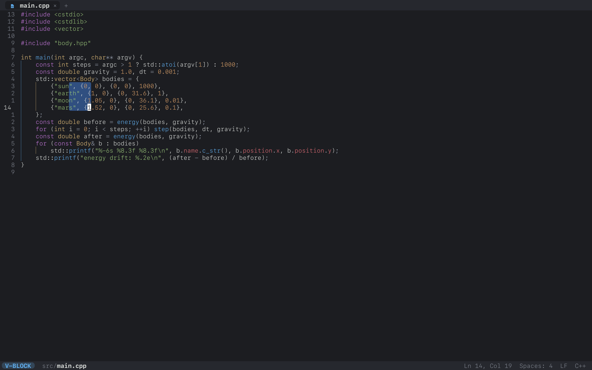

**Visual Block mode** (Ctrl-V) selects a rectangle; `$` takes it to the end
of every line, `o` and `O` move the cursor to another corner. `d x y c s r`
`~ u U g?` work on the rectangle, `D` and `C` from its left edge to the end
of each line, `>` and `<` shift what is right of its left edge. `I` and `A`
type on the first line and Esc puts the same text on the others (`A`
fills out lines that stop short). What a block operation yanks or deletes
goes back in as a rectangle: `p` and `P` put its rows on the lines from the
cursor down, at the cursor's column.

**Search**: `/` and `?` find as you type (the cursor goes to the first
match; Esc puts it back), Enter keeps it, `n` and `N` go on, `*` and `#`
look for the word under the cursor. Matches stay lit until `:noh` or Ctrl-L.
Cmd+F opens `/` with the word under the cursor (or what is selected) on
it, selected: the first character typed takes its place, Backspace clears
it, an arrow keeps it to be typed onto (it is put there as a pattern that
finds it as it stands: `a\.b` for `a.b`).

What is typed is a regular expression, as Vim and Neovim read one: "magic"
(`.` `*` `[abc]` `[^abc]` `~` `^` `$` as they stand; `\+` `\=` `\?`
`\{n,m}` `\{-n,m}` (as few as may be) `\(\)` `\%(\)` `\|` `\<` `\>` with a
backslash), or after `\v` very magic (all of those without one: `\v(ab|c)+`),
`\m`, `\M`, or `\V` (nothing special but a backslash). The classes `\s \S
\d \D \w \W \a \A \l \L \u \U \x \X \o \O \h \H \i \k \f \p` and
`[:alpha:]` and the rest in a collection; `\n` is a line's end (a match may
run across lines), `\_s`, `\_.`, `\_[...]` take one too; `\zs` and `\ze` set
where the match is said to start and end; `\%^` `\%$` are the file's start
and end, `\%d123` `\%x2a` `\%u20AC` a character by number; `\c` and `\C`
anywhere ignore case or not (there is no 'ignorecase': as Vim's default,
case counts). `.` and the classes take a character, not a byte (`é` is
one). Back-references (`\1` to `\9` in the pattern: `\(\w\+\) \1` finds
a word said twice), look-ahead and look-behind (`\@=` `\@!` `\@<=` `\@<!`,
`\@12<=` to look no further back than 12 bytes, `\@>`), `\&`
(`foobeep\&...` finds "foo" in "foobeep"), `\%[...]` (`fu\%[nction]`),
and a line or column by number (`\%23l`, `\%<23l`, `\%>23l`, `\%5c`) work
as in Vim. A pattern with nothing special in it is looked for as text, the
fastest way (about 5 ms for something not there in 1 GB, on several
threads); any other runs on blit's own engine, where the text lies: a DFA
built as it goes finds the lines (about 0.7 GB a second a core), and a
Pike VM where on them, so no pattern can take exponential time. Those with
back-references or look-around (and any after `\%#=1`) run on a
backtracker, with lines ruled out first by the text every match must have
or by the DFA; it has a budget of steps, and a pattern that would take too
long stops with E363 instead of holding the editor.

**The command line**: `:w`, `:q` (closes the tab), `:q!`, `:wq`, `:x`, `:wa`,
`:qa`, `:wqa`, `:e FILE` (a new file, made when it is saved, but not in a
folder that is not there: "No file NAME"), `:e!` (the file read again from
disk, its changes here dropped), `:bn :bp :bd`, `:tabnew`, `:sp`, `:vs`, `:noh`,
`:{number}`, `:d`, `:y`, `:>`, `:<`, `:u`, `:red`, and `:s/this/that/` with
the flags `g` (every match on a line), `c` (asks of each: `y` `n` `a` `q`
`l`), `i` and `I` (case ignored or not), `n` (only counts them), `e` (says
nothing when there is none) and `&` (the last one's flags first). In what a
match becomes, `&` and `\0` are the match, `\1` to `\9` its groups, `~`
what the last `:s` put in, `\r` and `\n` a new line, `\u` `\l` the next
character in upper or lower case, `\U` `\L` all that follows until `\E`
(`:%s/\(\w\+\)(\(\d\+\))/\2:\u\1/g`; `:%s/\n/,/` joins every line; `:s` or
`:&` alone does the last one again, `:&&` with its flags). A `:s` changes
only the lines it matched, all in one undo step. Lines are
given as numbers, `.`, `$`, `%` or `'<,'>` (which `:` in Visual mode fills
in). Up and Down recall earlier lines. One command to a line: `|` does not
start another, and a command with `|` after it is refused with E488
(`:lua`, the mappings, `:command`, `:grep` and a script's command keep it as
part of what they are given; in `:s` it is the pattern's or the
replacement's).

What Neovim has and this does not, yet: in patterns, `\z(`, and the `\%`
items that are about the cursor, the Visual area, marks or display columns
(`\%#`, `\%V`, `\%'m`, `\%23v`); 'ignorecase' and
'smartcase'; Ctrl-E and Ctrl-Y while `:s///c` asks; `=`, `!` and `gw`; folds made by hand (`zf`, `zd`) and fold levels; `:g`, `:normal`; the change list beyond its last entry
(`g;` goes to the last change only); `U`; digraphs and Ctrl-X completion in
Insert mode (completion is the language server's); Select mode and
`virtualedit`; a motion forced to another kind (`dv}`); Ctrl-A and Ctrl-X
on a selection; some seldom used `g` and `z` commands (`gI`, `ga`, `g,`,
`gx`, `zh`, `zl`); Ctrl-W beyond the keys named above. Of the keys newer
versions of Neovim set up by default, those that need something blit does
not have are missing: `grn gra grr gri grt` (references are `gr` and
type definitions `gy`; renaming, code actions and implementations are F2,
Option+Enter and Cmd+F12), `[q ]q [l ]l [t ]t [a ]a` (there are no quickfix, location, tag or
argument lists), Ctrl-W `d`, and the tree-sitter selections `an in`. `gd`
and `gD` ask the language server; Neovim's look for a declaration in the file.
On the command line the cursor stays at the end (no moving back into what
was typed, no Tab completion). A block that cuts through a tab or a wide character takes
the whole character. Marks with capital letters belong to their file like
the others. `>` and `<` shift by the file's own indentation (the same step
the indent lines use), a tab where the file uses tabs. Where Ctrl is the
key for the application's own shortcuts (everywhere but on a Mac), Ctrl-V
stays paste.

## Tabs, line numbers, indent lines, the status bar

Every open file has a tab in the bar along the top. Click a tab to bring it
to the front, drag it along the bar to move it, and close it with the cross
at its right (a dot there instead means unsaved changes, which are asked
about first) or a middle click. The `+` at the end, or a double click on the
empty part of the bar, starts a new file. When the tabs do not all fit, the
bar slides: turn the wheel over it. Two files with the same name show their
folders too. Opening a file that is already open goes to its tab. Each tab
keeps its own undo history, selection and place in the file. Closing the
last tab leaves a new empty file; Cmd+W never closes blit itself (Cmd+Q
does, and Vim's `:q` in the last window).

Line numbers run down the left of the text, with the cursor's line picked
out; a click on a number selects its line. As Vim has them with `number`
and `relativenumber`, the cursor's line shows its own number and every
other line how far it is from the cursor, the count to put before `j` or
`k` to get there (with Vim's modes on; without them every line has its own
number); `blit.opt.editor.relative_numbers = false` (or `:set nornu`) gives
every line its own.

A status bar runs along the bottom of the window, under the splits and the
side panel. On its left, the repository and the file: the branch (and how
many commits it is ahead of and behind the branch it follows), this file's
lines added, changed and taken out since the last commit (`+3 ~4 −1`, as
the marks beside the line numbers count them, saved or not), how many files
differ from the last commit (saved ones: what git sees), then the file's
path in the repository, with a dot while it has unsaved changes. On its
right: what a script put there (`blit.ui.status`), the errors and warnings
(the language servers' in the open file and the last build's in all of
them, one that both found on the same line counted once), for a Python
file its project's Python (`Python 3.12 (.venv)`; a click chooses another:
see [The project's Python](#the-projects-python)), the cursor's
line and column (and what is selected:
characters, or lines), the indentation, the line endings, and the language
with its server (and what the server says it is busy with: `C++ · clangd
(indexing 31/72)`); `C++ (no colours)` when that language's grammar is not
installed (see [Syntax highlighting](#syntax-highlighting)). A click on the
repository part opens the side panel's Git tab, one on the problems its
Problems tab, and one on the line and column Go to file with `:` typed, for
a line. A click on the indentation, the line endings or the language opens
a short list that changes it for that file: tabs or 2, 3, 4 or 8 spaces
(what the indent lines, the Tab key and Vim's `>` go by; the file's text
stays as it is), LF or CRLF (every line end made so, as one step to undo, and Enter
puts that in), or another language (its colours and the scripts'
`FileType` follow; its language server stays the one its name says; the
folder's session keeps the choice), with getting its grammar first when it
has none. When the
window is narrow a long path is shortened from its start first, then the
least needed parts go. With Vim's modes on, the command line is just above
it.

The window's title names the file in front and the project folder:
`render.cpp — blit (~/Dev/blit)`, with a dot first while the file has
unsaved changes. Before the side panel has a folder, it is the one the
panel would open at for that file.

Each level of indentation has a thin coloured line down it, a different
colour per level, carried through the blank lines inside a block. How many
columns make a level is worked out from each file (two spaces, four, a
tab...); `indent_width` sets it by hand. The colours are the theme's
`guides`.

```lua
blit.opt.editor.tab_bar = true         -- each of these can be switched off
blit.opt.editor.status_bar = true
blit.opt.editor.line_numbers = true
blit.opt.editor.relative_numbers = true  -- false: every line its own number
blit.opt.editor.indent_guides = true
blit.opt.editor.indent_width = 0       -- 0: from the file
blit.opt.themes["rose-pine"].guides = { "#786168", "#7c6449", "#546a75" }   -- one to six colours, first level first
```

### Distraction-free and presentation modes

"Toggle distraction-free mode" leaves the text alone: the window goes full
screen (if it was not), and the tab bars, the breadcrumbs, the line
numbers, the status bar, the side panel and the minimap go, each coming
back as it was when the mode is left. "Toggle presentation mode" does the
same with the text larger, for showing: `blit.opt.look.presentation_size`
points, or 1.6 times its size (0, the default). Either command goes from
one mode to the other; the same one again leaves it. Asking for the side
panel (showing it, or one of its tabs) leaves the mode too, so that the
panel is there to be used.

## Local history

Each file's text is kept, by its path, at every save (and at the first
save of a session, the text it had on disk before it), and every five
minutes while it is being typed in: in blit's data folder
(`~/.local/share/blit/history`, a folder for each file named by a hash of
its path, each version a gzip file), written on a thread of its own. A
text is not kept again while it is the newest; the 200 newest versions of
a file are kept. A file on another machine (`ssh://host/path`,
`docker://NAME/path`) has one too, kept on this machine by its whole path
(the same path on two hosts is two histories), from the text blit has:
at the first save of a session, the text as it was last read from there,
so the machine is never asked for it. Putting a version back is an edit
like any other; saving it writes it there as any save does.

"Show the file's local history" lists the versions, newest first: how long
ago, whether at a save or while typing, and when. Moving through them
shows each as a diff against the text as it is now, in a tab beside the
file (what the version had and the text has not in red, the other way in
green). Enter puts the one chosen back, as one edit that one undo takes
back; Esc closes the list and the tab. `blit.opt.editor.local_history =
false` keeps none.

## Spelling

The words in the comments and strings on show (as the syntax colours find
them), in a Markdown file's text (not its code, between backticks or in
blocks), and in all of a plain text file are checked, in English, by the
system's checker: NSSpellChecker on a Mac, and elsewhere Hunspell's
`en_US` dictionary (`/usr/share/hunspell`), opened when first wanted, so
that blit does not need it; without one nothing is checked, and nothing
is said as files open: Option+Enter on a word says what is missing
("hunspell has no English dictionary"), and so does the
`editor.spell_check` row in Settings. A word that
looks like a name in code (a digit, an underscore, a capital after its
first letter), one in capitals, and part of an address or a path are left
out. The check runs on a thread of its own once the text and the view
have been still a moment.

A word the checker does not know is underlined as a problem is. Option+Enter
on it lists what it might be (Enter puts one in its place) and, last,
adds it to the dictionary: the system's own on a Mac, blit's
(`~/.local/share/blit/words`) elsewhere. `blit.opt.editor.spell_check =
false` turns it off.

## Splits

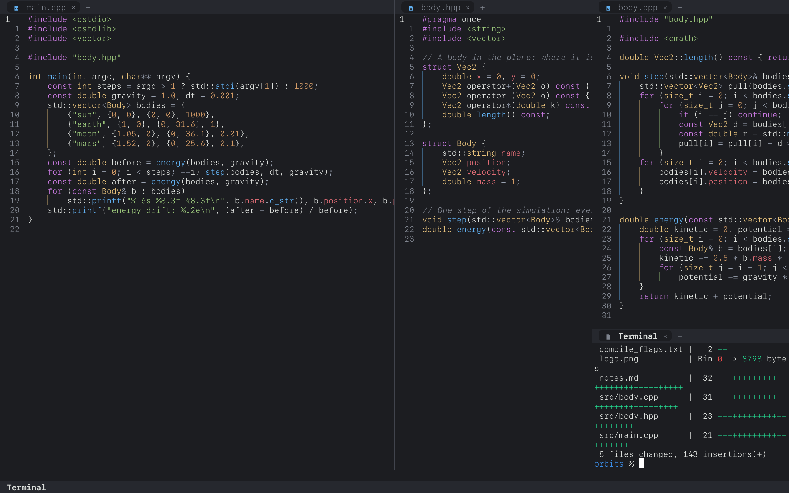

The window can be divided into splits, side by side or one above the other,
and each of those divided again (up to sixteen in all). Every split has its
own tabs, line numbers and scroll position; the side panel is shared.
Cmd+\ makes a split to the right of the one with the keyboard and
Cmd+Shift+\ one below it, and opens Go to file for it: the file chosen
opens there (one open in another split moves there), and Esc leaves it
with a new file. A click gives a split the keyboard (its front tab is the
one in bold), and Cmd+Option with an arrow moves the keyboard to the split
on that side. The wheel scrolls whichever split the mouse is over. Drag the
line between two splits to resize them. A split goes when its last tab is
closed, or with Cmd+Shift+W: its tabs then join the split beside it, after
that split's own and with the one that was in front still in front (a new
file with nothing in it goes with it). The terminals' split along the
bottom is hidden instead, its programs still running; the last split
cannot go, and Cmd+Shift+W closes its tabs, asking about unsaved changes
as Cmd+W does.

Things are moved by dragging them. While something is being dragged, the
place it would land is washed with colour: one half of a split means "a new
split here", the whole of it means "in with this split's tabs". Esc puts it
back.

- **A tab** dragged out of its bar goes to another split's tabs (drop it on
  the bar to choose its place among them, or anywhere in the middle), or
  becomes a new split at whichever edge of a split it is dropped on.
- **A whole group of tabs** is dragged by the empty part of its tab bar, or
  by any tab with Option (Alt) held. Dropped on an edge of another split,
  the group moves there as a split; dropped in the middle, its tabs join
  that split's.
- **A file from the tree** in the side panel can be dragged onto a split to
  open it there, or onto an edge to open it in a new split.
- **A file or folder in the tree** dragged onto a folder of the tree moves
  there on disk (below the last row: to the working folder), and so do the
  others chosen with it. One whose name is already there stays where it is
  (the others move all the same), and one notice says which did not. A file
  open in a tab follows it.

**One file in two splits.** A file can show in several splits at once,
the same text in each: what is typed in one shows in the others, and each
split keeps its own cursor, selection and scroll in it (a change above
another split's cursor moves that cursor along with its line). Choosing a
file that another split shows (Go to file, Cmd+\, the tree, a drop) shows
it in the split with the keyboard too; closing one of its tabs asks
nothing while another split still shows it. A terminal, a profile, a
preview, a picture or a PDF has one view: choosing it goes to its tab.

## Git

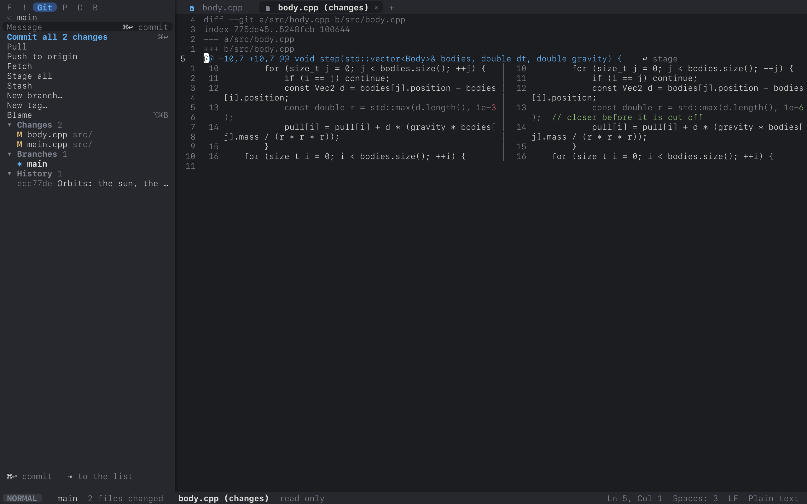

blit shows what git knows about the files it has open, and does the
everyday things from the side panel. It runs the `git` program for all of
it, so whatever your git does in a terminal (credential helpers, ssh keys,
hooks, your settings) it does here. Nothing git does ever holds up the
editor: a push that takes ten seconds takes them on a thread of its own.
Where git is not installed on the folder's machine, the Git tab says so
("git is not installed on lab") in place of "Not a git repository", and
so does what needs a repository.

**In the text.** Lines changed since the last commit have a mark beside
their number: one colour for added lines, one for changed ones, and a dash
where lines were taken out. A change that is staged just as it is has a
thinner bar (a staged removal, a quiet dash); one with anything not yet
staged keeps the full one. The marks follow the text as you type; nothing
has to be saved first. A click on a mark offers **Stage this change** (or,
once it is staged, **Unstage this change**) and **Show the diff**, which
opens the file's diff at that change; Up, Down and Enter pick, Esc or a
click elsewhere puts the offer away. What is staged is the text as it is in
the editor, saved or not. Blame is shown only when asked for: Cmd+Option+B
(or Blame in the Git tab) turns it on for the file in front, and again
off. It is a column beside the line numbers (commit, author and age, once
for each run of lines from one commit) and, quietly at the end of the
cursor's line, who last changed it and when, with the commit's summary.

**The Git tab** (Ctrl+Shift+G, or click "Git" at the top of the side panel)
is for the repository the working directory is in: the folder the Files tab
shows. Choose another folder there and git follows. (Before the panel has
ever been opened, that is the project of the file in front.) A file open
from outside that repository gets no marks and no blame. From the top:

- The branch, with how many commits it is ahead (↑) of and behind (↓) the
  branch it follows.
- The commit message, a field that has the keyboard when the tab opens;
  Tab goes between it and the list below. Enter starts a new line and
  Cmd+Enter commits. The field grows with the message (to a third of the
  tab, then it scrolls), and the arrows, Home and End move about in it.
  Past the 50th column of the first line, and the 72nd of the others, the
  text is muted: git's usual widths for a summary and a body.
- **Commit**, which says what it will commit: "Commit 3 staged" with files
  staged, "Commit all 54 changes" with none (every change to files git
  already knows). Then **Pull, Push, Fetch, Stage all, Stash, New branch…,
  New tag…** and **Blame**, each a row that Up and Down reach. **Stash**
  puts the changes to files git knows away (files it does not know stay);
  a new tag is made on the commit checked out. While one runs its name
  shows there, with Cancel. A branch that follows nothing yet is pushed to
  `origin` under its own name and follows that from then on. How it went
  (or git's complaint, if it did not) appears on the line below. A folder
  that is not a repository gets a row that makes it one.
- **Conflicts**, **Staged** and **Changes**: the files, each with git's
  letter for what happened to it, in git's colours (changed, added,
  removed). Click `+` at the end of the row picked or under the mouse to
  stage the file and `−` to unstage it. Pick a file to get **Stage / Unstage**,
  **Discard** (throws away what is not staged, after asking), **Diff** and
  **Open**; a double click opens its diff.
- **Stashes**, when there are any: newest first. Pick one to **Show** it
  (its diff, in a tab), **Pop** it (`p`: back into the files, and gone from
  the list), **Apply** it (`a`: back, and kept) or **Drop** it (Delete,
  after asking). One that does not go back cleanly leaves its conflicts
  under Conflicts, as a merge does, and is kept.
- **Branches**: the one checked out is starred. Pick another for **Switch**,
  **Merge** (into the one checked out), **Rebase onto** (`r`: the branch
  checked out is rebased onto it, after asking) and **Delete**; a double
  click switches. Switching to a branch on the server makes a local one that
  follows it. `h` on a branch shows its commits under History instead
  (History then says whose they are), and `h` again goes back.
- **Tags**, when there are any, folded to start with (click the heading):
  newest version first ("v1.10" before "v1.9"). Pick one to **Show** it, **Push** it (`p`: to the server the
  branch follows, or `origin`) or **Delete** it here (after asking).
- **Worktrees**, when the repository has another than this one: this one
  first (marked), each with its branch and where it is. Enter on another
  opens it as a folder is opened to work in (the side panel, the Git tab
  and the rest follow it): its session comes back, or, the first time, the
  tabs open here go there, each file at its place in that tree (one it
  does not have closes; one with changes not saved stays, as with any
  folder). Backspace removes it, after asking (its branch stays).
  "Git: New worktree…" makes one for a branch, beside the repository and
  named after it and the branch (`blit-feature` for `feature`), the branch
  made from the one checked out if there is none, and opens it as Enter
  does. A git command that fails leaves why in the Git tab (git's
  `fatal:` or `error:` line).
- **Submodules**, when there are any: each one's path, how it stands (●
  as the repository wants it, `+` at another commit, ○ not checked out,
  `U` in a conflict) and its commit. Enter opens one that is checked out as
  the folder worked in; `u` (and "Git: Update the submodules") checks them
  all out at the commits the repository wants, the ones in them too.
- **History**: the last hundred commits, as a graph: before each, the
  lanes of the lines of descent it is on, worked out from the commits'
  parents (a branch meeting the line it started from, a merge's other
  parent joining), each in a colour of its own; beside it, the branches
  and tags that point at it (the one checked out bold, the server's
  quieter). A double click shows one, with its diff. While History shows
  another branch's commits, `c` cherry-picks the one picked onto the branch
  checked out; on the branch checked out, `i` rebases from that commit on,
  interactively (below). "Git: History of all branches" shows every
  branch's commits together (again: the one checked out's), and "Git:
  Search the history…" lists those whose message or author has the text
  in it, any case, or that changed it as a path, newest first and without
  lanes (nothing searched for: all of them again).

From the keyboard: Up and Down (or `j` and `k`) pick, Enter does the usual
thing with what is picked (a file's diff, switch to a branch, show a
commit, a stash or a tag), `o` opens the file and `m` merges the branch,
Right stages and Left unstages, Delete discards a file's changes or deletes
a branch, a stash or a tag, Cmd+Enter commits, Cmd+R looks again, Esc goes
back to the text. The line at the bottom says the keys for what is picked.
The command search has them too: "Git: Commit", "Git: Pull", "Git: Push",
"Git: Fetch", "Git: Stage all", "Git: Stash", "Git: Pop the latest stash",
"Git: New branch…", "Git: Switch branch…", "Git: New tag…", "Git: Rebase
onto branch…", "Git: Cherry-pick a commit…", "Git: Continue the rebase or
cherry-pick", "Git: Stage the change at the cursor", "Git: Unstage the
change at the cursor", "Git: Diffs in two columns or one", "Git: The
file's history", "Git: The history of the lines chosen", "Git: History of
all branches", "Git: Search the history…", "Git: Rebase interactively
onto…", "Git: Merge the file's conflicts", "Git: Resolve the simple
conflicts", "Git: Compare the file with…", "Git: New worktree…", "Git:
Update the submodules" and "Git: Pull requests…".

**Comparing with any revision**: "Git: Compare the file with…" lists the
branches (but the one checked out), the tags, History's commits and
HEAD; the one chosen opens a diff tab of the file as it is now against it.
A revision typed that no row has (`HEAD~3`, a commit's hash) is compared
with as it is, on Enter.

**Pull requests** go through GitHub's own command, `gh`, signed in as it
is (`gh auth login`), in the repository it takes this one to be. "Git: Pull
requests…" lists the open ones (number, title, author, branch, and a draft
or a review's verdict); the one chosen offers:

- **Check out**: its branch, made or brought up to date by `gh`, and its
  comments asked for: each comment on a line then shows after that line in
  the file (◆, who, its first line, and how many answers it has). One on a
  line the pull request takes out is not shown in the file, which no longer
  has that line; it is in the list below, marked "(taken out)".
- **Show the changes**: its diff, as GitHub has it, in a tab coloured as a
  diff.
- **The comments on its lines**, as threads (each answer under what it
  answers); one chosen is gone to (its file, at its line, if it is still
  there) or answered (the answer goes to its thread).
- **Approve**, **Ask for changes…** (what should change asked for) and
  **Comment…**.

What posts to GitHub (an answer, a review) is asked about first. Each runs
in the background; what goes wrong is what `gh` said.

**Diffs** open in a tab of their own, coloured, to read and copy from, with
the cursor on the first hunk. A file's diff is staged from there a hunk or
a line at a time: in the diff of its changes, Enter (or `s`) stages the hunk
the cursor is in, or with lines selected (Visual mode's, with Vim), just
those lines; in the diff of what is staged of it, Enter (or `u`) unstages
them. After the heading of the hunk the cursor is in, the key that does it
is shown. `]` and `[` go to the next hunk and the one before; the tab is
read again as what is staged changes, and after a hunk goes the cursor is
on the next. `|` shows any diff in two columns, the old lines on the left
and each beside the line it became on the right, with their numbers and
within a changed line what stayed the same muted; lines too long for a
column go on in the rows below. `|` again goes back to one column, and
diffs open the way the last one was turned. Two columns stage the same way:
a row selected is both its lines.

**A file's history.** "Git: The file's history" opens a tab of the
commits that changed the file in front, newest first, followed through
renames, each with its change; "Git: The history of the lines chosen" does
the same for the lines selected (or the cursor's line), as `git log -L`
follows them back. Enter on a commit there shows all of it.

**Merging.** A merge or pull that conflicts leaves the files under
Conflicts and "merging" beside the branch. Enter on one (or "Git: Merge the
file's conflicts" in the file) opens it in a merge tab of three columns:
theirs (what is merged in), the result, and yours (the branch checked out),
merged line by line from git's three versions of it. What only one side
changed is taken from it, the same change by both once; where both
changed the same lines, or lines next to each other's, there is a
conflict, red, between git's markers in the result. On a conflict `t` takes
theirs, `y` yours, `b` both (yours first; `B` theirs first) and `x` opens
it again; where the two sides' changes only touch (git calls those
conflicts too) `e` takes each side's, and `a` (or "Git: Resolve the simple
conflicts") does that for all of them. What the result has of each side is
green, what it leaves muted. `]` and `[` go to the next conflict and the one
before. Cmd+S writes the result to the file (with any conflict still open
between markers) and, once none is, stages it. Then commit; or **Abort
merge**.

**Rebasing interactively.** "Git: Rebase interactively onto…" (the branch
followed, to start with) or `i` on a commit in History lists the commits
since that base in a tab, oldest first, each with what is to be done with
it: `p` picks it, `r` rewords it (a new subject, the rest of its message
kept), `e` stops at it to change it, `s` squashes it into the one before
(their messages together), `f` fixes it up into that one (its message
dropped), `d` drops it; Alt+Up and Alt+Down move it. Cmd+S starts the
rebase. It stops where it was told to, or at a conflict, as below.

A rebase or a cherry-pick that conflicts, or a rebase told to stop, stops
with "rebasing" or "cherry-picking" beside the branch: change or settle the
files (a merge tab settles a conflict here too) and stage them, then
**Continue rebase** (or **Continue cherry-pick**), or give it up with
**Abort rebase** (**Abort cherry-pick**).

**Files that change on disk** under an open tab (git switched branches,
pulled, merged or discarded; or another program wrote them) are read again
when that happens and when the window gets focus, keeping the cursor's
place. A tab with unsaved changes of its own is left alone, and a notice
says so. Its next save asks first, in the box, whether to save over what
is on disk now; **Compare with disk** (there, or as a command) shows what
the tab has against what is on disk, in a tab beside it. **Save all** asks
about each such file in turn, and the question of a save on another
machine that comes back while another box is open waits for that box to
close. Closing such a tab with **Save** (or Vim's `:wq`), or quitting
with **Save**, asks the same (quitting, about each file in turn): **Save over it** saves, and
the tab closes or blit quits once it is written; **Compare with disk**
or Esc keeps the tab open with its changes, and nothing closes or quits.

```lua
blit.opt.git.enabled = false   -- no git at all
```

## Finding files and text

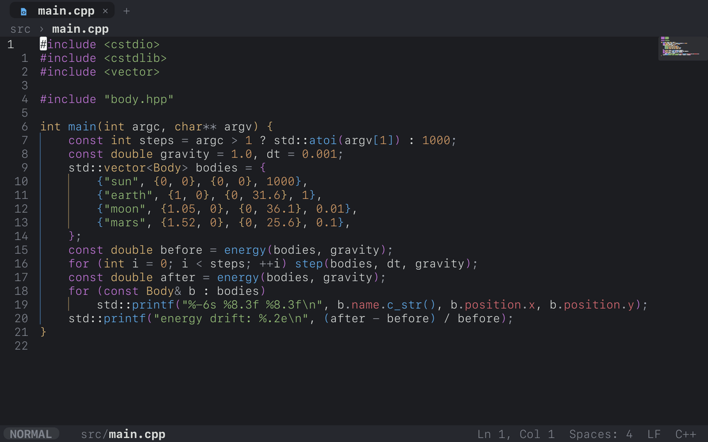

**Cmd+P**, Go to file, finds a file by name. With nothing typed it lists
the files open (Open, the one in front last) and those opened lately
(Recent). Type some of its letters, in order but not necessarily together (`appcp` finds `app.cpp`, `rcpp` finds `render.cpp`):
the list narrows as you type and the best match is first. Letters that
follow one another, and letters at the start of a word (after a slash, a
dot, an underscore, a capital after a small letter) count for more than
letters scattered about; a match in the file's own name counts for more
than one that needs its folders. Several words may be typed, separated by
spaces, and every one has to match (`src grid`). Small letters match
either case; a capital matches only itself. Among matches as good as each
other, files open or opened lately come first. `name:120` (or `name:120:5`)
opens the file at that line (and column); `:120` alone goes to line 120 of
the file in front. Enter opens the file chosen, Cmd+Enter opens it in the
split to the right (making one if there is none).

**Cmd+K**, Search everywhere, finds four kinds of thing at once, each
under its heading: files (as Go to file finds them, the best eight), the
project's symbols (from the language server, as Cmd+Option+P has them),
commands (as the command search has them, with their keys) and settings
(with what each is now). With nothing typed it lists the files open and
opened lately. Commands and settings need closer matches than the command
search asks for: the letters typed together somewhere, or each just after
the one before or at the start of a word (`lnum` finds
`editor.line_numbers`). Tab goes to the next kind. Enter opens the file,
goes to the symbol, runs the command, or opens init.lua at the line that
sets the setting, with its value selected; a setting the file does not set
yet is added (the template's commented line made a setting, else a new
line at the end), and saving it applies it.

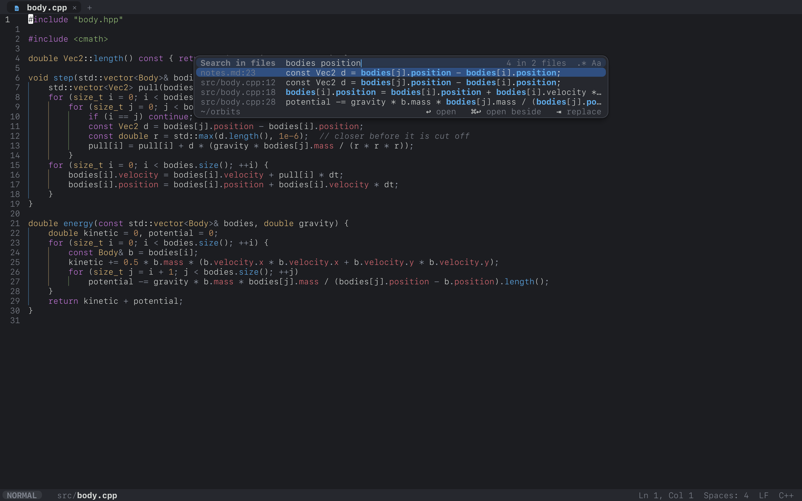

**Cmd+F**, with Vim's modes off, opens the box that finds in the file,
at the top right of its split, with the word at the cursor (or what is
selected) in it, selected so that typing replaces it: the match from the
cursor on is chosen (selected in the text) as it is typed, the others lit
up, and the field says which of how many it is ("3 of 12"). Enter (or Down,
or Cmd+G) chooses the next, Shift+Enter (or Up) the one before, round the
ends; Esc leaves the one chosen selected, and Cmd+G and Cmd+Shift+G go on
from it. Small letters match either case; a capital typed is a capital
found. **Cmd+Option+F** (with Vim's modes as without) opens it with a second
field, Replace with (and adds that field to a box Cmd+F opened; Tab
goes from one field to the other): Enter replaces the match chosen and
chooses the next, Cmd+Enter replaces them all, in one undo step. With
modes on, the match chosen is
selected as in Visual mode, and when the box shuts what it found is the
last search (`n` goes on with it).

In both boxes (this one and Search in files) **Option+R** (or a click on
`.*` in the field) turns regular expressions on, Vim's as `/` reads them
(above), and **Option+C** (or `Aa`) makes case count as typed; each is lit
when on, and stays on until turned off. With regular expressions on, what a
match becomes is read by `:s`'s rules: `&` and `\0` the match, `\1` to `\9`
its groups, `\n` a new line, `\u` and `\U` upper case; without, it is put
in as it stands. A pattern that is not one says why, in the footer.

**Cmd+Shift+F**, Search in files, finds text in files: the lines that have
every word typed on them, in any order, with the file and line number of
each. It opens with what was searched for last (or what is selected),
selected, so that typing replaces it; F4 and Shift+F4 then go to the next
and the previous hit without the box, and the bottom line says which ("Hit
4 of 37"). The words
are looked for as they stand, not as patterns; small letters match either
case, and one letter alone is not searched for. Enter opens the file at
that line with the cursor on the first of the words, and Ctrl-O (or
Option+Left) comes back. The search runs on several threads and shows what
it has found so far while it goes on; it stops at 3,000 lines.

Both look under the working directory (the folder the [side
panel](#side-panel) shows). Files a `.gitignore` leaves out are left out,
and so, whatever `.gitignore` says, are `.git`, `node_modules`, `target`,
`build`, `build-*` and compiled files; `blit.opt.search.ignore` adds more, in
`.gitignore`'s syntax. A search for text also passes over files that are
not text and files over 8 MB. The folder is read again in the background
when the box opens, if the last reading is more than 2 seconds old, the
window has come back to the front since, or the file tree has seen a
change; the list as it was is searched meanwhile, and again when the new
one is in (switching between names and text reads nothing).

**Replacing in files**: **Cmd+Shift+H** opens Search in files with a
second field, Replace with, or in Search in files adds it (again: takes it
away); Tab goes from one field to the other. What is typed is then looked
for as it stands, spaces and all (or as a pattern, Option+R), the count is
of matches, and each line
found shows what it is and, after an arrow, what it would become, the parts
that change lit. Cmd+Enter asks first, in the box: "Replace 37 hits in 5
files?" (Enter yes; anything else no). A file open in a tab is changed
there, in one undo step, and saved; the others are read, changed and
written where they are, on another machine through its connection, so
that a build straight after sees the whole change. An open file that had
changes of its own is changed but not saved (they are yours to save),
and the bottom line names it. It says how it went: "Replaced 37 hits in
5 files", or "...; main.cpp changed, not saved (it has changes of its
own)". (When a search has stopped at 3,000 lines, it asks for
a narrower one first.)

In the box: Up and Down (or Ctrl-P and Ctrl-N, Ctrl-K and Ctrl-J) choose,
Page Up and Page Down go by a page, Enter opens, Esc (or a click beside the
box, or the key that opened it) shuts it. Cmd+Shift+F turns a search for
names into one for text, keeping what is typed, and Cmd+P goes back to
names. Tab has one meaning in the box, on to the next: the other field,
the next kind, the name chosen completed. Option+Backspace (or
Ctrl-W) takes a word back, Cmd+Backspace (or Ctrl-U) all of it, Cmd+V puts
in what the clipboard holds. A row can be clicked, and the wheel turns the
list. In Vim's command line, `:find NAME` and `:grep WORDS` open the box
with that typed.

**No system file dialogs.** Opening a file (Cmd+O), naming a new file when
it is first saved, and choosing a folder to work in (the side panel's
menu) all happen in the same box: a path is typed, starting from the
working directory, and what is in the folder typed so far is listed under
it, narrowed by the rest of what is typed. Enter on a folder goes into it
and Tab completes the row chosen; `..` is the first row, and `~` is the
home folder. Enter on a file opens it; a name that is not there opens a
new file of that name (or, when saving, is the name saved under: saving
over a file that is there asks first). To choose a folder, go into it and
take its first row, "Use this folder".

```lua
blit.opt.search.ignore = { "*.log", "/dist/" }  -- more to leave out, as in a .gitignore
blit.opt.search.gitignore = true                -- false: .gitignore files are not heeded
blit.opt.search.hidden = true                   -- false: names that start with a dot are left out
```

## Scrolling

A wheel notch moves three lines (`blit.opt.scroll.lines`) and eases into place. A
touchpad moves the text exactly with the fingers; on macOS a flick then
glides on and slows to a stop, as it does in other applications
(`momentum = false` turns that off, at the next start). The view stops at
the text's edges.

Sideways, the view goes as far as the widest line in the file and no
further. With no line wider than the window it does not move sideways at
all.

When the cursor goes out of view the view follows it only as far as it
must, keeping `blit.opt.editor.scrolloff` lines (0, Vim's `:set so=3`)
above and below it. A jump out of view (a search's match, a definition, a
reference, Ctrl-O, Vim's `G`, `%` or a mark) puts its line a third of the
way down instead, so that what follows it is in view (and never past the
text's end: after `G` the last line is at the bottom).

### Soft wrap

A line longer than the view can go on in the rows under it instead: it
breaks after the last space that fits (a space past the edge hangs there;
a word longer than the width breaks where the width ends; a wide
character is kept whole, on the next row). Markdown files wrap as they
open (`blit.opt.editor.soft_wrap_languages = {"markdown"}`, a list of
languages as the status bar names them, `text` for plain text);
`blit.opt.editor.soft_wrap = true` wraps every file, and **Option+Z**
("Toggle soft wrap", Alt+Z elsewhere) turns it on or off for the file in
front, whatever the settings say. A file larger than 16 MB does not wrap.
While a file wraps, nothing scrolls sideways.

A wrapped line's rows are moved through as rows: the arrows up and down,
and Vim's `gj` and `gk`, go to the row above or below, keeping the column
along the row (and stopping at its end, not going on into the next part
of the line). Vim's `j` and `k` go by lines, over a wrapped line's other
rows, and so do the counts the relative numbers show. A line's number is
on its first row only. A click lands where it is along its row; a
selection, the underlines and the notes after a line follow the line from
row to row. Folded lines take no rows, wrapped or not. Inlay hints take
room in the rows as the text does, each on the row of the character it
comes before; on the cursor's line, where they are not drawn, they keep
that room, so that the line's rows stay as they are as the cursor comes
and goes.

Each split keeps its own wrap, for its own width (the same file in two
splits of other widths wraps in each as fits), made again line by line
as the text changes.

### The minimap

Down the right of a split wide enough for it (80 columns of text besides),
the file small: each line a couple of pixels high, each character a pixel
in its syntax colour (the text's colour where the colours are not in
yet: they are worked out for what has been on show). It goes over the
ends of long lines (a diff's two columns and a merge's three are laid out
left of it) and over the scroll bar, whose place the view's box on it
takes: a lighter box shows the lines on show. A click there brings
that place into the middle of the view; dragging scrolls with the mouse.
A file that fits is all there from its top; a longer one moves down the
column as the view moves down the file.

It is drawn in tiles of 1024 lines, each a picture on the GPU, made again
from where the text changed (or all of them, when the colours do) once
typing pauses; a tile made again the same is not sent again, and tiles
far from the view are let go of. `blit.opt.editor.minimap = false` turns
it off.

## Looks

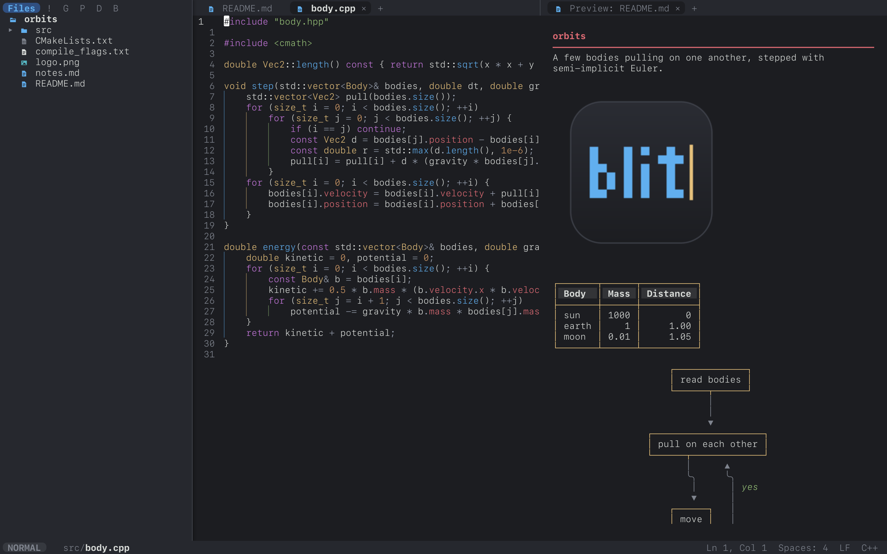

Every box is laid out by the same rules (`src/look.hpp`): text starts 11
points from the edge of its box or of the window, in every box and bar; a
lit row's rounded bar reaches to 4 points from its box's edge, and a
floating box is rounded by that bar's radius and those 4 points, so the two
curves share a centre. The accent colour means "you are here, or yours":
the caret, matched letters, the item in front, the active tab of a panel,
the one button that does it. Headings are muted and bold, secondary text
muted (on the chosen row of a list, a colour between the muted one and the
text's, as far toward the text's as it takes to read there), and keys are
written as macOS writes them (⇧⌘P) where the font, or a
fallback, has the symbols; a box's hints are a line of keys and what they
do. Nothing is cut off without an ellipsis, and the chrome has no italics.

The status bar starts with the mode, while Vim's modes are on: NORMAL on a
quiet tone, INSERT, VISUAL and REPLACE on the accent. The line above it, the
command line, takes the bar's colour while it shows something.

Everything that floats (completion lists, hover text, the side panel's
menu, the name of a tab being dragged) has round corners and casts a soft
shadow, darker on a dark theme than on a light one so that it shows. The
row lit in a list is a rounded bar; so is the tab in front, in the colour
of the text under it, and so are the tab, the row of the side panel and the
panel's own tab that the mouse is over, in a fainter tone. A tab shows its
cross only when it is in front or under the mouse.

In the text, what is selected has round corners: outward ones at its ends,
and inward ones where a longer line meets a shorter. That goes for Visual
Block mode's rectangle and for the matches of a search. The cursor's
corners are a little round too, and the scroll thumb is a bar with round
ends.

Shadows also say that something has slid under something: the tab bar
casts one on the text once the view is scrolled down, and the line numbers
cast one once it is scrolled sideways. The side panel casts one on what is
beside it.

And things move. A popup fades in and rises a few pixels as it does. The
cursor glides from one place to the next instead of jumping (it still jumps
when it comes to another file, or would have further to go than the view is
wide or high). The scroll thumb shows while the view moves or the mouse is
by it, and fades away when left alone. The place where a dragged tab would
land is a rounded box with a rim.

```lua
blit.opt.look.rounding = 6          -- corner radius in points that all of it is sized from; 0 = square corners
blit.opt.look.shadows = true
blit.opt.look.animations = true     -- popups fade in, the scroll thumb fades away
blit.opt.look.cursor_glide_ms = 60  -- how long the cursor takes from one place to the next; 0 = it jumps
blit.opt.look.dim_inactive = 0      -- how far a split without the keyboard is dimmed (0 to 0.6)
```

With `rounding = 0`, `shadows = false`, `animations = false` and
`cursor_glide_ms = 0` blit draws as it did before any of this, and as fast:
[How it is fast](#how-it-is-fast) and BENCH.md say what each part costs
when it is on.

## Settings

There is no settings file: settings are made in `init.lua`
(`~/.config/blit/init.lua`; `$XDG_CONFIG_HOME` is honoured, and
`--config FILE` or `$BLIT_INIT` names another), with `blit.opt` and the
same names throughout. Without an `init.lua` everything is at its default.
"Open init.lua" opens it in blit, making it the first time from a template in which
every setting is listed with its default and commented out. Saving it in
blit applies it at once, and the bottom line says "Settings applied", or
what is wrong and on which line (`init.lua:12: unknown setting
editor.tabbar`); edits made in another program apply the next time a blit
window gets focus.

Cmd+, (Ctrl+,) opens the settings screen: a tab of every setting, under
the template's headings, each with its value (in green where it is not the
default) and what it does. Enter (or Space) changes the one under the
cursor: a switch flips, a theme is picked from a list, anything else is
typed (a list's items with commas between). Delete puts it back to its
default, and O opens init.lua at its line. A change is written into
init.lua as a line, over the statement that sets it (on a line of its own,
after another statement, or inside an `if`; the value as far as Lua takes
it, over lines if it goes on), else over the template's commented-out one
(its comment kept), else at the end, and applied at once; Delete comments
the statement out (what follows it on its line goes to a line of its own).
With init.lua open and changes in it not saved, the line is put there
instead, to be saved with them. init.lua stays what counts: the screen
only reads and writes it.

```lua
blit.opt.font.family = "Victor Mono"   -- a family name, or the path of a font file
blit.opt.font.size = 14
blit.opt.font.ligatures = true
blit.opt.theme.dark = "rose-pine"       -- while the system is in dark mode
blit.opt.theme.light = "rose-pine-dawn" -- while it is in light mode
```

[init.example.lua](../init.example.lua), the template, documents every
setting: font family, style, size, line height, ligatures and OpenType
features; themes and token styles; tab width, the tab bar, line numbers
and indent lines; scrolling; window size. The same file holds mappings,
commands and anything else that needs a program; see
[Scripts and plugins](#scripts-and-plugins). `:set` changes a setting
while blit runs (`:set tab_width=2`), until it starts again. Tab completes
the setting's name there (Tab again: the next that fits, Shift+Tab the one
before; `no` before a switch's), and after `=` its value: true or false,
a theme's name, or what it is now.

**Fonts** are found by family name in the system font folders, so the name
you would type in any other editor works; close matches count ("Victor Mono"
finds "VictorMono Nerd Font Mono"). The font has to be monospace.

**Themes** built in: `blit-dark`, `blit-light`, `rose-pine`, `rose-pine-moon`,
`rose-pine-dawn`. `blit.opt.themes.NAME = { ... }` defines your own from
five colours (background, foreground, selection, cursor, scrollbar), or
changes single colours of a built-in one. "Choose a theme…" in the command
search lists every theme; each is put on as the choice comes to it, Esc
puts back the one there was, and Enter keeps it and writes
`blit.opt.theme.dark = "…"` (or `light`, by the system's appearance) into
init.lua, in its tab and not saved: over the line that sets it, else over
the template's commented-out one, else at the end.

**Ligatures** are shaped with HarfBuzz, which is loaded only when a font asks
for them. `blit.opt.font.features = { "ss01", "zero" }` turns on other OpenType features.

**Syntax colours and styles** come from tree-sitter (see below). Each theme
says, per kind of token, a colour and whether it is italic, bold,
underlined or struck through (`underline`, `strikethrough`):

```lua
blit.opt.themes["rose-pine"].syntax = {          -- one theme
  comment = "#908caa italic",
  ["keyword.return"] = "bold",                   -- keeps the colour it had
}
blit.opt.syntax.styles = {                       -- every theme (a theme's own wins)
  keyword = "italic",
  variable = "regular",                          -- neither italic nor bold
}
```

A dotted name takes whatever it does not set itself from its parent
(`keyword.return` from `keyword`). `blit.opt.syntax.italic = false` or
`bold = false` switches one of them off everywhere. The Rosé Pine themes use the styles the
theme's editor ports use: italic comments, variables, parameters and properties, bold builtins.
Every built-in theme underlines a link's address (`markup.link.url`) and
strikes struck-out text (`markup.strikethrough`); the Markdown preview
underlines its links and strikes `~~text~~`, and a terminal draws SGR 4 and 9
(underlined, struck) as programs ask.

**Italic and bold** use the font family's own faces ("Victor Mono Italic"),
found next to the regular one. Where a family has no bold face but the font
has a weight axis, the axis is used; failing that, the regular outlines are
slanted or thickened. `blit --info` says which it was. Ligatures work in
every style.

## Scripts and plugins

blit runs Lua 5.5. At startup it runs `init.lua`
(`~/.config/blit/init.lua`; `$BLIT_INIT` names another), then every file in
`plugin/` there, then each plugin's. Modules are required from `lua/`
beside `init.lua` and from each plugin's `lua/`. Without any of these there
is no Lua in the process at all, and nothing costs anything.

```lua
-- ~/.config/blit/init.lua
blit.opt.font.size = 14                 -- every setting (init.example.lua lists them)
blit.opt.keys.leader = " "

blit.map("i", "jk", "<Esc>")            -- keys to keys
blit.map("n", "<leader>w", ":w<CR>")
blit.map("n", "<leader>t", function()   -- keys to a function
  print(blit.info().name .. ", line " .. (blit.cursor()))
end, { desc = "where am I" })

blit.command("Upper", function(a)       -- :Upper, :'<,'>Upper
  local lines = blit.lines(0, a.line1, a.line2)
  for i, l in ipairs(lines) do lines[i] = l:upper() end
  blit.set_lines(0, a.line1, a.line2, lines)
end, { range = true })

blit.on("BufWritePre", { pattern = "*.lua" }, function(e)   -- trailing spaces go on save
  local lines = blit.lines(e.buf)
  for i, l in ipairs(lines) do lines[i] = l:gsub("%s+$", "") end
  blit.set_lines(e.buf, 1, -1, lines)
end)

blit.plug("someone/a-plugin")           -- :PlugInstall fetches it
```

Saving `init.lua` (or anything in `lua/` and `plugin/`) in blit runs it all
again from the start, and so do `:Reload` and an `init.lua` edited elsewhere
once the window has focus again. Each time, settings start from their
defaults and what `blit.opt` sets goes on top.

**Mappings** work as Neovim's do: a run of keys in some modes (`n`, `i`,
`v` or `x`, `o`, `c`; `""` for n, v and o) stands for other keys or calls
a function. Keys are written in Vim's notation: `<leader>`, `<C-s>`,
`<M-j>` (Option), `<D-k>` (Cmd), `<S-Tab>`, `<F5>`, `<Space>`, `<CR>`,
`<Esc>`. The first keys of a mapping wait up to `keys.timeout_ms` for the
rest, and go through as typed if the rest does not come; while they wait,
the bottom line shows them on its right (`<Space>f`), as it does the keys
of a Vim command under way. A count typed
before a mapping is `blit.count()`. Keys a mapping types are not mapped
again unless `{ remap = true }`. With `modal = false` the `i` mappings are
the ones that apply. All the changes a function makes to a document are
one undo step. A mapping of one chord (`<D-b>`, `<F5>`, `<M-j>`) is in the
command search as "Mapping <D-b> (n): …", its description or its keys,
and keys looked up there name it first: where it takes a command's key,
the command comes after it.

**The API**, in the table `blit` (lines are numbered from 1, -1 is the
last; columns are bytes from 1; `buf` is a number, 0 or nil for the file in
front):

| | |
|---|---|
| `blit.opt.SECTION.NAME` | read and set any setting (`blit.opt.lsp.servers.x = { command = {...} }`) |
| `blit.map(mode, lhs, rhs, opts)`, `blit.unmap(mode, lhs)`, `blit.maps()` | mappings; opts: `desc`, `remap` |
| `blit.command(name, fn_or_line, opts)`, `blit.delcommand(name)` | `:Name`; opts: `nargs` (`0`, `1`, `?`, `+`, `*`), `bang`, `range`, `desc`; fn gets `args`, `fargs`, `bang`, `line1`, `line2` |
| `blit.snippet(trigger, body, opts)` | a snippet of one's own (Tab after `trigger` puts it in); opts: `lang` (a language or a list of them; none: every one), `desc` |
| `blit.on(events, opts, fn)` → id, `blit.off(id or group)`, `blit.group(name)`, `blit.emit(name, data)` | events; opts: `pattern`, `once`, `group`; fn gets `event`, `buf`, `file`, `match`, `data` |
| `blit.cmd(line)`, `blit.normal(keys)`, `blit.feed(keys, remap)` | a command line, Vim keys, keys as if typed |
| `blit.run(name)` | a command of the command search's, by its name (or the start of it); false if there is none |
| `blit.mode()`, `blit.count()` | `n`, `no`, `i`, `R`, `v`, `V`, `"\x16"`, `c` |
| `blit.buf()`, `blit.bufs()`, `blit.info(buf)` | info: `id`, `path`, `name`, `language`, `lines`, `bytes`, `modified`, `readonly` |
| `blit.lines(buf, first, last)`, `blit.set_lines(buf, first, last, lines)`, `blit.text(buf)` | `set_lines` with `last = first - 1` puts lines in before `first` |
| `blit.cursor()`, `blit.set_cursor(line, col)`, `blit.selection()`, `blit.insert(text)` | |
| `blit.open(path)`, `blit.save(buf)`, `blit.close(buf, force)` | |
| `blit.workdir()`, `blit.set_workdir(dir)`, `blit.fs.list(dir)`, `blit.fs.exists(path)` | |
| `blit.fs.read(path, most)`, `blit.fs.write(path, text)`, `blit.fs.mkdir(path)` | a file's text, written, a folder made (with those above it); here or `ssh://`; nil and why when they cannot |
| `blit.build.add(name, spec)`, `blit.build.remove(name)`, `blit.build.systems()`, `blit.build.tasks()`, `blit.build.run(name)` | build systems for the Build tab; see [Building](#building) |
| `blit.build.matcher(name, spec)` | a pattern for a tool's messages, read as problems; see [Patterns of your own](#patterns-of-your-own) |
| `blit.project.add(name, spec)`, `blit.project.remove(name)` | kinds of project for the New project tab; see [New projects](#new-projects) |
| `blit.defer(ms, fn)`, `blit.every(ms, fn)`, `blit.schedule(fn)`, `blit.stop(id)` | timers |
| `blit.system(argv, opts, on_exit)`, `blit.kill(id)` | a program in the background, on this machine; opts: `cwd` (a folder here; one that is not there is said), `stdin`, `env`, `stdout` and `stderr` (functions: output as it comes), `timeout`; on_exit gets `code`, `stdout`, `stderr`. Without on_exit it is waited for and that is returned |
| `blit.notify(text, level)`, `print(...)`, `blit.messages()` | levels `info`, `warn`, `error`; `:messages` shows the last ones |
| `blit.ui.float(text_or_lines, opts)` → id, `blit.ui.set(id, text)`, `blit.ui.close(id)` | a box; opts: `title`, `at` (`cursor`, `center`, `editor` with `row`/`col`, `top-right`, `bottom-right`), `width`, `height`, `close` (`esc`, `move`, `never`), `timeout`, `ink` |
| `blit.ui.select(items, opts, fn)`, `blit.ui.input(opts, fn)` | the finder box as a picker (fuzzy, as Cmd+P) or a line to type; opts: `prompt`, `format`, `default` |
| `blit.ui.status(text)` | text on the right of the status bar (of Vim's bottom line, with the bar off) |
| `blit.ns(name)`, `blit.mark(buf, ns, line, col1, col2, opts)`, `blit.clear_marks(buf, ns)` | marks over the text; opts: `kind` (`match`, `select`, `error`, `warning`, `info`, `hint`), `note` (text after the end of the line), `note_ink` |
| `blit.plug(spec)`, `blit.reload()`, `blit.inspect(v)`, `blit.split(s, sep)`, `blit.trim(s)`, `blit.g` | |

**Events**, by Neovim's names: `BufReadPost`, `BufNewFile`, `BufEnter`,
`BufLeave`, `BufWritePre`, `BufWritePost`, `BufDelete`, `FileType`,
`ModeChanged` (`match` is `"n:i"`), `InsertEnter`, `InsertLeave`,
`TextChanged`, `TextChangedI`, `CursorMoved`, `CursorMovedI`, `VimEnter`,
`VimLeavePre`, `FocusGained`, `FocusLost`, `DirChanged`, `User` (from
`blit.emit`), and blit's own `BuildStart` and `BuildDone` (a task of the
Build tab's; see [The folder's own tasks](#the-folders-own-tasks)). A
pattern is a glob on the file's name (`*.lua`), on its path if it has a
slash, on the language for `FileType`, on the name for `User` and on the
task's name for `BuildStart` and `BuildDone`. `BufWritePre` runs before the file is written, so what it changes
is saved; the others run just after the input that caused them.

**Commands on the `:` line**: `:lua CODE`, `:lua =EXPR` and `:=EXPR`
(prints it), `:'<,'>lua` (runs those lines), `:luafile FILE`, `:source
FILE`, `:messages` (the scripts' messages, the editor's notices and Vim's
errors, E492 and the like); `:set name=value` (`:set tab_width=2`, `:set
noligatures`, `:set font.size?`, and Vim's `ts`, `sw`, `nu`); `:map`,
`:nmap`, `:inoremap`, `:nunmap` and the rest; `:command Name line`.

**Plugins** are folders in `~/.local/share/blit/plugins/` (beside the
grammars), each with `plugin/*.lua` to run and `lua/` to require from.
`blit.plug("owner/name")` (GitHub), `blit.plug("https://…")` or
`blit.plug({ "owner/name", rev = "v1.2" })` names one; `:PlugInstall`
clones the ones that are not there with git (in the background) and runs
them, `:PlugUpdate` pulls them all, `:PlugList` shows them. Plugins are
trusted as init.lua is: they can do anything Lua and blit can.

**When a script goes wrong** the editor carries on. An error is shown at
the bottom right with where it happened, and the traceback is in
`:messages`. A script that runs longer than `script.timeout_ms` (3 s) in
one go is stopped. A mapping that types itself is stopped 20 deep. Things
`init.lua` asks for that need the window (`blit.open`, `blit.cmd`) happen
once the window is there.

## Syntax highlighting

Files are coloured with [tree-sitter](https://tree-sitter.github.io) when a
grammar for their type is installed. blit ships no grammars; it fetches and
builds them itself. A grammar comes from its own repository on GitHub at a
fixed commit, is compiled with the system's C compiler, and is kept with its
highlight query under `~/.local/share/blit`:

```bash
blit --grammars                      # what blit knows where to get, and what is installed
blit --install-grammar cpp,python    # fetch and build these ("all" for every one)
```

or from the settings, where the editor does it in the background and colours
the file when the grammar arrives:

```lua
blit.opt.syntax.install = { "cpp", "python", "lua" }   -- have these installed
blit.opt.syntax.auto_install = true                    -- and the grammar of any file that is opened
```

Nothing is fetched unless one of these asks for it, or the command "Install
the grammar for this file's language" (in the command search, and first in
the list a click on the status bar's language opens). A file whose
language has no grammar installed says so there: `C++ (no colours)`. The
bottom line says when a grammar is in (the file is coloured then), or why
it could not be. It needs `curl`, `tar` and a C compiler (`cc`), which
macOS has once the command line tools are installed.

Built in are C, C++, HIP and Python, and what the files around them are
written in: CMake, Make, JSON, TOML, YAML, Markdown, shell scripts (Bash)
and Lua (init.lua); and hardware, shader, GPU and firmware languages. These
are the grammars blit knows where to get and the only file types it
recognises by itself:

| Language | Grammar | Files |
|---|---|---|
| C, C++ (HIP, Objective-C and C++ too) | `c`, `cpp` | `.c`, `.m`; `.cpp`, `.cc`, `.cxx`, `.h`, `.hpp`, `.hh`, `.hxx`, `.ipp`, `.inl`, `.hip`, `.mm` |
| Python | `python` | `.py`, `.pyi`, notebooks |
| CMake, Make, JSON, TOML, YAML, Markdown, Shell, Lua | `cmake`, `make`, `json`, `toml`, `yaml`, `markdown`, `bash`, `lua` | their usual endings and names |
| SystemVerilog | `systemverilog` | `.sv`, `.svh` |
| Verilog | SystemVerilog's | `.v`, `.vh` |
| Tcl (with XDC and SDC constraints) | `tcl` | `.tcl`, `.tk`, `.tm`, `.xdc`, `.sdc`, a `#!` line for `tclsh` |
| GLSL | `glsl` | `.glsl`, `.vert`, `.frag`, `.comp`, `.geom`, `.tesc`, `.tese`, `.mesh`, `.task`, `.rgen`, `.rint`, `.rahit`, `.rchit`, `.rmiss`, `.rcall`, `.vsh`, `.fsh` |
| HLSL | `hlsl` | `.hlsl`, `.hlsli`, `.fx`, `.fxh` |
| WGSL | `wgsl` | `.wgsl` |
| Slang | `slang` | `.slang` |
| Metal | C++'s | `.metal` |
| CUDA | `cuda` | `.cu`, `.cuh` |
| Assembly | `asm` | `.s`, `.S`, `.asm` |
| Linker script | `linkerscript` | `.ld`, `.lds` |
| Devicetree | `devicetree` | `.dts`, `.dtsi`, `.dtso`, `.overlay` |
| Kconfig | `kconfig` | `Kconfig`, `Kconfig.*`, and the configurations made with it: `sdkconfig`, `sdkconfig.*`, `defconfig`, `*_defconfig` |

Verilog and Metal use another language's grammar under their own names
(see `parser` below): installing either installs that grammar, and
neither gets a server of that language. Each is installed when asked for,
as any grammar is; until then the status bar says `(no colours)` beside
the language. A file of any other type, a `.rs` or a `.ts` say, opens as
plain text.

Any other language is added in init.lua: where its grammar comes from, and
which file endings are that language.

```lua
blit.opt.syntax.grammars.rust = {
  repo = "tree-sitter/tree-sitter-rust",   -- "owner/name" on GitHub
  rev = "v0.24.2",                         -- a commit or a tag
  extensions = { "rs" },                   -- files ending in .rs are Rust
}
-- Two more fields when a grammar needs them: path, the folder in the
-- repository that holds src/parser.c when it is not the top, and inherits,
-- the languages whose highlight queries come before its own.
blit.opt.syntax.grammars.c = { extensions = { "h" } }   -- .h files as C rather than C++
```

The name (`rust`) is the language's name everywhere in blit: a language
server's `languages` use it, and `blit --install-grammar rust` gets the
grammar. A grammar named like a built-in one changes only what it
lists. Endings from init.lua win over the built-in ones. Once init.lua
names a language, `extensions` alone is enough to have its files picked
out, even with no grammar: that is all a language server needs.

Four more fields say how a language is treated, whether its grammar is
its own or not:

```lua
blit.opt.syntax.grammars.ldc = {
  parser = "c",               -- C's grammar and colours, under this name
  extensions = { "ld" },
  name = "Linker script (C)", -- as the status bar and its list of languages show it
  comment = "/* %s */",       -- what gc wraps a line in ("#": a line comment)
}
blit.opt.syntax.grammars.kc = { filenames = { "Kconfig", "Kconfig.*", "*_defconfig" }, comment = "#" }
```

- `parser` makes the language an alias: its files are parsed and coloured
  with the named language's grammar (installing the alias installs that
  grammar), but they are this language to everything else. Language
  servers go by the language's name, so an alias gets no server of the
  language whose grammar it borrows: a linker script coloured as C does
  not start clangd. An alias with no `comment` of its own comments as
  that language does, and indents as it does.
- `filenames` are whole file names, with `*` for any run of characters
  and `?` for any one, for files that a name says more of than an ending.
  They are tried before endings.
- `name` is what the status bar and its list of languages call the
  language; without one it is the key with a capital (`Kc`).
- `comment` is what gc and `gcc` make a comment with: what starts a line
  comment (`"//"`, `"#"`), or both ends around `%s` as Vim's
  `commentstring` writes them (`"/* %s */"`).

`.m` and `.mm` files (Objective-C and Objective-C++) are C and C++ to
blit, so clangd takes them from the same compilation database.

Grammars put by hand into `~/.config/blit/parsers` (`LANGUAGE.so`) and
`~/.config/blit/queries` (`LANGUAGE/highlights.scm`), beside `init.lua`, or
into folders listed in `blit.opt.syntax.parser_dirs` and `query_dirs`, are
found too; for a language that is not built in, `extensions` in init.lua
still say which files it is for. The language is picked from the file name
(or a `#!` line for Python, shell and Lua scripts). `blit --info FILE` shows
what was found.

The colours come from each grammar's own `queries/highlights.scm`; for
HLSL and Slang, whose grammars keep none, from Neovim's (nvim-treesitter,
at a fixed commit too). Queries
may use `; inherits:` lines, the `#eq?`, `#any-of?`, `#match?`,
`#lua-match?`, `#contains?`, `#has-parent?` and `#has-ancestor?` tests and
their `not-` forms, and `#set! priority`. A pattern that uses a test blit
does not know is left out rather than guessed.

**Brackets** the tree has (not those in a string or a comment) are
coloured by how deep they are, in the theme's `brackets` colours round and
round (three for the built-in themes), and the one that pairs with the
bracket at the cursor, or just before it, is marked as a match is. Both
come with the colours, from the same worker, for any language with a
grammar.

```lua
blit.opt.syntax.bracket_colors = false                   -- brackets as punctuation (on)
blit.opt.themes["rose-pine"].brackets = { "#f6c177", "#c4a7e7", "#9ccfd8" }   -- up to six
```

**Expand the selection** (Ctrl+Shift+Cmd+Right; elsewhere Alt+Shift+=) selects the smallest thing
the tree has around the selection or the cursor (a name, then the
expression it is in, the statement, the block, the function...), larger at
each press; in brackets, what is between them comes before the brackets
with it. **Shrink the selection** (Ctrl+Shift+Cmd+Left; elsewhere Alt+Shift+-) goes back the way it
came. With Vim's modes on it is Visual mode. Without a grammar it is the
word, then its line, then the whole text.

**Breadcrumbs** under each split's tabs say where the cursor is: the
file's folders (from the project's) and its name, then the definitions it
is in, outermost first (`src › render.cpp › blit › Renderer › draw()`).
Too long for the split, the first folders give way to `…`. A click on a
folder or the name opens Go to file in that folder; one on a definition
opens the file's outline with it chosen. **Sticky scroll** pins, over the
top of the view, the lines that open the scopes the top of the view is in
(a namespace, a class, a function, a loop: any block the tree has), five
at most, with their line numbers; a click on one goes to it. The
definitions are the tree's (any node whose type says it is a function, a
method, a class, a struct, a namespace and so on, and that has a body),
so both work for any language with a grammar, without a language server.

**Enter indents** without modes as Insert mode's does (see [Modal
editing](#modal-editing)): the new line starts as far in as the one it
leaves (at the text after the cursor, the blanks before that left out), in
a language whose blocks are known a level further after a line that opens
one, and a level out after Python's `return` and its kin. A closer typed at
the start of a line (`}`, `end`, `else`...) takes it a level out, when the
sign or blank after it, or Enter, is typed. A line left holding only blanks
is left empty. Enter is one step to undo, and so is a closer with its move;
with more carets than one, each indents its own line.

**Brackets and quotes close themselves**: `(`, `[`, `{`, `"`, `'` and a
backtick typed put their closer after the cursor, when what follows is
nothing, a space or another closer (a quote not just after a letter, and
none in a string or a comment). Typing the closer steps over the one put
in, Backspace right after the opener takes both, and Enter between two
brackets opens an indented line between them. With text selected, the
two go round it. `blit.opt.editor.close_pairs = false` turns it off.

**More carets than one.** Cmd+D selects the word at the cursor; again, it
adds the next place that text is (past the end, round from the top) as a
caret of its own, selected, and goes there; Cmd+Shift+L adds every place
at once. Ctrl+Shift+Up and Down add a caret on the line above or below,
Option+click adds one where you click (on one, it goes), and Option+drag
makes a column of them, a caret on each line between, selecting the
columns between. Then typing, Backspace, Delete, Enter, Tab and the
moves happen at every caret, and one undo takes back all of it (and
leaves one caret). Carets that meet become one. Copying gives what each
has selected, a line each; pasting as many lines as there are carets
puts a line at each, and anything else all of it at each. Esc (or a plain
click) leaves only the caret you were at. The others are thin bars in the
cursor's colour, and the status bar says how many there are. Brackets
are not closed for you while there are several. With Vim's modes on, each
caret takes the command: `dw`, `A;`, `ciw`, a count, `.`, typing in Insert
mode; the matches Cmd+D adds are Visual mode's, so `c` changes them all.
What is not about a place runs once, at the caret you were at: the `:`
line, a search, `u` and Ctrl+R (after which one caret is left), macros.

**Snippets.** A language server's completion that is a snippet goes in
with its tab stops: the first placeholder selected, so that typing takes
its place; Tab goes on to the next, Shift+Tab back. A stop in more than
one place shows its placeholder in each (`${2:rst_n}` and a later `$2` both
read `rst_n`) and has a caret at each, so what is typed goes in at all of
them; a stop with choices offers them. The stops still to come are marked. The
last stop (where the snippet says the cursor ends), Esc, an undo, or Tab
with the cursor gone from the snippet ends it. With Vim's modes on the
stops are filled in from Insert mode. Snippets of your own are made in
`init.lua`, each with the word that puts it in when Tab is pressed after
it, and the languages it is for:

```lua
blit.snippet("fn", "int ${1:name}(${2:void})\n{\n\t$0\n}", {lang = "cpp", desc = "a function"})
blit.snippet("todo", "// TODO($TM_FILENAME_BASE): $0")
blit.snippet("wrap", "(${TM_SELECTED_TEXT})$0")
```

The body is in the servers' form: `$1`, `${1:default}` (with stops inside
it), `${1|one,two|}`, `$0`; variables (`$TM_FILENAME`, `$TM_SELECTED_TEXT`,
`$TM_CURRENT_LINE`, `$CLIPBOARD`, `$CURRENT_YEAR` and the rest of the
date, `${NAME:default}` where one has no value); `\$` and `\}` for the
characters themselves. A tab in it is one level of the file's indentation,
and its lines after the first start as far in as the line it goes into.
"Insert a snippet…" lists those for the file in front; one chosen over a
selection has it as `TM_SELECTED_TEXT`. A trigger inside a longer word
does nothing.

**Marks along the scroll bar**, down the right edge of a file longer than
its view, show where in the whole file the cursor is, and the problems,
breakpoints, matches of Find in this file and lines changed since the last
commit: each a thin bar at its place, the one that matters most where
several meet (the cursor, an error, a breakpoint, a warning, a match, a
change).

**Folding** hides a block's lines under its first line: Cmd+Option+[
folds the block that starts on the cursor's line, or else the innermost
the cursor is in (Vim's `zc`), and Cmd+Option+] unfolds it (`zo`; `za`
switches). "Fold every block" and "Unfold every block" in the command
search (`zM`, `zR`) do the whole file. The blocks are the tree's: anything
in brackets over three lines or more (the closing line stays), an
indented block, a comment of several lines, a `#if`; a file with no
grammar folds by indentation. A folded line has `›` beside its number and
`⋯ 12 lines` after its text; a click on either unfolds it. Up and Down
(and `j` and `k`) go past folded lines as one; a search, a jump or an edit
that takes the cursor into them opens them. Typing on a folded line keeps
it folded; an edit across a fold's edges opens it. Folds are the file's,
the same in every split that shows it.

```lua
blit.opt.editor.breadcrumbs = false    -- no breadcrumbs (on)
blit.opt.editor.sticky_scroll = false  -- nothing pinned (on)
```

`blit --info` prints which `init.lua`, theme and font were picked, the
cell size, which characters the font can join, and where the italic and bold
faces come from. A setting that is wrong is reported with the line of
`init.lua` it is on, and the default is used.

## Side panel

Cmd+B opens a panel down the left side of the window (pictured under
[Looks](#looks), with its menu open). A row of tabs runs
along its top; when their names do not all fit, the others shrink to their
icons and the active one keeps its name, always in view. Ctrl+Tab and
Ctrl+Shift+Tab go to the next and the previous tab. Every list in it moves
with Up and Down, `j` and `k`, Home and End (`gg` and `G`), and the row
picked stays lit, more quietly, while the panel does not have the keyboard.
Drag the panel's edge to change its width.

**Files** is a tree of the working directory. Folders come first, each kind
of file has its icon, and the file in front is picked out. Click a file to
open it in a tab (or go to the tab it already has); click a folder to open
or close it. A right click offers New file, New folder, Rename, Move to
Trash, Make it the project folder, Go to the parent folder, Choose a
folder… and Refresh, each with its key.
A new name is typed right in the tree: Enter keeps it, Esc gives up.

The working directory starts as the project the open file belongs to: the
nearest folder above it under version control, else the nearest one with a
build file (`CMakeLists.txt`, `meson.build`, `Makefile`, `configure.ac`,
`pyproject.toml` or `setup.py`), else the
file's own folder. The home folder is never picked this way. Click its
name at the top of the tree, or use the right-click menu, to choose another.
Deleting moves to the system's Trash (macOS and Linux), so it can be undone
from there. `.git` and `.DS_Store` are not shown.

Cmd+click (Ctrl+click off a Mac) chooses one row more, or one fewer;
Shift+click chooses the rows from the selected one to it. Esc lets them
go. Move to Trash and dragging act on all of them.

The tree keeps up with the disk by itself: what another program, a build or
git makes, removes or renames in the working folder shows at once (FSEvents
on a Mac, inotify on Linux), and an open file written elsewhere is read
again, with git's view, a moment later. Not for a folder on another
machine, where Cmd+R reads it again (and so does the end of a task, a
debug session or a notebook cell run there: see [Working on another
machine](#working-on-another-machine)). What tools write to their caches
in the project's `.cache` folder (clangd's index, for minutes while it is
built) is left alone, unless that folder is open in the tree.
`blit.opt.panel.watch = false` turns it off.

**Problems** lists what the language servers report, for every file they
report on (each open file, and with a server that offers it the whole
project's): each file with its icon and folder (one that is not open in
quieter ink), and under it its problems by line; click one to go to it.
While a build runs (see [Building](#building)) the problems its output
reports come in at the top, in a **Build** section: each file with its
icon and folder, and under it its errors (`E`) and warnings (`W`) by line,
the files in the order the build came to them. Enter or a click goes to
one, in its file; the language servers' follow under them. A problem with
notes (a compiler's notes, the include chain and template instantiation
that led to it, a sanitizer's stacks) has a small triangle before it:
Right or a click on the triangle shows them under it, further in (each
with its file, where that is another, and line), and Left hides them
again, as folders open and shut in the Files tab. Up and Down go through
the notes on show too; Enter or a click on one goes to its place. **F8** and **Shift+F8** go to the next and the previous
problem from anywhere: the build's, across files, while there are any,
else the language servers', from the cursor on and across files (opening
the next one if it is not open); the tab picks the one gone to and the
bottom line says which of how many it is.

Icons come from the font when it is a [Nerd Font](https://www.nerdfonts.com);
with any other font blit draws a small set of its own.

```lua
blit.opt.panel.open = true   -- show it when blit starts
blit.opt.panel.width = 32    -- in characters
```

## Language servers

When a language server for a file's type is installed, blit starts it and
shows what it says. Every tab's file is open on its server, not just the
one in front, and several servers run at once: one for each language and
project, so a project of C++ and Python has clangd and pyright side by side.
A server whose last file has been closed stops half a minute later. When
none of the servers set up for a file's language is installed on its
machine, opening the file says so, once for the language: "No language
server for C++: clangd is not installed on this Mac (lsp.servers in
Settings)"; turning those servers off there says nothing more.

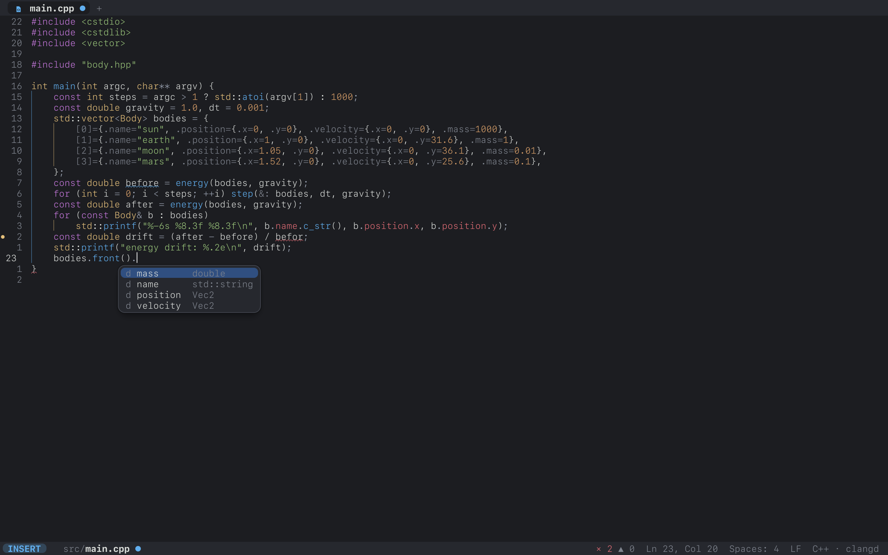

- **Problems** get a wavy underline in the colour of their kind (error,
  warning, information, hint). The line the cursor is on shows its most
  serious problem in words at its end; resting the mouse on an underline, or
  Cmd+I with the cursor there, shows all of it. The Problems tab of the
  [side panel](#side-panel) lists every file's, and F8 / Shift+F8 go
  through them. What the server relates to a problem (its
  `relatedInformation`: clangd's notes, such as the candidate a call did
  not match or where a template was instantiated) shows under it there,
  as a build problem's notes do, and under its message in the hover. A
  light bulb in the line numbers marks a problem the server has a fix for.
- **Completions** appear while typing and narrow as more is typed; the
  letters that matched are picked out, and the selected item's type and
  documentation show beside the list. An item that needs something added
  elsewhere, such as an import, adds it; where the server says where it
  is from (the module an auto-import takes it from), each row says so.
- **Hover**: rest the mouse on a name (or press Cmd+I) for its type and
  documentation, above the line or below it; one taller than the room
  on either side is cut short to the room there is, with "…" at its end.
- **Signature help** appears after `(` and follows the argument being typed.
- **Go to definition** with F12 or Cmd+click, and Ctrl+- to come back. A
  definition in another file opens that file.
- **Peek at the definition** with Option+Shift+F12: the definition in a
  box under the cursor's line (above it, when there is more room there),
  a dozen lines or so across the split; the split under it is dimmed. The
  box is a split of its own: its own tab, cursor and scroll, the text
  editable as anywhere (the same file in both shows each edit in both).
  Esc (in Vim, from Normal mode) closes it and gives the keyboard back;
  so does a click in the split under it, or going to another split. A
  file only the box had open, with changes, goes to a tab of the split
  it was asked from, so that nothing typed is lost.
- **Find references** with Shift+F12 (Vim's `gr`): a list of every place
  the name is used, each with its file, line and text, as Search in files
  shows them. Enter goes to one; afterwards F4 and Shift+F4 go to the next
  and the previous, until another list is made. While clangd knows only
  the open files (its index not built yet, or turned off: see below),
  the list's heading says so: `References (3, open files only)`.
- **Implementations, type definitions and declarations** with Cmd+F12,
  Cmd+Shift+F12 and "Go to the declaration" in the command search (Vim's
  `gy` and `gD`). One place is gone to; several are listed as references
  are. A server that has no declarations gives the definition.
- **The header or the source** with Option+F12: clangd's answer, which it
  knows from what includes what; otherwise a file of the same name beside
  this one, then in an `include`, `src`, `source`, `inc` or `lib` folder
  beside each of the four folders above it, then the one anywhere in the
  project whose path is most like this one's. (For a file on another
  machine, looked for there, on a thread: it opens when it is found.)
- **The file's outline** with Cmd+Option+O (Vim's `gO`): its classes,
  functions and the rest, nested, each with its kind, starting at the one
  the cursor is in. Typing narrows them, moving through them shows each,
  Enter goes there and Esc goes back. Without a server (or one that gives
  no outline) it is the definitions the syntax tree has.
- **Calls and types**: "Show the calls to this function", "Show the calls
  from this function", "Show the supertypes of this type" and "Show the
  subtypes of this type" (the server's call and type hierarchies) list
  them as a tree in the find box, the first level opened. **Right** on a
  row asks for its level (▸ not asked yet, ▾ open), **Left** closes an
  open one or goes to the row it is under, Enter goes to the row's place:
  for a call coming in, the line where it calls; otherwise where the
  function or type is. clangd gives both hierarchies (its calls going out
  from version 20).
- **A symbol in the project** with Cmd+Option+P: the server is asked again
  as the name is typed.
- **The other uses** of the name under the cursor are marked in the file
  once the cursor has stopped on it for a moment (not while there is a
  selection, nor for a name used once).
- **Rename** with F2: the new name is typed in the box, then the box shows
  how many changes that makes in which files, and Enter makes them. A file
  open in a tab is changed there (one undo takes the whole change back)
  and saved, unless it had changes of its own (then it is changed but not
  saved, and the bottom line names it); any other is changed on disk, on
  another machine too. If a file open in a tab has been typed in since the
  changes were found, none is made.
  While clangd knows only the open files, the count of changes ends
  `(open files only)`, and a name declared or defined in a file that is
  not open, or in a header, is not renamed (the bottom line says where):
  open that file, or wait for the index.
- **Formatting** with Option+Shift+F: the whole file, or the lines of the
  selection (Vim's `gq` with a motion, `gqq` for a line, or `gq` on a
  Visual selection). One undo takes it back. With `lsp.format_on_save`
  the file is formatted before it is written.
- **Fixes and refactorings** (code actions) with Option+Enter: a menu of
  what the server offers at the cursor or for the selection, fixes for the
  problems there first. Choosing one makes its change or runs its command.
- **Inlay hints**, with `lsp.inlay_hints`: parameter names before
  arguments and deduced types after names, in the quiet ink, between the
  characters on every line on show but the cursor's.
- **Reference counts**, with `lsp.reference_counts`: after each function,
  method, class and struct on show (as the syntax tree finds them), how
  many references the server finds to it, muted ("3 references", the
  definition itself not counted). They are asked for once typing has
  paused for a moment, each as its definition comes into view, and again
  when the text changes or a file is saved. A click on one lists those
  references, as Find references does. None are shown while clangd knows
  only the open files (they would count those alone), and all come once
  its index is built. (Code lenses as servers send them are not asked
  for: clangd, pyright and ruff send none.)
- **The server's colours** (semantic tokens) over tree-sitter's, where they
  say more: a type, a parameter, a macro, a namespace, a member of an enum.
  A file that tree-sitter does not colour gets the server's alone. Lines
  the preprocessor leaves out (clangd's inactive code, under an `#if` not
  taken) are drawn as comments are, but for a HIP device branch's: clangd
  reads a HIP file as the host's compile sees it, so a branch of a
  conditional any of whose conditions, up to that branch, names
  `__HIP_DEVICE_COMPILE__` or `__CUDA_ARCH__` keeps its colours.

Hints and colours are asked for once the text has stood still a quarter
of a second, for what is on show.

```lua
blit.opt.lsp.format_on_save = true   -- the server formats a file before it is saved (off)
blit.opt.lsp.inlay_hints = true      -- parameter names and deduced types between the characters (off)
blit.opt.lsp.semantic_colors = false -- tree-sitter's colours alone (on)
blit.opt.lsp.highlight_uses = false  -- no marks on the other uses of the name under the cursor (on)
blit.opt.lsp.reference_counts = false -- no counts of references after the definitions (on)
```

The server's colours use the theme's colour for what tree-sitter calls the
same thing (`type`, `variable.parameter`, `function.macro`, `module`,
`constant`, `property`, `function`, `function.method`, `attribute`,
`comment`), unless
the theme has one of its own for the kind, as `lsp.KIND`:

```lua
blit.opt.syntax.styles["lsp.parameter"] = "#d19a66 italic"
blit.opt.themes["rose-pine"].syntax["lsp.macro"] = "#c4a7e7"
```

The kinds are the protocol's: `namespace`, `type`, `class`, `enum`,
`interface`, `struct`, `concept`, `typeParameter`, `parameter`, `property`,
`enumMember`, `function`, `method`, `macro` and `decorator`.

blit knows how to start the servers for the languages it has built in, and
uses the first one for the file's language that it finds on `PATH` or in
`/opt/homebrew/bin`, `/usr/local/bin`, `~/.local/bin`, `~/.cargo/bin` or
`~/go/bin`. `blit --info FILE` says which. Nothing is downloaded or
installed.

| Language | Servers, the first one found is used |
|---|---|
| C, C++, HIP, CUDA (told it as `cuda-cpp`) | `clangd` |
| Python | `pyright`, `basedpyright`, `pylsp` |
| CMake | `neocmakelsp`, `cmake-language-server` |
| JSON | `vscode-json-language-server` |
| TOML | `taplo` |
| YAML | `yaml-language-server` |
| Markdown | `marksman` |
| Shell | `bash-language-server` |
| Lua | `lua-language-server` |
| SystemVerilog, Verilog | `verible-verilog-ls` (verible) |
| GLSL | `glsl_analyzer`, `shader-language-server` |
| WGSL | `wgsl-analyzer`, `shader-language-server` |
| HLSL | `shader-language-server` |
| Slang | `slangd` |
| Devicetree | `dts-lsp` |

Tcl, Metal, assembly, linker scripts and Kconfig have none.

In init.lua a built-in server can be changed or switched off, and a server
for any other language described. That language is named in
`blit.opt.syntax.grammars` (see [Syntax highlighting](#syntax-highlighting)),
which also says which files are that language:

```lua
-- blit.opt.lsp.enabled = false   -- no language servers at all

blit.opt.lsp.servers.clangd = {   -- change a built-in server: only what is listed
  command = { "clangd", "--background-index=false", "--clang-tidy" },
  init_options = '{"fallbackFlags": ["-std=c++23"]}',
}
blit.opt.lsp.servers.marksman = { enabled = false }   -- never start this one

-- A language blit does not have built in: its files, then its server.
blit.opt.syntax.grammars.rust = { extensions = { "rs" } }   -- (add repo and rev for colours too)
blit.opt.lsp.servers["rust-analyzer"] = {
  command = { "rust-analyzer" },
  languages = { "rust" },
  roots = { "Cargo.toml", ".git" },
}
```

The server is told the language by that name, unless its `language_id`
says another (`typescriptreact`, `csharp`, ...): one name for every
language it takes, or a table of them by language, the rest keeping
theirs. Without one, blit's one translation is `bash` to `shellscript`.

```lua
blit.opt.lsp.servers.tsserver = {
  command = { "typescript-language-server", "--stdio" },
  languages = { "typescript", "tsx" },
  language_id = { tsx = "typescriptreact" },   -- or language_id = "typescript" for both
}
```

The project folder handed to the server is the nearest one above the file
that holds one of the server's `roots`; files in two projects get a server
each. clangd is started with its background index on, so that references,
rename and the reference counts reach files that are not open:
`--background-index -j=4`, at clangd's own low priority (the lowest on
Linux) and on four threads at most, whatever the machine; those four
threads are also the ones it answers the open files with. (clangd 15 and
later take `--background-index-priority=background` too, for the lowest
on macOS as well; blit leaves it out because clangd 14, Ubuntu 22.04's and
Debian 12's, stops at a flag it does not know.) While
it indexes, the status bar says how far it has got beside its name
(`clangd (indexing 31/72)`). It keeps the index in `.cache/clangd` in the
project's folder (a `.gitignore` entry for `.cache/` keeps it out of git),
so the next start reads it rather than building it again. A command of
your own replaces those flags; the example above turns the index off.
Until its first indexing has ended, and always with the index off (or in
a project with no compile database, which it cannot index), clangd knows
only the open files: references and rename say `open files only`, the
reference counts are not shown, and a name is not renamed when it is
declared or defined in a file that is not open, or in a header, whose
users clangd cannot see in the files that are not open: let the index
finish (or turn it on) to rename those.

The server's own output goes nowhere; `BLIT_LSP_LOG=/some/file blit ...`
keeps it for when a server misbehaves.

## Working on another machine

blit edits files on another machine over ssh, with the tree, the finder,
git and the language server all working there, and nothing to install on
it first:

```bash
./build/blit ssh://devbox/home/me/project      # a folder there: the working directory
./build/blit ssh://devbox/home/me/notes.txt    # or one file
```

The host is anything `ssh` itself takes (a name from `~/.ssh/config`, or
`user@host`). With no `ssh` on this machine (no `docker`, for a
container), the status bar says so where it would name the host. From
the start screen, `r` (Connect to a server…) opens the box that chooses
a folder at `ssh://`, which lists the hosts `~/.ssh/config` names; one
it does not name is typed (`ssh://me@devbox`) and offered as it is.
Going into a host (Enter or Tab) connects and lists
its home folder, and Enter on its first row ("this folder") works there. In that box, and
in the one that opens files, `ssh://` typed anywhere starts the path again
there, and `~` is the home folder on the other machine.

The first time it connects, blit copies its agent (a small static program,
about 2 MB) to `~/.cache/blit` on that machine and starts it; after that
it is only started. A new build of blit brings a new agent, kept next to
the old one. Everything blit does with those files goes through the agent,
over the one ssh connection:

- **Files** are read and written whole by the agent. The tab appears at
  once, read only and marked *loading*, and fills in when the text has
  come. Saving writes the text on a thread: the status bar says *saving…*
  until it is written there, typing goes on meanwhile (what is typed after
  stays unsaved), and a save that fails says why on the bottom line.
  Closing the tab or quitting while a save is under way waits for it in a
  box: Enter goes on without waiting (the save still lands), Esc stays.
  Nothing on the main thread waits for the network. A big file goes in
  parts, with what else is sent going between them, so that keys typed into
  a terminal there are not held up behind a save. A big file read from
  there comes the same way, in parts of about 1 MB, with a terminal's
  output and the language server's answers going between them: the status
  bar says how much has come (*loading 12 of 40 MB…*, or *fetching
  name 12 of 40 MB…* for a picture, a PDF or another file that is not
  the one in front), and a click there stops it, as closing a file's tab
  does. No message from the agent is larger than a few MB.
  Writing goes through a temporary file and keeps the
  file's permissions. A file changed there (a `git pull` in a terminal on
  that machine) is read again when blit's window comes back to the front,
  as a local one is; under unsaved changes it is left alone, as a local
  one is, and saving asks first. Nothing watches the disk there, so the
  end of something blit ran there (a task or run configuration, the tests,
  a debug session, a notebook cell) stands in for it: a moment later (once
  for all that end meanwhile) the tree's open folders there are read
  again, the open files there are looked at (on a thread) and read again
  if the program wrote them, and git there is asked again. A save also
  looks first whether the file there changed since it was read, and asks
  if it has.
- **The tree** lists folders there; new, rename and delete work as they do
  here (delete moves to the freedesktop Trash of the user the agent runs
  as), on the tree's own thread: the tree shows them when they are done,
  and one that fails says why on the bottom line. A folder there in the
  tree, and in the boxes that open files and folders, says *Listing…*
  until its names come. One that cannot be listed for want of the
  connection says why (*The connection to box was lost*), not that it is
  empty, and the tree keeps what it last knew of its folders meanwhile.
- **Finding files and text** (Cmd+P, Cmd+Shift+F): the agent walks the
  folder and searches the files on that machine, on as many threads as it
  has cores, and sends back the names and the lines found; the files
  themselves never cross the connection. With no connection to it, they
  say why (*The connection to box was lost*), not that nothing matches;
  Search everywhere (Cmd+K) says so above what it can still find (the
  commands and settings), and finds the files there again once the
  connection is back.
- **Git** is that machine's own git, run there. A worktree opened from
  the Git tab, or made by New worktree, is a folder there too.
- **Programs** run there (a terminal, a build, a language server) send
  their output as they write it. Their tabs name the machine (`Terminal:
  box`, `make (box)`, `notes.txt (changes, box)`, `notes.txt (against
  disk, box)`). A terminal, a task, a profiling run and the notebook's
  kernel keep running there while the connection is down (see below); one
  whose program the machine lost meanwhile (it restarted, or its agent
  was stopped) ends with *[connection to box lost]*, not an exit code,
  and one opened while the connection is down says *the connection to box
  was lost*. One that writes faster than blit reads it
  (`yes` in a terminal) is paused there after a few MB rather than filling
  memory, and a language server's error output stays there. The other way
  round too: a program there that does not take what it is sent (a paste
  into a terminal whose program is busy) has a few MB of it held there, and
  the rest waits here.
- **Language servers** are found and run there: the first server for the
  file's language that is on the `PATH` a login shell there would have, and
  the project folder is found there too. The status bar names it with its
  host (`clangd@devbox`).

The status bar starts with the host of the tab in front (a file's own, a
terminal's, none for one on this machine; for a tab with neither, the
working folder's), and says while
it is connecting (and copying the agent, the first time). A connection
that is lost is made again by itself while something is open there (a
tab, the folder) or running there: at once, then after 2, 5, 10, 20, 30
and then every 60 seconds, and at once when blit's window comes back to
the front or the Mac wakes. No more than four connections are begun in 30
seconds, the first one counted, since a firewall's limit on new
connections (ufw's `LIMIT` blocks after six) counts them too. Meanwhile
the status bar says *reconnecting to box…*; click it to try now. A
connection that was refused (the key, a password, a second factor) is not
tried again by itself, so that a login that asks is not asked over and
over: it says so in red, and a click connects again. A save made just
after the connection went waits for it to come back (ten seconds at most),
and goes then. One that could not be made when a file or folder there was
opened (from the command line, say): connected again, it opens then
(unless another file or folder has been opened since, which the status
bar then shows instead).

**The agent outlives the connection.** What ssh runs is only a go-between
(`blit-agent --attach`): the agent itself runs apart from it, in a session
of its own (and on Linux, where systemd would end it with the login, in a
`systemd-run --user` scope of its own), and the go-between finds it by a
socket in `/tmp/blit-UID`, a folder only that user can enter. Where that
folder cannot be made so, the agent is the connection's own, as it was
before, and ends with it. Terminals, tasks (the Build tab, run
configurations, the tests), profiling runs and the notebook's kernel keep
running while the connection is down: what they write is kept there, the
latest 4 MB of each, and when blit connects again they are its own again,
with what they wrote meanwhile shown as if it had come at once (a task's
problems read from it, its paths clicked as usual) and what they write
from then on following. What is typed into such a terminal while the
connection is down goes when it is back. What else blit started there (a
language server, git, the debugger) ends with the connection, as before,
and is started again when needed. Each program's environment is the
connection's, so a `PATH` changed in a login file there is seen by what is
started once connected again.

The agent ends:

- when nothing has been working and no blit has been attached for
  `blit.opt.remote.agent_idle` minutes (10). Working: a task while it
  runs, a profiling run, the kernel while it runs a cell, a terminal while
  a program is in front of its shell (a shell at its prompt is not
  working, and is closed then);
- when blit quits, at once if nothing is working there. If something is,
  quitting asks *2 jobs are running on box: keep them running, or end
  them?*: Keep Running leaves them to their end (the agent then ends as in
  the first case), End Them ends them, Cancel stays;
- on *Stop the agent on the server* (Command search), which asks first
  and ends everything the agent runs there, for every blit (the server of
  the tab in front, or of the folder). It is not made again by itself
  then: the status bar says *agent stopped*, and a click connects again,
  with a new agent;
- with a new build of blit: the new agent is another program, so the old
  one finishes its own jobs and ends as in the first case, while the new
  one takes what is started from then on;
- with the machine;
- and in any case once no blit has been attached for
  `blit.opt.remote.agent_keep` hours (24), what it kept running ended
  first, so that a forgotten run does not keep an hourly machine's bill
  going.

When it ends, or the connection does with the agent of one connection,
it ends what it started there, each program with all that program
started in turn, and kills what has not ended two seconds later.

What it needs:

- ssh. Without a key, what ssh asks (a password, a key's passphrase,
  whether to trust a new host) is asked in a box in blit, the typing
  hidden for secrets; Esc cancels connecting. (A `ControlMaster` in
  `~/.ssh/config` makes connecting again quicker.)
- A Linux machine (x86-64 or ARM64) or a Mac of the same kind as this one.
  The Linux agents are built with GCC 16 in Docker by `src/agent/build.sh`
  and kept in `src/agent/bin/`; blit carries them inside itself (`#embed`).
  The Mac's own is built with blit.
- `/bin/sh`, `uname`, `head` and `mkdir` there, which every such machine has.

### Dev containers

A running container is another machine too: `docker://NAME/path` is a
file or a folder in it, reached through `docker exec` instead of ssh, with
blit's agent copied in the same way (into the container's `$HOME`, so the
first open in a new container takes a moment).

"Open in the dev container" opens the working folder in the container its
`.devcontainer/devcontainer.json` (or `.devcontainer.json`) describes. The
first time, the container is made: its `image`, or one built from its
`build.dockerfile` (`dockerFile`) with `build.context` (`context`; by
default the Dockerfile's folder). The folder is mounted at
`workspaceFolder` (by default `/workspaces/NAME`, or as `workspaceMount`
says), with `containerEnv` and `runArgs`, and `postCreateCommand` is run
in it once. After that the same container is started again if it has
stopped, and opened as it is if it runs. "Rebuild the dev container"
removes it and makes it anew. When docker's daemon is not running, both
say *docker is not running* (and docker's own words), not that the image
did not build. Comments and trailing commas in
devcontainer.json are fine. Nothing else in it (features, forwarded ports,
remoteUser, the lifecycle commands but postCreateCommand) is acted on.

## Profiling

The side panel's **Profile** tab records a program with the system's
profiler and shows where its time went, where its memory came from, or
where its threads waited:

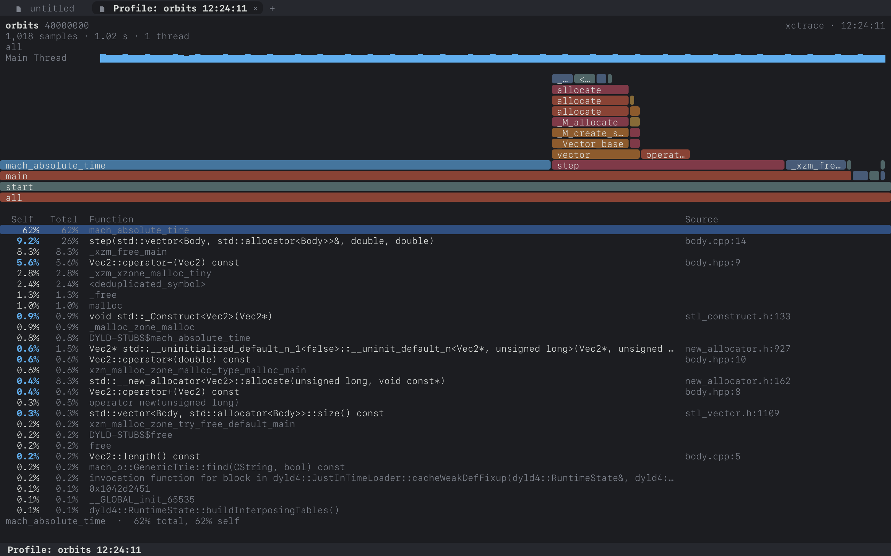

- **perf** on Linux, **xctrace** (Instruments' Time Profiler) on macOS.
  Nothing else is needed; on a Mac, xctrace comes with Xcode.
- **Program**: chosen in the box that opens files. An `ssh://host/path`
  program is recorded on that machine, with that machine's profiler (see
  [Working on another machine](#working-on-another-machine)).
- **Arguments** and **Working directory** (the program's folder unless
  set), then **Record**. **Stop** ends the recording early and keeps what
  was recorded. Where the folder has a build (its run configuration's
  `build`, else the Build tab's Build), Record runs it first, and records
  only if it went well.
- **Call stack**: frame pointers (the default) or DWARF, for perf and
  programs built without frame pointers.
- **Inline performance labels**: on or off.
- **Record**: what the next recording is of, chosen in turn:
  - **Time on the CPU**: samples of what runs (the Time Profiler; perf).
  - **Memory first touched**: every page the program writes for the
    first time, by where it was written, in bytes: its new memory, as the
    system sees it (Instruments' Virtual Memory Trace, its "zero fill"
    faults; perf's page faults, a page each, with transparent huge pages
    off for the program run here). Neither needs Developer Mode on a Mac,
    as Instruments' Allocations would; and what is counted is memory
    used, not every allocation.
  - **Time waiting**: where the threads were blocked, and for how long.
    On a Mac, Instruments' System Call Trace: each system call by how
    long it took (a sleep, a read, a lock's wait). On Linux, perf's
    context switches, each by the time until its thread ran again (a
    thread only preempted is left out); this needs
    `kernel.perf_event_paranoid` at 1 or lower, and blit says so when it
    is not.
  - **Every allocation**: blit's own sampler put in front of the
    program's allocator (`DYLD_INSERT_LIBRARIES` on a Mac, `LD_PRELOAD`
    on Linux; a small library blit carries and writes out when it is
    wanted). It samples allocations by bytes, one about every 64 KB, a
    larger block always, each with its stack, and forgets a sampled block
    that is freed again; when the program ends (or Stop ends it) blit
    names the stacks with `atos` or `addr2line`, source lines and all, and
    opens two profiles: **Allocations**, every allocation by where it was
    made, in bytes, and **Held at the end**, those never freed: the leaks.
    `BLIT_ALLOC_RATE` in the program's environment sets another rate. On
    this machine only, and not for a program the system protects (one in
    `/usr/bin`, or signed to refuse it).

  The command search has "Record a memory profile…" and "Record a
  profile… waiting" beside "Record a profile…". A memory or waiting
  profile is a profile like the others: a flame graph and the functions
  by their share, its tab named "Memory: …" or "Waiting: …", its summary
  in megabytes or seconds waited.

Each recording opens in a tab of its own:

- A **flame graph**: each function above what called it, as wide as its
  share of the time. Click a frame to zoom into it; Esc zooms back out.
  The line at the bottom names the frame under the mouse with its total
  and self time.
- The **functions**, by self time, with total time and source line. Up
  and Down choose one (its frames light up in the graph); Enter or a
  double click opens its source.
- **Bottom-up**: `b` turns the graph over: the functions the time was
  spent in at the bottom, each as wide as its own time, with what called
  them above, out to the outermost caller. `b` again goes back.
- **Callers and callees**: `c` shows, in place of the list, the chosen
  function's callers and the functions it calls, each with the share it
  had there; Enter on one (or a double click) makes it the function
  chosen. `c` or Esc goes back to the list.
- **The timeline**, under the heading: a lane for each of the heaviest
  threads (six at most) across the time recorded, how much each ran in
  each stretch as a bar, a dot where it did not. Drag across it to choose
  a stretch: the graph and the list are then of that stretch alone (the
  heading says which); a click or Esc gives all of it back.
- **Comparing**: "Compare with a profile…" in a profile's tab chooses
  another of those made or opened as the earlier, and opens the two
  compared. The later's flame graph has each frame coloured by how its
  share of the time moved since: red where it grew, blue where it shrank,
  the stronger the more, grey where it stayed about the same (a path the
  earlier had not counts as grown). In place of the list, each function's
  own share before and after and the change in points, those that moved
  most first, with any the later no longer has.
- **Threads.** The Profile tab lists the threads of the profile shown
  (when it has more than one), the heaviest first, with each one's share:
  Enter on one shows its own flame graph and its own functions in the
  profile's tab (the heading says which, and its share); *All threads*
  shows them all together again. Thread names are the program's own
  (`pthread_setname_np`), or what the profiler calls them.

Each profile is **kept** beside the project, in `.blit/profiles` in the
folder being worked in (or the program's folder when none is), as
`program-date-time.blitprofile`. The Profile tab lists those it finds there
under the ones made since blit started, and Enter opens one again in its
tab, threads and source labels and all. (Add `.blit/` to a project's
`.gitignore` to keep them out of git.)

The profile shown also labels the code: a function that took time gets
`◆ 52% total, 48% self` after its definition, and a line that took more
than half a percent gets `● 52%`. Labels need debug information (build
with `-g`); without it the tab still shows the functions.

perf records user-space call stacks only (`--user-callchains`), which
works at the default `perf_event_paranoid` of 2 without root.

## Terminal

**Ctrl+\`** opens a terminal in a split along the bottom (the one the
[Build tab](#building)'s output uses), in the folder being worked in, with
the keyboard; its first line says "Ctrl+\` back to the file". Pressed there
again, it gives the keyboard back to the text and the split goes out of the
way, its programs still running; the next press brings it back as it was,
the same terminal in it. With the split on show and the keyboard in the
text, Ctrl+\` gives the terminal the keyboard. **Ctrl+Shift+\`** opens
another terminal there. Each is a tab like a file's: reorder it, close it,
or drag it into a split of its own.

- Closing a terminal whose program is still running asks first ("'npm run
  dev' is still running in this terminal. Close it?"), and so does quitting
  ("2 programs are still running in terminals."), counting the hidden ones.
  A shell at its prompt is closed without asking. What a shell on another
  machine runs cannot be seen from here, so only a build's command counts
  there.
- The shell is your login shell. When the folder is on another machine
  (`ssh://host/...`), the terminal runs there, through blit's agent, on
  the same connection as the files; it connects by itself if it has to.
  "New terminal on this machine" opens one here instead, in the folder on
  this machine opened last (or the home folder).
- Programs see an xterm (`TERM=xterm-256color`, 24-bit colour): full-screen
  programs (vim, htop, less) work, and the tab's size follows the split.
  `LANG` is set to UTF-8 when nothing sets it.
- Keys go to the program, Vim's keys included. The editor keeps its Cmd
  shortcuts (switching tabs, closing one), except: **Cmd+C** copies what is
  selected, **Cmd+V** pastes, **Cmd+K** clears the history. (On Linux:
  Ctrl+Shift+C and Ctrl+Shift+V.)
- **Cmd+F** (or Find in this file from the command search; on Linux Ctrl+F
  is the program's) finds in the lines the terminal keeps, its history and
  its screen, with the box that [finds in a file](#finding-files-and-text),
  its keys and its rules for case (with Vim's modes on too): the match
  nearest the bottom of the view is chosen first, the field says which of
  how many it is, Enter or Down chooses the next and Shift+Enter or Up the
  one before. Each match is lit, the one chosen as what is selected, and the
  view goes back through the history to show it. A line the tab's width
  wrapped is found whole. What is typed in the box is the box's, never the
  program's; Esc shuts it, and the view is the screen again. The lines are
  looked at as they are when a key is typed in the box: what the program
  writes meanwhile is found at the next key.
- **Open the terminal's lines as text** (in the command search) opens what
  the terminal in front (else one on show) keeps, as it is then, in a tab
  of its own named after it ("Terminal (lines)"): a tab for reading, where
  Vim's keys move, search (`/`) and yank (`y`) as in a file, and changes
  are refused as in any tab for reading. It does not follow what the
  terminal writes after.
- Drag to select; double-click a word, triple-click a line; middle or
  right click pastes.
- A program that asks for the mouse (htop, less with `--mouse`, vim with
  `mouse=a`, tmux) gets it: clicks, drags and the wheel, as xterm sends
  them (modes 1000, 1002 and 1003, told in SGR's form when it asks, 1006).
  With **Shift** held, the mouse is the terminal's own again: dragging
  selects.
- The wheel and **Shift+PageUp/PageDown** scroll back through the last
  10,000 lines. In a full-screen program the wheel is its arrow keys.
- Pictures: sixel (`img2sixel`, `chafa -f sixel`) and the kitty graphics
  protocol (`kitten icat`, `chafa -f kitty`, `timg -pk`): RGB, RGBA or PNG,
  compressed or not, sent within the escape codes (not as files). Each is
  drawn where the cursor was, a pixel to a pixel of the screen (or filling
  the cells it asks for), and goes up with the text into the history and
  off its top with its line; clearing the screen takes those on it away. A
  program can ask the size of a cell in pixels (`CSI 16 t`), and is told it
  with the tab's size.
- A line keeps being one line when the tab's width changes: what was
  wrapped is wrapped again at the new width (in the history too), and a
  narrower tab wraps long lines rather than cutting them. The row at the top
  of the tab stays there, unless the cursor's line would go below the tab.
- The tab is named after the program's title (or the shell's folder), and
  closes when the shell exits; if it exits with an error, the tab stays
  and says so.

### The project's Python

Each project has one Python, which everything that runs Python takes: the
Python console, the debugger's debugpy, a notebook's kernel, pytest and
coverage.py in the Tests tab, and the language server (pyright's and
basedpyright's `python.pythonPath`, pylsp's jedi environment; a setting of
your own for the server that names one wins). A folder in the project
with its own `pyproject.toml`, `.venv`, `venv` or `uv.lock` is a
subproject with a Python of its own: a file takes the nearest one at or
above its folder. The Python is, first to last:

- the one chosen for the project (below);
- `blit.opt.python.interpreter`, for every project: a path (`~/` for the
  home folder; one with a `/` that is not whole, such as
  `env/bin/python`, in the project's folder) or a command (`python3.12`,
  `uv run python`);
- the folder's `.venv`'s (or `venv`'s), IPython for the console where it
  has it;
- `uv run python` for a uv project (a `uv.lock`, or a `pyproject.toml`
  that names `uv_build` or `[tool.uv]`, as the Build tab knows one);
- the active conda environment's (`$CONDA_PREFIX`);
- else `python3`.

It is found on a thread, by asking it its version and where it is (for a
folder on another machine, there, through blit's agent), and kept: it is
looked for again when a venv is made or taken away in the folder (as the
side panel hears of it), when blit comes to the front (it is asked again
only if it is another one), and when asked: "Find the project's Python
again". Nothing waits for it: what needs it first (the console, a
debugging session, a kernel) starts once it is known, a moment later.

For a Python file, the status bar names it, "Python 3.12 (.venv)" (with
what chose it: `.venv`, `venv`, `uv`, `conda NAME`, `pinned`, `chosen`,
or nothing for the PATH's), or, where what would run it is not installed,
that (`python3 is not installed on this Mac`, `uv is not installed on
lab` for a uv project); a click on it, or "Choose the project's
Python…", lists the Pythons there are: the project's venvs (any folder
in it with a `pyvenv.cfg`), uv's for a uv project and those uv has
installed, conda's (the active environment's base and its `envs`),
pyenv's and those on the PATH. The one chosen is the project's (or the
subproject's) from then on, kept in its session; Automatic, the first
row, gives the choice back.

### The Python console

"Open the Python console" starts the [project's
Python](#the-projects-python) in the terminals' split, as a tab named
Python (IPython, where a venv has it), in the project's folder (the
subproject's, for a Python file in front that is in one). Once started it
is used again, until it ends.

"Send the lines to the Python console" sends the lines selected (in Vim,
Visual mode's), or the cursor's line, after which the cursor goes to the
next line; the console is started if it is not. The lines go as a
bracketed paste, which Python's own prompt (from 3.13) and IPython take
whole, so a block keeps its indentation and the blank lines in it. Each
Return after the paste is sent a moment later, in a read of its own (one
in the same read as the paste is taken as part of it): one runs a line,
and for more than one a second is sent if the prompt then asks for more
(a continuation prompt with nothing on it: Python's own prompt, or a
block that ends indented) once the console has answered the first (for a
few seconds at most: one on another machine answers a round trip later),
never leaving an empty prompt after a block IPython ran on the first. Lines sent before the console has started
wait for it. A Python that never asks for pastes is sent the lines one by
one after five seconds, without their blank lines.

Neither has a key of its own; map them in init.lua, for example
`blit.map("nx", "<leader>r", function() blit.run("Send the lines to the Python console") end)`.

## Debugging

**F9** puts a breakpoint on the cursor's line (a red dot in the gutter),
or takes it away; so does a click in the gutter left of a line's number,
where the dot goes (on a test's mark or a fold's, the mark's own click).
The breakpoints and the expressions watched are kept in the folder's
session. **F5** starts debugging: the first time it asks which
program, and the side panel's **Debug** tab (Cmd+Shift+D) keeps it, with
its arguments and working directory. Where the folder has a build (the
[run configuration](#run-configurations)'s `build`, else the Build tab's
Build, or make's `make`), F5 runs it first, in the output terminal, and
debugs only if it went well (one that fails says so, and nothing starts).

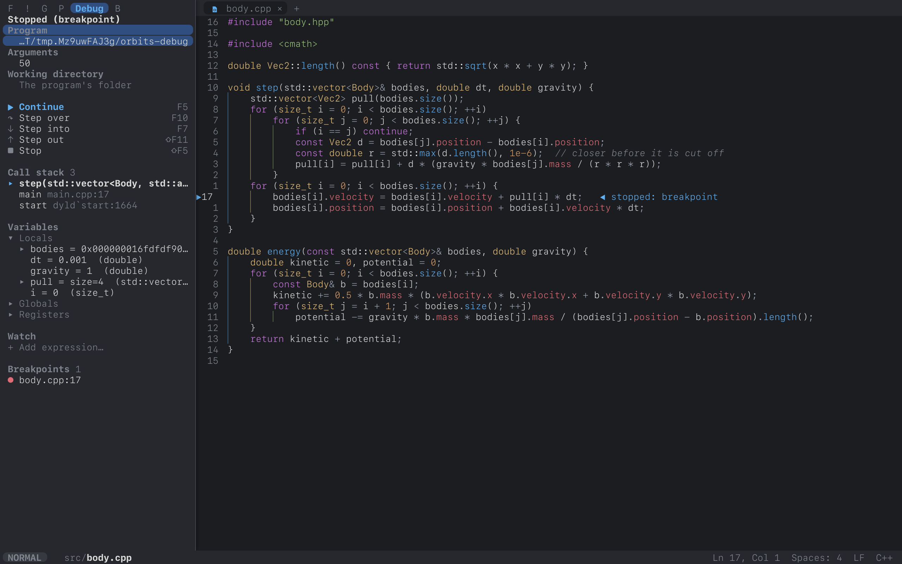

| | |
|---|---|
| Start, or continue | F5 |
| Stop | Shift+F5 |
| Restart | Cmd+Shift+F5 |
| Pause | F6 |
| Step over / into / out | F10 / F7 or F11 / Shift+F11 (F11 is macOS's Show Desktop unless that is turned off) |
| Breakpoint on this line, or not | F9 |
| A breakpoint's condition, hit count and log message | Shift+F9 |
| A breakpoint disabled, or enabled again | Space on it in the Debug tab, Alt+click on its dot |
| Run to the cursor | Ctrl+F10 |
| Evaluate an expression where it stopped (Tab completes what is typed) | Cmd+Shift+Y |
| The Debug tab | Cmd+Shift+D |
| The debug console (and from there, back to the file) | Cmd+Option+Y |
| In the Debug tab, on a variable: set its value / watch its writes / its memory | F2 / W / M |

Where it stops, the line has an arrow in the gutter and says why, and its
file comes to the front. The Debug tab shows the threads (when there is
more than one: Enter on one shows its call stack, and the steps step it),
the call stack (Enter on a frame shows its source and its variables), the
variables (Right or Enter opens one a level, Left shuts it), the
expressions watched, the breakpoints (Enter goes to one, Space disables
it, Delete takes it away), and what the program printed.

- **Restart** (Cmd+Shift+F5, or the Debug tab's Restart) starts the
  program again as the session began, built again first as F5 builds (a
  build that fails leaves the session as it was): in the same session,
  its breakpoints and watches kept, where the debugger can restart one
  (lldb-dap), else the session is ended and begun again.
- **A program that reads what is typed to it** (C's `stdin`, `scanf`,
  `getchar`, C++'s `std::cin`, Python's `input()`) is given a terminal tab
  in the terminals' split: its input and output are the tab's, and what
  is typed there is the program's (the keyboard stays where it was: click
  the tab to type). Other programs' output is in the Debug tab, as it was.
  A run configuration's `debug.console` says which (`"terminal"`,
  `"debug"`). With lldb-dap or gdb on this machine the program is started
  on the tab's terminal itself (lldb's `target.input-path` and the like,
  gdb's `inferior-tty`); debugpy, and a debugger on another machine, are
  asked to run it in one and ask blit for the tab (`runInTerminal`). Once
  the session is over the tab says it is done.
- **A condition and a hit count.** Shift+F9 asks for a breakpoint's
  condition (`x == 2`: it stops only where that holds), then its hit count
  (`3`: it stops the third time it gets there), each as it is now; nothing
  typed in either is a plain breakpoint. On the cursor's line (which gets
  a breakpoint if it has none), or, with the Debug tab's keyboard on one,
  on that breakpoint. One that waits for something is a diamond in the
  gutter, and the tab says what it waits for (`count.c:8 if x == 2, hit 3`).
- **What the debugger says of them.** A breakpoint it has not verified
  (in a library not loaded yet, or on a line it has no code for) is
  hollow in the gutter and in the Debug tab, which says *not verified*
  and why, where the debugger says; it fills in when the debugger says it
  is (a library loaded as the program runs). One the debugger puts on
  another line (a blank line's goes on the next that has code) is on
  that line from then on, kept there, and the tab says *moved from line
  N*; one moved onto a line that has one is one with it.
- **Disabled.** Space on a breakpoint in the Debug tab, Alt and a click on
  its dot, or *Enable or disable the breakpoint* (the cursor's line's)
  disables it: it stays, quiet in the gutter and *disabled* in the tab,
  and is not given to the debugger, until it is enabled the same way.
- **Watch.** *Add expression…* in the Debug tab keeps an expression there,
  evaluated each time the program stops, in the frame shown (and again
  when another frame is chosen); one that cannot be says why. Enter on one
  changes it (nothing typed takes it away), Delete takes it away.
- **Logpoints.** Shift+F9's third question is a message: a breakpoint
  with one does not stop, it says the message (each `{expression}` in it
  filled in with its value) in what the program printed. A diamond in a
  diamond in the gutter.
- **A function's breakpoint.** *Break at a function…* stops where the
  function named starts, wherever it is; the Debug tab lists them under
  *Function breakpoints* (Enter changes the name, Delete takes one away).
- **Setting a value.** F2 on a variable in the Debug tab asks for its new
  value; the program goes on with it, and the watches are evaluated again.
- **Watching a variable's writes.** W on a variable stops the program where
  it is next written, wherever that is (W again, or Delete under *Writes
  watched*, no longer). The machine has only a few of these (four on most).
- **Run to the cursor** (Ctrl+F10) goes on to the cursor's line and stops
  there, the breakpoints as they were. *Jump to the cursor's line* moves
  the program there without running what is between, where the debugger
  can (gdb can; Apple's `lldb-dap` cannot, and says so).
- **Attaching and core files.** *Attach the debugger to a process…* lists
  your processes, narrowed by name as you type; it stops at the
  breakpoints as one started with F5 would, and Shift+F5 lets the process
  go on. *Debug a core file…* asks for the program, then the core: it shows
  where it stopped, the stack and the variables, as a stop would.
- **The disassembly.** *Show the disassembly* opens a tab of the
  instructions around where it stopped, under headings of the source lines
  they are of (the function, the file and line, and its text), the
  instruction it stopped at marked as the line is. There F10 and F11 step
  an instruction at a time, and F9 puts a breakpoint at an instruction (the
  Debug tab lists them under *Instruction breakpoints*). It follows the
  frame chosen.
- **Memory.** *Show memory at…* opens a page of memory (4 KB) where an
  expression points (`&total`, `p`, `0x16fdfe0c8`), the cursor on that
  byte; M on a variable in the Debug tab opens where the variable is. Each
  line is sixteen bytes, as numbers and as characters, `??` where it cannot
  be read. It is read again at each stop, what changed since in the accent.
  *Write to memory at the cursor…* writes bytes typed as hex (`2a 00`)
  where the cursor is; *Next page of memory* and *Previous page of memory*
  turn the pages.
- **The values in the code.** While it is stopped, each line of the
  function it stopped in, from its start to where it stopped, has after it
  the values of the variables it names (those of the frame shown; not in a
  comment or a string, not a member's), quietly. `debug.inline_values =
  false` leaves them out.
- **Several sessions at once.** "Start another debugging session" (or
  attaching to a process, or opening a core file, while a session is
  under way) keeps the session under way aside and starts another. The
  Debug tab lists them under *Sessions*: Enter shows one as it was left,
  Delete stops one. The breakpoints are every session's; one that stops
  while another is shown comes to the front, and one that ends gives its
  place to another. Each has its own threads, stack, variables, output,
  writes watched and breakpoints at instructions.
- **Completing what is evaluated.** Tab in the Evaluate box completes
  what is typed as the debugger would: one answer goes in, several that
  share more than is typed that much, else a list of them to choose from.
  (lldb-dap and debugpy complete; gdb does not.)
- **The debug console.** *Show the debug console* (Cmd+Option+Y) opens a
  tab in the terminals' split (Ctrl+` hides it and brings it back with
  them): what the program and the debugger print (the program's errors in
  red, the debugger's own word quieter: what it says of itself before the
  program runs, as lldb-dap's greeting, is the console's alone, not in the
  Debug tab's output), and at the bottom a line for the debugger's own
  command line. Enter sends it, in the frame shown (lldb-dap takes an
  expression or one of lldb's commands, gdb its commands alone, so an
  expression goes with `print`, debugpy Python), and the answer comes
  under it; a value with members is opened a level, and Enter on a member,
  from the lines above, opens it further or shuts it. Up and Down go
  through the lines typed before (kept in the folder's session), Tab
  completes as the debugger would (lldb's commands too), Cmd+F finds in
  the lines. A line that starts `monitor` goes to the gdb server as it is
  (OpenOCD's or a probe's own commands: `monitor reset halt`): gdb passes
  it on, and to lldb-dap it goes as lldb's
  `process plugin packet monitor`. The function keys stay the debugger's:
  F10 there steps, the source showing in the split above. With Vim's keys,
  Esc leaves the line for the lines above (Vim's keys move over them), and
  i or a comes back to it.
- **Exceptions.** The Debug tab lists the exceptions the debugger can stop
  at under *Exceptions* (lldb-dap: C++'s, Objective-C's and Swift's throws
  and catches; gdb: Ada's assertions and exceptions, C++'s thrown,
  re-thrown and caught; debugpy: those raised, those uncaught, and those
  that reach a library's code): Enter turns one on or off, and Shift+F9
  gives it a condition where the debugger takes one (lldb-dap, gdb). Each
  is as the debugger has it (debugpy: uncaught on, raised off) until it is
  changed; those changed are kept in the folder's session. Stopped at an
  exception, the Debug tab says what it is (at one of these, its name, at
  gdb's too, which calls its stop a breakpoint) and what the debugger says
  of it (its message, its stack trace, the exceptions it was raised while
  handling), and the line it stopped on says so after it.
- **The standard library's containers** read as they should: a vector's
  or a map's size, its elements under it, a string as text (lldb's
  formatters for libc++ and libstdc++, gdb's printers as the system
  installs them). With lldb, a value whose type has no summary of its own
  gets one made from its members (a map's entries read `{first:"a",
  second:1}`); with gdb, a map's entries read `["a"] = 1`.
- **Breakpoints move with their lines** as the file is edited, as marks
  do: a line put above one takes it down, lines taken away above it take it
  up, and one whose own line is taken away stays where that line was. A
  session under way keeps the lines it was given (the program running is
  the one built from the file as it was); the next start, or F9 in the file,
  gives it the new ones.

The debugger is the one the machine has: Xcode's `lldb-dap` on a Mac
(full Xcode), `lldb-dap` on Linux where there is one, else gdb 14 or
later (`gdb -i dap`: it speaks the Debug Adapter Protocol itself; a
run configuration's `debug.adapter` asks for one or the other, below),
and debugpy for a `.py` program, run
with the [project's Python](#the-projects-python) (the program's
folder's: its project's or subproject's), which runs the program too.
Where none is installed on the program's machine, starting says which
(`No debugger: neither lldb-dap nor gdb is installed on this Mac`, or
`arm-none-eabi-gdb is not installed on lab` for a `debug.adapter` of
another, or the Python or uv a `.py` program's adapter needs).
Where that Python has no debugpy of its own, blit fetches its own copy
the first time one is needed (debugpy's wheel from PyPI, at the version
blit names, checked against its SHA-256, its Python files only) into
blit's data folder (`~/.local/share/blit/debugpy/VERSION`), and runs
debugpy from there; for a program on another machine, the wheel is
copied there and unpacked in blit's cache there
(`~/.cache/blit/debugpy/VERSION`). Where the copy cannot be had (no
network), starting says why. "Debug the test at the cursor", the Tests
tab's **d** and Option-click on a test's mark debug a pytest test this
way too: debugpy runs pytest on it in the project's folder
(`python -m pytest path::Class::test -x -q`; a parametrised test at the
cursor, all its cases, as running it there does), and it stops at
breakpoints in the test and in the code it calls. A program with HIP's code for the GPU in it is debugged with
ROCm's `rocgdb`, where there is one (on the PATH or in
`/opt/rocm/bin`): a breakpoint in a kernel stops a GPU wave there, with the
kernel's frame and variables. The GPU's waves, named by their work-group
and number ("GPU wave (0,0,0)/0"), are one row under the program's own
threads, *GPU waves* and how many (there may be thousands): Right or Enter
lists them below the variables (Left shuts the list), and the wave that
stopped, and the one whose stack is shown, are under that row all the
same. A program on another machine (`ssh://host/...`) is
debugged there, with that machine's debugger, its source opened from
there; F5 waits for nothing there: the Debug tab says *Starting on host…*,
and F5 again (or Shift+F5) calls it off. Stopping never waits for the
debugger to end. Build what is debugged with `-g` (and `-O0` to step
through it as written).

## Building

The side panel's **Build** tab (Cmd+Shift+U) lists what the working
folder builds with, found from its files: CMake (its presets, and each
folder it was configured in: `build*`, `cmake-build-*`, `out`), Meson,
make (with its targets), autotools and Ninja for C, C++ and HIP, and uv
or pip for Python (its `.venv`, `pytest` when there are tests, `python -m`
for a package with a `__main__`). Other languages' build systems are
init.lua's to add, with `blit.build.add` (below). A build preset whose
folder has not been configured yet (a fresh clone) configures it first
(`cmake --preset debug && cmake --build --preset debug`). Its folder may
be outside the project (an absolute `binaryDir`), and its configure
preset may be the other presets file's; one whose `binaryDir` has a macro
blit cannot know (`$env{}`, `$penv{}`) is built alone.

Each task is a command run by the shell. Enter runs the one chosen; Space
makes it the one the **Run button** at the window's top right runs
(`▶ Build (debug)`, or `■ Stop` while it runs), and **Cmd+Shift+B** runs
that one from anywhere. The output is in a terminal tab in the
[terminals' split](#terminal) below the text (brought back if Ctrl+\` hid
it), used again by the next run (a run still going there is ended), and the
keyboard stays where it was. When it ends the tab says how, and
the folder is looked at again (a configure makes a build folder, whose
tasks then show). Each task's row says how its last run went ("running…",
"done", "failed: exited with code 2"), with what its output said it came
to (below: "done · 12 passed, 1 failed, 2 skipped").

**Stop** (`■ Stop`, or Cmd+.) ends the run's program as Ctrl+C in a
terminal would (a tool's own way to stop, which lets go of a probe), and
a second Stop kills one that will not end. Its tab stays, with what it
wrote and the problems found in it, and says `[stopped after 4.2 s]`;
its row says "stopped", and a run that was stopped is not a failure.

When a run ends while blit is behind another window, the system says so
in a notification: the task's name, and "Done in 3.2 s" or "Failed with
exit code 2 after 3.2 s · 3 errors". On macOS blit.app's own (the first
one asks for leave to show them, as the system does); a blit that is no
app bundle (one run from its build folder) hands it to `osascript`. On
Linux freedesktop's Notify over D-Bus, through `gdbus` (or else
`notify-send`), found on PATH. Where there is none of those, blit says
so once, in its own window. `blit.opt.build.notify = false` stops
them.

What the build prints is read for problems as it comes, on the terminal's
own reading thread (nothing per frame): GCC's and Clang's
`path:line:col: error: message` (and `warning`, `fatal error`; Clang's
message wrapped to the terminal's width onto the lines under it is
joined, but not the source line above the carets, which without line
numbers looks the same), CMake's
`CMake Error at path:line (command):` with the paragraph under it (one in
a file outside the project, as a module of CMake's own, is placed at the
first frame of its `Call Stack` in the project, saying where it was), make's
`path:line: *** message`, Python's tracebacks (the innermost frame in a
file of the program's own, with the exception) and its warnings, and
pytest's `path.py:line: AssertionError`, and the sanitizers' reports
(below). Colours are no matter, nor
Ninja's progress line written over itself; the same problem twice (a
header's, from each file that includes it) is one. A relative path is
taken from the folder the task runs in, or one make or Ninja says it
entered, or one `make -C` was told to go into: the one the file is in.
They fill the **Build** section of the side panel's Problems tab (above),
F8 goes through them, the status bar counts them, and the Run button says
how many: `▶ Build (debug) · 3 errors` (warnings, when there are no
errors). A run that failed with no error in its output says so instead:
`▶ make · failed (exit 2)` on the Run button (with its warnings' count,
if it has some), "make failed with exit code 2: no problem found in its
output" in the Problems tab and from F8, which then has nowhere to go;
never "No problems" under a red button. One whose program the shell could
not find (its exit code 127) names it instead: `▶ Build · failed (cmake is
not installed)`, "Build failed: cmake is not installed on this Mac" (or on
the host the folder is on) in the Problems tab, from F8 and at the end of
its tab, and "cmake is not installed" on its row. In the text they are marked as
the language server's problems are, in the split with the keyboard: a
wavy underline in the colour of the kind, from the column the tool gave
over the word there (the line's text, where it gave no column), and the
cursor's line's first error in words after it (the server's, where the
server has one on that line; `blit.opt.lsp.inline_diagnostics = false`
leaves the words out). A mark moves with its line as lines are put in or
taken out above it, and goes once its own line is changed: what the build
said of it no longer stands. The next run starts with none, in the tab
and in the text. A compiler's notes (`note:`), the include chain before
its problem (`In file included from c.h:2`, GCC's lines of `from` under
it, Clang's a line each) and GCC's instantiation context (`In
instantiation of ...`, `required from here`) are that problem's notes, in
the Problems tab under it (where a chain comes just before a note, it is
the note's, and so the problem's). Validation messages (below) with no
place are listed under **No file**; one whose file is nowhere (Metal's
run-time `program_source` with no `.metal` file to be, below) is listed
and counted, and F8 says it without going anywhere. **Cmd+click**
on a `path:line` (or `path:line:col`, or Python's `File "path", line N`)
in any terminal tab opens the file there, in a split with text: a
relative path from the shell's folder, the folders the build went into,
or the one the terminal started in. A file that is not there is said so
("No file NAME"; on another machine, when its answer comes) and opens no
tab. Cmd+R in the
tab looks again by hand; with nothing found the tab says so, and how to
add a system (below). On another
machine (`ssh://`) the folder is looked at, and the tasks run, there.

A sanitizer's report, in a build's output or a run's, is a problem too:
AddressSanitizer's, LeakSanitizer's, ThreadSanitizer's and
MemorySanitizer's (`==4242==ERROR: AddressSanitizer: heap-buffer-overflow`)
at the first frame of its stack in the program's own files (not the
system's or the compiler's), saying what was wrong and what was read or
written ("READ of size 4"); each leak of a leak report is one of its own.
Every frame of its stacks is a note of it, under the line over each stack
("READ of size 4 thread T0", "allocated by thread T0 here"): a
ThreadSanitizer data race is one problem, with both accesses' stacks (and
where each thread was made). UndefinedBehaviorSanitizer's `path:line:col: runtime error:` lines are
read as they come. Each frame of a stack is a `path:line` to Cmd+click. A
bare file name in none of the folders tried (macOS's ASan symbolises with
`atos`, into `ring.cpp:16`) is the project's one file of that name, from
a list of the folder's files made on the reading thread the first time
one is needed (none when several have it).

A program a task, a run configuration or a terminal's build runs may
print **validation** messages, and each is a problem too. Vulkan's (on
Linux) come from the Khronos validation layer
(`VK_INSTANCE_LAYERS=VK_LAYER_KHRONOS_validation`), as it prints them
(`Validation Error: [ VUID-vkCmdDraw-None-08606 ] ...` with the message on
the lines under it; before layer 1.3.290 all on one line; after a
messenger's own words, as `validation layer: `) or as JSON
(`VK_LAYER_MESSAGE_FORMAT_JSON=1`). An error is an error, a warning or a
performance warning a warning; information is left out. The layer knows
the call, not where in the program it was made, so a Vulkan message has
no place in a file: it is listed under **No file**, without a line. GPU-assisted
validation (`VK_LAYER_GPUAV_ENABLE=1`) names the shader's own line when
the shader was built with debug info (`glslangValidator -g`): the problem
is at that line. Metal's (on the Mac) are its API validation's
(`MTL_DEBUG_LAYER=1`: the failed assertion, or with
`MTL_DEBUG_LAYER_ERROR_MODE=nslog` each logged one) and its shader
validation's (`MTL_SHADER_VALIDATION=1` with
`MTL_SHADER_VALIDATION_REPORT_TO_STDERR=1`, at the first frame of the GPU
stack). The same message again, as one said every frame (its objects'
handles aside), is the one row, its count at the row's end (`×120`), and
counted once on the Run button. Enter (or a click) on a Vulkan message's row
shows the spec's own statement of its VUID in a read-only tab: the VUID,
its command, the statement, and where it was read from. **Show the Vulkan
spec's statement of the picked problem's VUID** does the same for the row
picked, one with a place (a shader's line, where Enter goes) included.
Statements are read from Vulkan-Headers' `registry/validusage.json`: the
system's (`/usr/share/vulkan/registry`, `/usr/local` or `/opt/homebrew`'s,
`$VULKAN_SDK`'s, the newest `~/VulkanSDK`'s), else a copy of Vulkan-Headers'
own (tag v1.4.363) fetched once, the first time one is asked for, into
blit's data folder (`~/.local/share/blit/vulkan`); `BLIT_VALIDUSAGE` names
another file. It is indexed once, on a thread of its own, and statements
read from it there. Metal's messages have no such file: their row is what
there is.

The other tools a build runs are read too, each problem with the tool's
own code for it where it gives one (shown in brackets) and the other
places it names as notes:

- **Linkers and assemblers.** GNU ld's `undefined reference`, `multiple
  definition` (the first definition a note) and its other errors and
  warnings, at the source line the debug information names, else the
  object's source (CMake's `CMakeFiles/app.dir/src/a.c.o` is `src/a.c`; a
  bare `a.c` the project's one file of that name) with the function; macOS's
  ld's `Undefined symbols` and `duplicate symbol` listings, a problem for
  each symbol. collect2's `ld returned 1 exit status` and Clang's `linker
  command failed` are a problem only when no line of the linker's was. GNU
  as's `a.s:5: Error:` and `Warning:`.
- **HDL tools.** Verilator's `%Warning-WIDTH: a.v:3:5:` (code `WIDTH`; its
  `In instance` and other locations notes), Yosys's `a.v:3: ERROR:` and
  `Warning:`, Icarus's `syntax error`, `sorry:` and `error:`, vvp's
  `ERROR:`, `WARNING:` and `FATAL: a.v:12:` (from `$error`, `$warning`,
  `$fatal`), verible-verilog-lint's lines (its rule the code), Vivado's
  `ERROR: [Synth 8-439] message [path:line]` and `CRITICAL WARNING` (as
  warnings), nextpnr's `ERROR:` and `Warning:` (an `(on line 3)` at that line
  of the `.pcf` its command named).
- **Shader compilers.** glslang's `ERROR: a.frag:12: 'x' : message`, qsb's
  (glslang's, with no file: the one its command named), spirv-val's `error:
  line 12:` (its VUID the code, the instruction a note, the module its
  command named), Metal's run-time `program_source:12:5:` (the `.metal`
  file a command named, or the project's one `.metal` file), slangc's
  `a.slang(12): error 30015:`, DXC's and FXC's MSVC form `a.hlsl(12,5):
  error X3000:`, naga's diagrams (`┌─ a.wgsl:12:5` under the message, its `=`
  lines notes) and tint's `a.wgsl:12:5 error:` with its notes.
- **Python's tools.** Ruff's concise, full and pylint forms (its rules as
  warnings, `invalid-syntax` as errors), `ruff format --check`, pyright's
  `path:line:col - error:` (its rule the code, a message's lines joined) and
  pre-commit's failed hooks: the files a fixing hook fixed, and the
  `path:line:` lines a hook printed.

What names no file at all is listed under the tool's name (`ld`, `yosys`,
`nextpnr`, `vivado`): ld's `cannot find -lfoo`, Yosys's `ERROR:` with no
place (taken only after Yosys's banner or command, as a bare `ERROR:` line
is anybody's). Yosys's warnings that name no place are not listed. The
commands named are those make echoes, or Ninja shows under `FAILED:`.

A test framework's output is read too, from a task that runs a test
program: GoogleTest's (`path:line: Failure` and the expectation under it),
Catch2's (v3: `path:line: FAILED:` with the expression and its expansion),
doctest's (`path:line: ERROR: CHECK( x ) is NOT correct!` with its values,
and `path(line):` as it writes it for MSVC) and Unity's
(`path:line:test:FAIL: message`). Each failure is a problem at its place,
the test's name and what its framework said under it in the message
("Math.Breaks: Expected equality of these values: add(1, 2); Which is: 3;
4"). Each test's result goes to the [Tests tab](#tests) as it comes, and
their count (GoogleTest's `[  PASSED  ] 1 test.`, Catch2's and doctest's
`test cases: 3 | 1 passed | 1 failed | 1 skipped`, Unity's `3 Tests 1
Failures 1 Ignored`; CTest's own count when it ran them, theirs not added
to it) is what the run came to: "1 passed, 1 failed, 1 skipped".

So are sizes and timing. size's table (`text data bss dec hex filename`,
GNU's or arm-none-eabi's: the last file's row, or `-t`'s totals) comes to
"text 4 KB, data 4 B, bss 3 KB"; the linker's `--print-memory-usage`
table, where there is one, to "FLASH 4.1 KB / 256 KB (1.6%), RAM 3 KB /
64 KB (4.7%)". Each size says how much it grew or shrank since the same
task's last run that printed it ("+120 B"): kept in memory for the
session, so a run's first after blit starts has nothing to set itself
against. nextpnr's `Max frequency for clock 'clk': 122.73 MHz (PASS at
12.00 MHz)` (the last of its two, after routing) comes to "clk 122.7 MHz,
slack +75.19 ns", and Vivado's timing summary (its `WNS(ns) TNS(ns) ...`
table) to "WNS -0.842 ns, TNS -12.375 ns, WHS +0.124 ns". Timing that is
not met is a problem: nextpnr's clock that failed ("Timing not met: clock
'clk' at 122.73 MHz, 400.00 MHz asked for (slack -5.65 ns)"), an error
where nextpnr stopped for it (its `ERROR: Max frequency ...`), a warning
where it was let fail (`--timing-allow-fail`); Vivado's `Timing
constraints are not met.`, a warning, with its worst slack. Neither names a
place in the design: it is at the constraints file the output named
(Vivado's `Parsing XDC File [path]`, not an IP's own; nextpnr's `--sdc`,
`--pre-pack` or `--pcf`, as make echoes its command), else under the
tool's name, a file that is nowhere (as Metal's `program_source` above).
What a run came to shows on its task's row, and after the Run button's
words where that leaves the tabs beside it room (`▶ make test · 2 errors ·
1 passed, 1 failed`); it goes when the task runs again, and comes back as
the new run's output says it.

A task that flashes a board or programs an FPGA shows how far it has got
while it runs, read from the tool's output as it comes, the bar it is
redrawing in place included: OpenOCD's `program` (and Espressif's
`program_esp`), probe-rs's download, J-Link Commander's `loadfile`,
esptool's write-flash (each file of ESP-IDF's under way again from 0%),
openFPGALoader's loads into SRAM and flash, picotool's `load`, and
Vivado's hardware manager (its steps: `Connect ✓ · Load`). The Run button reads the stage under way, its percent
and the bytes where the tool prints them (`■ Program 62% 12.0/22.0 KB`;
a click still stops it), and the task's row the stages done before it
(`Erase ✓ · Program 62% 25.0 KB`); both are drawn again only when the
stage or its percent changes. After, what it came to is kept on the row
and the button: `Flashed 40.2 KB in 1.8 s, verified` (the tool's own time
where it says one), `Loaded into SRAM in 2.1 s`, `Unchanged, verified`
(the tool found all of it there already, as Espressif's OpenOCD says), or,
for a failed or stopped one, where it stopped (`stopped in Program at
38%`). (The button has a third of the window at most: when
the whole does not fit, it has it without the time, `Flashed 40.2 KB,
verified`, else the words before the time, `Flashed 40.2 KB`.) A failure is a problem with the tool's own words
(`OpenOCD init failed: open failed`, `JTAG init failed with: unable to
open ftdi device`), placed at the program's name. Whose output it is
comes from the task's command (or the command make echoes), and from the
tool's own first lines.

Under **CMake** the tab has two rows of its own. **Build type**: Enter goes
from the project's own (what the build folder was configured with) to
Debug, Release, RelWithDebInfo, MinSizeRel and round. **Target**: Enter
lists the build folder's targets, as CMake's `help` target has them
(CMake's own, and one for each file, left out; with Ninja, whose `help`
has phony names alone, the executables `ninja -t targets` adds); the first, "all", builds
everything. CMake's tasks run with them: a configure is given
`-DCMAKE_BUILD_TYPE`, a build `--target` (and, with a type chosen, is
configured first, so that the folder has that type), and each task's row
shows its command as it will run. A preset's tasks keep the preset's
build type; a preset's build is given the target
(`cmake --build --preset debug --target app`). The targets are listed on
a thread of their own (on another machine, a round trip), and the
picker opens once they are.

### The assembly beside the file

"Show the assembly beside the file" opens a read-only tab in a split to
its right with what the compiler makes of the file (C, C++, Objective-C,
and what a `compile_commands.json` has a command for): the file's own
command, from a `compile_commands.json` in its folder, one above it, or a
`build*` folder of one or a folder in that (a preset's `build/debug`; the
one a `.clangd` beside it names first), with `-S -g` and its object, its dependency files
and link-time optimization left out; with none, `cc` or `c++ -O2`. The
compiler runs in the background, and its output is read on a thread of
its own (a large file's is many megabytes). Shown are the code's labels
and instructions, each instruction's name and then its operands, its
comment quieter; the directives, the debug information's sections and
the compiler's own labels for them are left out. Each time the file is
saved, it is made again. A file that does not compile shows the
compiler's errors instead.

The two are linked: with the cursor in the file, the instructions of its
line are marked in the assembly, and the first of them is brought into
view; with the cursor in the assembly, its line of the file is marked and
brought into view. (Instructions of an inlined function from a header are
of the header's lines, so none of the file's.) The command again, from
the assembly, goes back to the file.

```lua
-- In init.lua: a system of your own (files that say it is there, its tasks).
blit.build.add("Cargo", {
  detect = {"Cargo.toml"},             -- or function(root, files) return true end
  tasks = {
    {name = "Build", cmd = "cargo build", default = true},
    {name = "Test", cmd = "cargo test"},
    "cargo clippy",                     -- a command alone is its own name
  },                                    -- or function(root, files) return {...} end
  first = false,                        -- true: before the built-in ones
})
blit.build.remove("Autotools")          -- a built-in one (or your own) not looked for
blit.map("n", "<leader>t", function() blit.build.run("Test") end)
```

`files` is the folder's entries (`{name =, type = "file" | "dir"}`). A
task's `cwd` (relative to the folder) is where it runs, and its
`problems` which of init.lua's patterns (below) its output is read with.

### Patterns of your own

A tool whose messages blit does not read is init.lua's to describe, with
`blit.build.matcher(name, spec)`: a [Lua pattern](https://www.lua.org/manual/5.4/manual.html#6.4.1)
for its lines, and which of the pattern's captures (by number, from 1)
are the problem's `file`, `line`, `col`, `severity`, `message` and
`code` (the tool's own name for it). `file` may instead be the one file
every problem is in (for a tool that names none), and `severity` how bad
each is (`"error"`, the default, or `"warning"`); a captured severity is
an error when it says error, fatal or fail (or is `E` or `F`), a warning
when it says warn (or is `W`), and anything else (`Note`, `UVM_INFO`) is
no problem at all, so that the line is left to the next pattern. With no
`message` the line is the message. `next` is a pattern for the lines
after the first that go on with it (as many as 16): what they capture
fills in what the first did not (a simulator's message, with its file
and line on the line under it), and their `message` goes after the
first's; a problem no line gave a file to is none. The patterns are
made ready once, when init.lua runs (a pattern that is not one is said
so there), and run on the thread that reads the output, before the
built-in kinds, in the order they were given; a line taken by one is
read no further. A line without the pattern's plain text (`"** "`
below, or `UVM_`) costs a search for that text, so a pattern with some is
cheap. A task's output is read with all of them, unless the task names
some (`problems = {"questa", "uvm"}`, in `blit.build.add` or
`.blit/run.json`) or none at all (`problems = "none"`: nothing in its
output is a problem, the built-in kinds' included).

These are for the commercial simulators, which blit does not read itself:

```lua
-- Questa and ModelSim: "** Error: tb.sv(12): (vlog-2730) Undefined variable: 'x'."
-- (also "** Error (suppressible):", and "# ** Error:" in vsim's transcript)
blit.build.matcher("questa", {
  pattern = "^#? ?%*%* (%a+)[^:]*: ([^:(]+)%((%d+)%): (.*)$",
  severity = 1, file = 2, line = 3, message = 4,
})
-- Its run-time messages, the place on the line under them:
-- "# ** Error: Assertion error." then "#    Time: 50 ns ... File: tb.sv Line: 12"
blit.build.matcher("questa-run", {
  pattern = "^# %*%* (%a+): (.*)$", severity = 1, message = 2,
  next = {pattern = "^#%s+Time: .- File: (.-) Line: (%d+)", file = 1, line = 2},
})
-- Xcelium: "xmvlog: *E,UNDIDN (./tb.sv,12|5): 'x': undeclared identifier [12.5(IEEE)]."
blit.build.matcher("xcelium", {
  pattern = "^%w+: %*(%u),(%w+) %(([^,]+),(%d+)|?(%d*)%): (.*)$",
  severity = 1, code = 2, file = 3, line = 4, col = 5, message = 6,
})
-- UVM (any simulator): "UVM_ERROR ./tb.sv(42) @ 100: uvm_test_top.env [SCBD] got 3, expected 4"
blit.build.matcher("uvm", {
  pattern = "UVM_(%u+) ([^%s%(]+)%((%d+)%) @ [^:]*: [^%[]*%[([^%]]+)%] (.*)$",
  severity = 1, file = 2, line = 3, code = 4, message = 5,
})
```

### Problems from a file

**Read the problems from this file…** (in the command search) reads a
file a tool wrote into the Build section of the Problems tab, in place
of the last run's (the box that opens files starts at the file in front,
so a SARIF file open in a tab is Enter away; the file is read on a
thread of its own, here or on another machine). It may be:

- **SARIF 2.1** (`g++ -fdiagnostics-format=sarif-file`,
  `clang --analyze --analyzer-output sarif`, Verilator's
  `--diagnostics-sarif`, cppcheck, clang-tidy): each result at its first
  location, its rule as its code, its level as how bad (a `note` result
  is a note of the one before it, as GCC writes them), and its related
  locations (GCC's include chain among them) and code flows (the
  analyzer's path) as its notes. A relative path is from its
  `originalUriBaseIds` folder when the file is there, else from the
  folder of the file read (one made on another machine, or in CI).
- **GCC's JSON diagnostics** (`-fdiagnostics-format=json` and
  `json-file`, GCC 15 and before): each diagnostic, its option as its
  code, its children (and a `note` after it) as its notes; paths from
  the file's folder. A build's log of them (an array for each file
  compiled, make's lines between) is read too.
- **anything else**, a log (a run in tmux, a CI step's, a Vivado log),
  read as a build's output is, from the log's folder.

The bottom line says what it was read as and how many it had. The next
run's problems take their place.

### The folder's own tasks

Commands of the project's own (flash the board, program the FPGA, run
the simulation) live beside it in `.blit/tasks.json`, read with the rest
when the folder is looked at (Cmd+R in the Build tab looks again). They
are the Build tab's first tasks, under **Tasks**:

```json
{ "tasks": [
  { "label": "Flash", "command": "esptool.py --chip esp32s3 write_flash 0x0",
    "args": ["build/app.bin"], "kind": "flash" },
  { "label": "Program", "command": "openFPGALoader -b basys3",
    "args": ["build/${fileBasenameNoExtension}.bit"], "kind": "program" },
  { "label": "Simulate", "command": "make sim TOP=${word}", "cwd": "sim",
    "env": { "SEED": "7" }, "long": true, "kind": "simulation" }
] }
```

(A list of tasks alone, as Zed writes it, is read too.)

- `label` and `command` are needed: the command is a line for the shell,
  as written.
- `args`: words put after it, each one word whatever is in it (quoted as
  it needs).
- `cwd`: the folder it runs in, from the project's; `env`: its
  environment, on top of blit's; `problems`: the patterns its output is
  read with, as a task's (above).
- `long`: see below.
- `kind`: the kind of work it is: `flash`, `program` (an FPGA),
  `synthesis`, `simulation` or `gpu-profile`, shown on its row before its
  command (and given to `BuildStart` and `BuildDone`).

A file that is not JSON, a task without its `label` or `command`, or a
`kind` that is none of those is said, as for `run.json`.

**Variables** in a command or its arguments are put in as it runs:
`${file}` (the file in front, or, with a terminal in front, the first
split's file), `${fileDirname}`, `${fileBasename}`,
`${fileBasenameNoExtension}`, `${line}` (the cursor's, from 1), `${word}`
(the word at the cursor), `${selection}` (what is selected; empty when
nothing is) and `${workdir}` (the project's folder). In a project on
another machine the paths are the ones there. Each is quoted for the
shell as the place it is in needs: bare, it is one word (a name with
spaces or quotes in it stays whole); inside `'...'` or `"..."` it is
part of that string. `\${file}` and names that are not these
(`${HOME}`) are left for the shell.

**A long task** (`"long": true`: a simulation, a synthesis, a GPU
profile) has an output tab of its own beside the other runs' terminal:
the next run does not end it or take its place, and its row keeps
saying how it goes. While it runs the Run button and its row show its
time (`■ Stop Simulate 1:23`, "running… 1:23"), drawn again when a line
comes or once a second while blit is in front (nothing ticks behind
another window). Once it has run more than 10 s, anything that would end
it asks first: Stop, running it again (its last run's tab goes with
it), closing its tab or quitting.

**Events** for init.lua: `BuildStart` as a task of the Build tab starts,
`BuildDone` as it ends. The pattern is matched against the task's name,
and `e.data` has `name`, `kind` and `command`, and for `BuildDone` also
`status` (the exit code; -1 for a run whose tab was closed while it ran,
which ends it with no code to give), `errors`, `warnings`, `stopped` and
`seconds`:

```lua
blit.on("BuildDone", { pattern = "Flash" }, function(e)
  if e.data.status == 0 then blit.notify("Flashed in " .. string.format("%.1f s", e.data.seconds)) end
end)
```

### Run configurations

What to run, with what, lives beside the project in `.blit/run.json`
(made with one to fill in by "Edit the run configurations"; saving it
reads it again):

```json
{ "configurations": [
  { "name": "orbits", "program": "build/orbits",
    "args": ["--steps", "100"],
    "env": { "ORBITS_LOG": "debug" },
    "cwd": ".",
    "build": "Build" }
] }
```

`program` and `cwd` are from the project's folder (in a project on
another machine, a whole path for `program` is one there, and it runs
there); `args` may also be one
line (`"--steps 100"`), split as a shell splits it; `build`, a task of
the Build tab's to run first, may be left out; `problems` names the
patterns its output is read with, as a task's (above).

They are the Build tab's first tasks, under **Run**, and the first is the
Run button's: Cmd+Shift+B runs its `build` task, then, if that went well,
the program, in the output terminal. The one chosen is also what
**Debug** (F5) and **Profile** run, with its arguments, folder and
environment (given to the debugger, which the program inherits; to perf
through `env`, to Instruments with `--env`), and the environment the
tests run with.

How F5 debugs it is its `debug`, where it has one (all of it may be left
out):

```json
{ "name": "orbits", "program": "build/orbits", "build": "Build",
  "debug": {
    "adapter": "gdb",
    "arguments": { "stopAtBeginningOfMainSubprogram": true },
    "after": ["set print pretty on"],
    "console": "terminal" } }
```

- `adapter`: the debugger. `"lldb-dap"` or `"gdb"` (`gdb -i dap`, 14 or
  later) for that one, wherever the machine has it; `"debugpy"`; or a
  command line of your own, run by the shell as written
  (`"arm-none-eabi-gdb -i dap"`, or a list of its words). Left out: the
  machine's own, as above.
- `request`: `"launch"` (the default: blit starts the program) or
  `"attach"` (to what `arguments` name: a process, a gdb server; Shift+F5
  then lets it go rather than ending it).
- `arguments`: laid over what blit sends the debugger for the
  configuration (`program`, `args`, `cwd`, and `env`: an object for gdb and
  debugpy, a list of `NAME=value` for lldb-dap), in the debugger's own
  names: yours take the place of blit's, and an object yours and blit's
  both have is merged member by member. So `"stopOnEntry": true` for
  lldb-dap, `"stopAtBeginningOfMainSubprogram": true` for gdb,
  `"justMyCode": false` for debugpy, lldb-dap's `"initCommands"`.
- `after`: commands for the debugger once the session has started (for a
  launch, before the breakpoints are set and the program runs; for an
  attach, once it is attached, to the target it names too, so that
  `monitor ...` and `load` reach the gdb server), each run as if typed at
  its console (DAP's `evaluate`, in its `repl` context): lldb's
  `settings set ...`, gdb's `set ...`, `monitor ...`. What each says, or
  why it could not, is among what the program printed.
- `console`: where the program's input and output go: `"terminal"`, a
  terminal tab; `"debug"`, the Debug tab. Left out: a terminal for a
  program that reads what is typed to it, the Debug tab for others.

A board on a gdb server (OpenOCD's, on port 3333), flashed and halted as
the session starts:

```json
{ "name": "blinky", "program": "build/blinky.elf", "build": "Build",
  "debug": {
    "adapter": "arm-none-eabi-gdb -i dap",
    "request": "attach",
    "arguments": { "target": "localhost:3333" },
    "after": ["monitor reset halt", "load"] } }
```

(gdb's `attach` connects to its `target` as `target remote` would. With
lldb-dap, the same board is `"arguments": { "gdb-remote-port": 3333 }`,
or `"attachCommands": ["gdb-remote 3333"]`.)

### The board: probe and port

"Choose the probe…" (Command search, or Enter on **Board** in the Debug
tab) lists what is plugged in over USB, read by blit itself (IOKit on a
Mac, `/sys/bus/usb` on Linux; no tool is run), one row each:

```
ST-LINK V3E  004D00283133510F37363734  /dev/cu.usbmodem14203
Black Magic Probe  7BB180B4  /dev/cu.usbmodem7BB180B43  gdb /dev/cu.usbmodem7BB180B41
Digilent FT2232 (FPGA)  210183A8F2C1  /dev/cu.usbserial-210183A8F2C11
CP210x serial bridge (CP2102N USB to UART Bridge Controller)  0001  /dev/cu.usbserial-0001
```

Debug probes and FPGA programmers come first (ST-LINK V1 to V3 and the
ST-LINKs on Nucleo and Discovery boards, SEGGER J-Link, the Raspberry Pi
Debug Probe and any other CMSIS-DAP, Espressif's USB-Serial/JTAG on the
ESP32-S3, C3 and C6, Black Magic, FTDI chips and Digilent's boards), then
the RP2040's and RP2350's boot ROMs, then serial ports alone (CP210x,
CH340, FTDI's serial chips, a Pico's USB serial, any other). A probe and
its serial port are one row: its name, its serial number (with two of
the same probe, that is what tells them apart), and its port; a Black
Magic Probe's GDB server port follows. Hubs never show, and other
devices (a keyboard, a camera) only when nothing else is plugged in. In
a project on another machine the devices are that machine's, listed by
blit's agent there (`blit-agent --usb`), each row ending `on HOST`.

Enter writes the one chosen into the `board` of the run configuration
the Run button runs (else the file's first; a folder with no
`.blit/run.json` gets one), keeping the rest of the file as you wrote
it:

```json
{ "name": "fw", "program": "build/fw.elf",
  "board": {
    "probe": { "kind": "stlink", "serial": "004D00283133510F37363734", "usb": "0483:374e" },
    "serial": { "port": "/dev/cu.usbmodem14203", "baud": 115200 },
    "chip": "STM32F411CEUx",
    "elf": "build/fw.elf",
    "svd": "svd/STM32F411.svd",
    "flash": "probe-rs",
    "debug": "probe-rs" } }
```

- `probe`: the probe's `kind` (`stlink`, `jlink`, `cmsis-dap`,
  `esp-usb-jtag`, `blackmagic`, `ftdi`, `rp-boot`, ...), its `serial`
  number as the tools take it (an ST-LINK V2's binary one in hex, as
  probe-rs writes it), its `usb` vendor and product ids, and for Black
  Magic its `gdb` port. `"probe": "SERIAL"` is read too.
- `serial`: its console's `port`, and the `baud` you give it
  (`"serial": "PORT"` is read too). Choosing a serial port alone (a
  CP210x on an ESP32 board) sets the port and takes the probe out;
  choosing a probe with no port takes the port out, and keeps the baud.
- `chip`, `elf`, `svd` (paths from the folder), `flash` (the tool:
  `"esptool"`, `"openocd"`, `"probe-rs"`, `"jlink"` or
  `"openfpgaloader"`; `{ "tool": ... }` too) and `debug` (a preset's
  name; `{ "preset": ... }` too) are yours to write; choosing a probe
  leaves them as they are.
- The `flash` object may also say where a raw `.bin` goes (`"address":
  "0x08000000"`), openFPGALoader's `board` (`"basys3"`) or `cable`
  (`"digilent"`), OpenOCD's `interface` and `target` scripts
  (`"interface/stlink.cfg"`, `"target/stm32f4x.cfg"`), and J-Link's
  `device` (else the `chip` is); `bitstream` beside it is an FPGA's.

The Debug tab shows the board's probe and port under **Board** for a
configuration that has one.

**The Boards view**: where openFPGALoader is installed (on the project's
machine), the same list has the FPGA boards and cables it sees, each
after the row of the USB device it is on. Its `--scan-usb` lists the
cables; for each FTDI chip (and each JTAG cable of another maker's it
knows) its `--detect` (through Digilent's cable for a Digilent board, by
the chip's serial number) says which FPGA is on it, and each board in
openFPGALoader's own list with that FPGA on a Digilent cable is a row of
its own, as no USB string tells a Basys 3 from a Cmod A7-35T. Where an
FPGA's cable is plugged in and openFPGALoader is not installed, the list
has the cable alone and blit says so (`openFPGALoader is not installed on
this Mac: the boards on its cables are not named`):

```
Digilent FT2232 (FPGA)  210183A8F2C1  /dev/cu.usbserial-210183A8F2C11
Basys 3 (xc7a35t)  210183A8F2C1  /dev/cu.usbserial-210183A8F2C11
Arty A7-35T (xc7a35t)  210183A8F2C1  /dev/cu.usbserial-210183A8F2C11
Cmod A7-35T (xc7a35t)  210183A8F2C1  /dev/cu.usbserial-210183A8F2C11
```

Enter on one writes it as the probe picker writes a probe, and its
`flash` too: `{ "tool": "openfpgaloader", "board": "basys3" }` (an FPGA
on a board openFPGALoader does not name: its `cable`), keeping the flash
object's other members. A cable with no FPGA answering adds nothing.

### Flashing the board

"Flash the board" (Command search; **Cmd+Ctrl+B**, Alt+Shift+B where
Ctrl is the editor's key; `gB` in Normal mode) flashes the board of the
run configuration the Run button runs (else the first configuration that
has a board). Its build runs first (the configuration's `build`, else
the Build tab's Build or `make`; when there is none, nothing), and if
that went well, the board's tool, in the output terminal, as a task of
kind `flash`: the Run button and the configuration's row show its stage
and percent as it goes, then what it came to (`Flashed 40.2 KB in 1.8 s,
verified`), and a failure is a problem in the tool's own words.

The tool is the board's `flash`, else the one its probe's kind says:
esptool for Espressif's USB-Serial/JTAG (and for a board with no probe
whose `chip` is an ESP32, or that is only a serial port, such as the
DevKit's USB serial bridge chosen in the probe picker, when an ESP-IDF
build wrote `flasher_args.json`, whose chip it takes), openFPGALoader for an FTDI
chip (a Digilent board), probe-rs for an ST-LINK or a CMSIS-DAP, J-Link
Commander for a J-Link. Each is run by its path on the machine the
project is on, and blit says so when it is not there:

| Tool | What runs |
|---|---|
| esptool | `esptool --chip esp32s3 -p PORT --before default-reset --after hard-reset write-flash --flash-mode dio … 0x0 build/bootloader/bootloader.bin 0x8000 … 0x10000 build/app.bin` (write-flash reads back what it wrote) |
| OpenOCD | `openocd -f interface/stlink.cfg -c 'adapter serial SERIAL' -f target/stm32f4x.cfg -c 'program build/fw.elf verify reset exit'`; for an ESP32, Espressif's `openocd-esp32` with `program_esp FILE ADDRESS verify` for each file |
| probe-rs | `probe-rs download --chip CHIP --probe VID:PID:SERIAL --non-interactive --verify --reset build/fw.elf` (a `.bin` with `--binary-format bin --base-address ADDRESS`) |
| J-Link | `JLinkExe -NoGui 1 -ExitOnError 1 -USB SERIAL -CommandFile FILE`, the file made for the run: `device CHIP`, `si SWD`, `speed 4000`, `connect`, `loadfile build/fw.elf`, `r`, `g`, `exit` (loadfile reads back what it wrote) |
| openFPGALoader | `openFPGALoader -b basys3 --usb-serial-num SERIAL build/top.bit` (or `-c digilent`), into SRAM; `-f --verify` for the FPGA's flash |
| Vivado (`"flash": "vivado"`) | `vivado -mode batch -nojournal -nolog -notrace -source FILE`, the file made for the run: the hardware manager, the cable whose name has the probe's serial number, the device whose part begins the board's `chip` (`xc7a35t` for `xc7a35tcpg236-1`; else the first of AMD's), `program_hw_devices` with the bitstream; into SRAM only |

What is written is the board's `elf` (else the configuration's
`program`); for an ESP-IDF project (esptool, or OpenOCD for an ESP32),
the files and addresses its build wrote in `flasher_args.json` beside the
ELF (else in `build/`), with its flash options and chip; a `.bin` goes to
the flash object's `address`. An FPGA's is the board's `bitstream`, else
the newest `.bit` under the folder (else the newest `.bin`).

Vivado, when it is not on the PATH (its `settings64.sh` not sourced),
is looked for where AMD installs it, the newest version there:
`/tools/Xilinx/VERSION/Vivado/bin/vivado` (2025.1 on) or
`/tools/Xilinx/Vivado/VERSION/bin/vivado` (before), and the same under
`/opt/Xilinx`. A `hw_server` it starts (none was running) is ended with
it, so that openFPGALoader can use the cable at once; one that was
running already is left as it was, and one left by a load that was
stopped keeps the cable for about a minute. Choosing
the board again in the probe picker keeps a board set to Vivado so.

OpenOCD's, esptool's, openFPGALoader's and Vivado's output reaches the terminal
through a pipe, where each prints a line for each step; probe-rs (whose
bars are not drawn at all when its output is not a terminal) and J-Link
Commander are given the terminal itself.

**Only if changed.** A flash that went well is remembered for the board,
for as long as blit runs: a hash of what the image puts into the target
(an ELF's loadable segments, so a build that changed only its debug
information is the same image; any other file whole), with the tool,
the probe and the target. "Flash the board" with the same again does
not run the tool, and the row and the button say `Not flashed: unchanged
since the last flash`. "Flash anyway" flashes it whatever was flashed
before. A flash that failed, was stopped or whose tab was closed is never
remembered as done, and the board's flash before it is forgotten too.

**Programming an FPGA.** For a board flashed with openFPGALoader,
"Flash the board" and "Program the FPGA (SRAM)" load the bitstream into
its SRAM (a task of kind `program`), every time: what is in SRAM is gone
when the board's power is, which blit cannot see. "Program the FPGA's
flash" writes it into the board's flash (`-f --verify`), and is not run
again with the same bitstream, as a flash is not.

## Tests

The side panel's **Tests** tab lists the project's tests, found on a
thread: CTest's in every build folder that has been configured (the
project's own folders, and one level into `build*`, `cmake-build*` and
`out`, as a preset's `build/debug`; so the
GoogleTest, Catch2 and doctest tests registered with it too:
`ctest --show-only=json-v1`), and pytest's (`--collect-only`; `-m
pytest` of the [project's Python](#the-projects-python), so its
`.venv`'s or `uv run`'s; with none, the `pytest` on the PATH, else
`python3 -m pytest`). They are
grouped by build folder and by file, each with how its last run went: a
tick, a cross with the failure's message, a dash for one skipped, a dot
for one not run. Where none are found, the tab says what pytest (or the
Python) last said.

Enter runs the test chosen (a heading: all under it), **a** all of them,
**f** the failed ones again, **d** debugs a CTest test (its own command,
as CTest has it) or a pytest test (under debugpy: see
[Debugging](#debugging)), **c** runs them all with coverage, and Cmd+R looks for
them again. The commands "Run the tests", "Run the failed tests again",
"Run the test at the cursor" and "Debug the test at the cursor" do the
same from anywhere. A run goes to the output terminal, where its output
shows, after the folder's build where it has one (as F5's: below), and
only if that went well; each runner writes a JUnit report, read when it ends (a module
pytest could not collect, which stops its run, is said, with why). Where
a test is defined (`TEST(A, B)`, `TEST_F`, `TEST_CASE("x")`, `SCENARIO`;
`def test_x`, in a `Test` class or not: each its own, though a module and
its class have one of the same name) its mark beside the line number
shows how it went, and a click on it runs it (Option-click debugs it); a
parametrised test's mark is all its cases', a cross if one failed, and
they all run. The test at the cursor is the one defined nearest above it
("No test here" if that is not one the runner has). A run
asked for before the tests are found runs once they are; opening a file
with tests in it looks for them. In a project on another machine they
are found and run there, and the reports are written in blit's cache
there and read back (on a thread) when the run ends.

**Coverage**: "Run the tests with coverage" runs them, then reads what
they ran. For C and C++ that is GCC's gcov, over a build folder built
with `--coverage` (`-DCMAKE_CXX_FLAGS=--coverage`; its old `.gcda` files
are cleared first, and the gcov is the one beside the compiler CMake
chose; LLVM's gcov, the one Apple's compilers bring, cannot be read, and
is said to be); for Python, coverage.py, with the same Python as pytest
(and the run configuration's environment). Lines that ran have green
numbers and lines that did not red, while the file is as it was then; the
Tests tab lists each file's share, Enter opening it, and "Show or hide
coverage" switches it. On another machine the build folder's compiler is
read there first, and a run asked for while that is on its way is not
started again.

A task of the [Build tab](#building)'s that runs a GoogleTest, Catch2,
doctest or Unity program (or CTest) marks its tests here as its output
says how each went: the folder's CTest test of that name, or one listed
under the task's name and its framework ("make test (GoogleTest)") if no
runner here has it. Catch2 and doctest name only the tests that failed or
were skipped, unless told to say more (Catch2's `--durations yes` names
each, doctest's `-s` each assertion's). Running one of those (Enter, a
click on its mark) runs its task again; with tests of the runners here,
they run and it is left out.

## New projects

The start screen's **New project** tab (`p`, or Ctrl+Tab) makes a project
from a form; once the start screen has gone, Cmd+Option+N (or "New
project…" in the command search) brings it back in a tab of its own. The
form has its kind, name, location (any folder, or `ssh://host/...` to
make it on another machine), whether it is a git repository, and the
kind's own choices. Up and Down move, Left and Right (or Space) change a
choice or a switch, Enter types into a line or looks up libraries, and
Cmd+Enter (or Enter on Create) makes it. Under the form it says which
files it writes and what it runs once they are written. Creating happens on
a thread: Create says *Creating…*, the form keeps answering, and the main
file opens when the project is made; one that cannot be made says why on
the form's bottom line. On another machine a Libraries row says
*Looking…* until what the machine has has come, and Enter there opens the
search when it does.

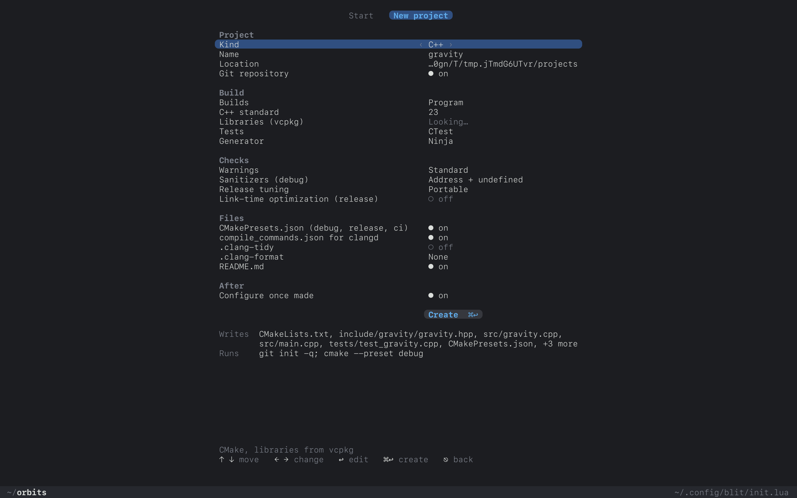

| Kind | What it is | Its choices |
|---|---|---|
| C++ | CMake | program or library (static, shared, header-only), standard, libraries from vcpkg, tests (CTest, Catch2, GoogleTest, doctest), warnings, sanitizers, release tuning, link-time optimization, generator, presets, install rules, clangd, clang-tidy, clang-format |
| HIP | CMake with `LANGUAGES HIP` | program or library, GPU targets (those of the machine's GPUs, from `rocm_agent_enumerator`), standard, ROCm libraries (those installed), host libraries from vcpkg, GPU tests (skipped where there is no GPU), sanitizers, a rocprofv3 script |
| C | CMake, Meson or make | program or library, standard, libraries from vcpkg (CMake) or pkg-config, tests, warnings, sanitizers, hardening |
| Python | uv or pip | application, library or script (PEP 723), Python version, layout, build backend, dependencies and dev dependencies from PyPI, a command, pytest or unittest, Ruff, a type checker |

Headers go in `include/NAME/`, sources in `src/`; a program is a library
of what it does and a small `main`, so its tests have something to link.
Flags are a target's own (never global), and a CMake project has presets
(debug with the sanitizers, release, and ci with warnings as errors; a
HIP project's release comes first, the one it configures, builds with the
Run button and points `.clangd` at).
Once the files are written blit runs `git init` and the configure (or
the venv, or `uv add`) in the Build tab's output terminal, opens the main
file, and makes the folder the working folder.

**Libraries are looked up, not ticked from a list of a few.** Enter on a
Libraries row opens a search of them; choosing one adds it (or takes it
away) and the search comes back for the next. Where they come from:

- **vcpkg**: its ports, from its folder (`VCPKG_ROOT`, or `~/vcpkg`,
  `~/Dev/vcpkg`, `/opt/vcpkg`, the one on the `PATH`). Each chosen port
  goes in `vcpkg.json` (with the commit vcpkg is at as its baseline), and
  its `find_package` and `target_link_libraries` come from the port's
  usage notes; a port without them gets a line saying vcpkg will say what
  to write when it installs it. The CMakeLists uses vcpkg's toolchain when
  `VCPKG_ROOT` is set.
- **ROCm**: the packages in its `lib/cmake` (`ROCM_PATH`, `/opt/rocm`, the
  newest `/opt/rocm-*`), each linked by the targets its targets file
  makes, to the GPU code alone.
- **pkg-config**: its modules (`pkg-config --list-all`), as
  `pkg_check_modules`, Meson's `dependency()`, or make's flags.
- **PyPI**: its 15,000 most downloaded packages (fetched once a week into
  blit's data folder), and any other by its exact name.

On another machine all of this is that machine's: its vcpkg, ROCm, GPUs,
uv and pkg-config.

```lua
-- In init.lua: a kind of your own, and a built-in one taken away.
blit.project.add("Notes", {
  description = "Markdown notes",
  fields = {
    {key = "title", label = "Title", default = "untitled"},
    {key = "toc", label = "Contents", kind = "switch", default = true},
    {key = "style", label = "Style", kind = "choice", choices = {"plain", "fancy"},
     when = {toc = true}},              -- shown only while Contents is on
  },
  create = function(dir, values)        -- dir is made already; values.name, values.git too
    blit.fs.write(dir .. "/notes.md", "# " .. values.title .. "\n")
    return "notes.md", "echo made"      -- the file to open, a command to run there
  end,
})
blit.project.remove("Python")
```

A field's `kind` is `text` (the default), `switch`, `choice`, or
`libraries` with a `source` (`vcpkg`, `rocm`, `pkg-config`, `pypi`).

## Markdown preview

**Cmd+Shift+V** in a Markdown file opens its preview in a split to the
right: the file drawn, in the theme's colours. It is drawn again as the
file is typed in, and scrolls to where the file's cursor is. Cmd+Shift+V
again brings it to the front; from the preview, it (or Esc) goes back to
the file. In the preview the arrows, `j` and `k`, Page Up and Page Down
(or Space and `b`), Home and End (or `g` and `G`) and the wheel scroll it;
a click on a link opens a web address in the browser, another file beside
this one in a tab, and `#heading` goes to that heading. In a file that is
not Markdown (by its name, or the language chosen in the status bar), a
notebook or an SVG, it draws nothing and says so on the bottom line; a new
file of no language yet is taken as Markdown.

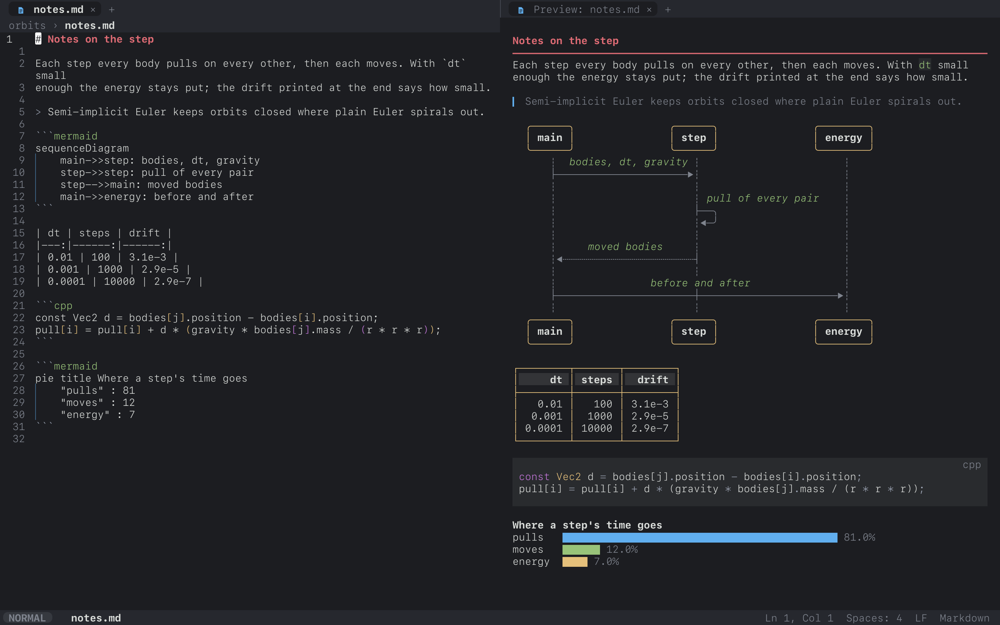

It draws headings (each level its own, below), **bold**, *italic*, `code`,
~~struck~~ text, links and autolinks (and links defined elsewhere with
`[name]: url`), lists (nested, numbered from any number in a column,
`- [ ]` tasks as a square, crossed when done),
quotes (nested), tables (aligned as their `:--:` says, cells wrapped to
fit, below), fenced and indented code (on a tinted band, the language at its
top right; a block in a language blit has a grammar for, by its name,
`c++`, `py`, `sh`, `yml` or another file ending, is coloured by that
grammar in the theme's colours, on the preview's thread; a `diff` or
`patch` block has its added lines in the colour the Git views give them,
its removed ones in the errors' colour, a hunk's `@@` header in the accent
and a file's header quiet), rules, line breaks, HTML (below; comments
left out), math (below), `==highlighted==` text, definition lists (a
term on a line of its own, then `: what it means` lines: the term bold,
each definition indented under it, numbered quietly when there are more
than one), and leaves out front matter.

**Headings** are told apart by what a grid of cells has. The top three
levels have a colour each and the lower three share a fourth. Levels one
to four are bold, the fifth bold and slanted, the sixth slanted only. The
first has a heavy line under it in its own colour, the second a light,
quiet one; those two have two blank rows above them, the others one. The
colours are the theme's: `markup.heading.1` to `markup.heading.4` (the
last for levels four to six) where it names them. Where it names only
`markup.heading`, as the built-in themes do, or none, the first level has
that colour and each level under it the first of the theme's other
colours (its functions', types', keywords', strings') that no level above
has taken.

**Tables** have quiet lines (the theme's muted colour) and a tinted
header, one band across all its cells. One too wide for the preview
gives each column room for its longest word and shares out the rest as
each would take it, so that a column of long text wraps least. When a
cell's text wraps, a line
between the rows below the header keeps each row's lines apart; a table
whose cells all fit on a line has none. Columns stay in line with wide
characters and emoji (a family or a flag in one cell's width) in them.

**Math** is drawn as text, in italics, by GitHub's rules: `$...$` and
`` $`...`$ `` within a paragraph, not past a hard line break (not `$5
and $6`, nor with a space just inside a `$`, nor in code), `\(...\)` too, and display math (`$$...$$` or
`\[...\]`, on lines of their own) on rows of its own, each of its rows
(TeX's `\\`) in the middle. Greek letters, operators, relations and
arrows are Unicode's (`\alpha` α, `\le` ≤, `\to` →, `\int` ∫); a power or
an index is raised or lowered where Unicode has a character for all of
it and the font draws them (x², aᵢⱼ, ∑ₙ₌₁), else written `x^(n+1)`;
`\frac{a}{b}` is a/b (in brackets where a part needs them), `\sqrt` √
(∛, ∜), `\mathbb{R}` ℝ, `\binom{n}{k}` C(n,k), `\text{...}` its words, and
accents go over one letter (x̂, v⃗). Sizing, `\left`/`\right` and
environments' names go; what blit does not know stays as it was written.

**HTML** in the text is drawn as GitHub draws it, in blit's own way:
`<kbd>` is a key, on the code's tint; `<sub>` and `<sup>` are lowered and
raised in Unicode's characters where it has them all and the font draws
them (H₂O, x², 1ˢᵗ), else written `_2` and `^2`; `<mark>` (and
`==text==`) is on a highlighter's tint; `<b>`, `<strong>`, `<i>`, `<em>`,
`<u>`, `<ins>`, `<s>`, `<del>` and `<code>` look as their Markdown does;
`<a href>` is a link; `<br>` breaks the line; other tags go and their
text stays. In blocks of HTML, `<h1>` to `<h6>` are headings, a `<p>`,
`<div>` or heading with `align="center"` (and `<center>`) is in the
middle, `<hr>` is a rule, and `<details>` is open: its `<summary>` bold
after a `▾`, what it holds under that, indented (Markdown in it too).

**Alerts** (GitHub's: a quote whose first line is `[!NOTE]`, `[!TIP]`,
`[!IMPORTANT]`, `[!WARNING]` or `[!CAUTION]`, in any case, alone on its
line) are callouts: a heavier bar and a bold title, both in the kind's
colour (the theme's blue, green, purple and yellow, and its colour for
errors), and what the alert says under the title in the text's colour,
its lists and code as anywhere else. A quote with any other tag, or with
nothing after its tag, stays a quote.

**Footnotes** (`[^1]` or `[^name]` in the text, and `[^1]: what it says`
anywhere, with more lines or paragraphs indented under it) are numbered
in the order the text first refers to them, whatever they are called.
Each reference is a small raised number (`¹`; `[1]` in a font that has
no raised digits), and a link: a click on it goes to the footnote. The
footnotes are drawn at the end under a short rule, each with its number
and its text as Markdown, then `↩`, a link back to the first place that
referred to it. A footnote nothing refers to is not shown, as on GitHub;
a reference to one that is not defined stays as it was typed.

**Pictures** that are a paragraph of their own (``, or a
row of them; one inside a link too) and HTML's ``
are drawn, from files beside the Markdown file or anywhere on its machine
(another machine's, for a file opened over ssh): one pixel of the picture
to a point, or the size `width`/`height` ask for, made smaller to fit
across the preview and within its height, in the middle where the HTML
says `align="center"`. A click opens the picture in its own tab (or
follows the link it is in). An SVG is drawn at the size it takes there; an
animation plays while its rows are on show, and waits where it was while
they are not. A picture in the middle of a sentence shows its alt text, as
a link, and so does one that cannot be read.

**Pictures on the web** (``) are not fetched unless
`blit.opt.markdown.web_pictures = true`: until then their alt text shows,
as a link. With it, the system fetches them (on a thread of their own,
20 seconds at most, no cookies kept) and blit keeps them in its cache
folder (`~/Library/Caches/blit/pictures`), fetching one again after a day;
one that cannot be fetched then is shown from the copy kept.

**Mermaid diagrams** (` ```mermaid ` blocks) are laid out and drawn by
blit itself, with no browser, no JavaScript and no SVG library.
The kinds below are pictures, in the middle of the preview:
blit lays them out in points, draws the shapes with its own anti-aliased
rasterizer and the text from the editor's font's own outlines, at the
size they are shown at (the display's density, the preview's width), so
they are the same pixels on a Mac and on Linux. Their colours are the
theme's (the boxes in its type colour, the text in its text colour, the
lines a little quieter), the text the editor's font at its size, and a
character it lacks from the editor's fallback fonts (one in no font, an
emoji, is a box). One wider than the preview is made smaller to fit (a
left-to-right one is laid out top to bottom first, and then closer
together, if that fits better), never cut off; it is drawn again when
the width, the theme, the font or the display changes.
The pictures drawn lately are kept, so that typing elsewhere in the file
never lays one out again. A click on one does nothing.

- `graph` / `flowchart`, in any direction (TD/TB, BT, LR, RL): every node
  shape (`[ ]` rectangle, `( )` rounded, `([ ])` stadium, `[[ ]]`
  subroutine, `[( )]` cylinder, `(( ))` circle, `((( )))` double circle,
  `{ }` diamond, `{{ }}` hexagon, `[/ /]` and `[\ \]` parallelograms,
  `[/ \]` and `[\ /]` trapezoids, `> ]` flag; `A@{ shape: ... }` by
  name), edges plain, dotted (`-.->`), thick (`==>`), hidden (`~~~`),
  without heads (`---`), with circles or crosses, both ways (`<-->`),
  longer for each dash more (`--->`), with text (`-->|yes|`,
  `-- yes -->`, on a pill over the line), chains (`A --> B --> C`) and
  `&`. Subgraphs are titled boxes round their nodes, nested (32 deep at
  most), each in its own `direction` when no edge goes into it (as
  Mermaid's rule is); an edge may go to a subgraph itself, from it to
  something in it, or round from it to itself, and edges that come in at
  its title pass beside it. `classDef`, `class`, `:::name`,
  `style` and `linkStyle` colours (fill, stroke, its width and dashes, the
  text's colour) are used; `%%` comments and a front matter `title:` too.
  Nodes go in ranks (Sugiyama's way, as Mermaid's dagre does), ordered to
  cross as little as they can and placed in balance with their
  neighbours; edges are smooth curves that leave and meet their nodes'
  borders (a decision's from its tip, or a corner when they go off to
  the side), spread along a side when several share it, and go round
  what is in their way; an edge back up a loop goes round beside the
  others, and a loop on a node is a round one beside it. Long text
  wraps; a Markdown string's `**bold**` and `*italic*` are drawn so. One
  too large to lay out in good time (many thousands of edges' worth of
  ranks) says so.
- `stateDiagram` / `stateDiagram-v2`: states (`state "..." as X`,
  `X : text`), `[*]` as start and end dots (each composite state's its
  own), transitions with what they say, composite states as boxes with
  their name in a band (nested, with their own `direction`), choices as
  small diamonds, forks and joins as bars, notes (`note left of`,
  `note right of`, on one line or up to `end note`) beside their state,
  `classDef` and `class` colours. (Concurrent regions, `--`, are laid out
  as one.)
- `classDiagram`: classes as boxes of three parts (the name, with its
  annotations such as `<<interface>>` over it; the attributes; the
  methods, `name(args) : type`), visibility marks as written, generics
  (`List~T~` as `List<T>`), static members underlined and abstract ones
  (and an `<<abstract>>` class's name) slanted. Members come from
  `class A { ... }` blocks or `A : +member` lines; `class A["Label"]`
  names one. Every relation, with its ends: inheritance (`<|--`) and
  realization (`<|..`) with a hollow triangle, composition (`*--`) a
  filled diamond, aggregation (`o--`) a hollow one, association (`-->`)
  and dependency (`..>`) an arrowhead, an interface (`()--`) a ring,
  links (`--`, `..`); dotted ones dashed; both ends at once
  (`<|--|>`); how many at either end (`A "1" --> "*" B`, beside the line
  by its box) and what it says (`: label`, on a pill). `namespace`s are
  titled boxes round their classes; `note` and `note for A` are notes
  (beside their class); `direction`, `style`, `classDef`, `cssClass` and
  `:::` colours too. Laid out in ranks as flowcharts are, each parent
  over its children.
- `erDiagram`: entities as tables (the name in a band, then a row for
  each attribute: its type, name, keys `PK`, `FK`, `UK` and comment, in
  columns, rows in turn a little stronger), `p[Person]` and `"a name"`
  names. Relations end in crow's feet for each cardinality (`||` only
  one, `|o` zero or one, `}|` one or more, `}o` zero or more; or in
  words, `one or more`, `zero or one`, `1+`, ...), solid when
  identifying (`--`, `to`), dashed when not (`..`, `optionally to`),
  with what they say on a pill. `direction`, `style`, `classDef` and
  `class` too.
- `sequenceDiagram`: participants in a row across the top and again at
  the bottom, a lifeline down from each; `participant`, `actor` (a stick
  figure), `as` names, `A@{ "type": "database" }` (a cylinder) and
  `"collections"`; `box` round participants, in its colour, with its
  label; `create` (the box drawn where the message that makes it arrives)
  and `destroy` (its lifeline ended with a cross). Messages of every
  kind: solid and dotted, with an arrowhead (`->>`), none (`->`), a cross
  (`-x`), an open head (`-)`, async), both ways (`<<->>`); to oneself, a
  loop out and back. Activations (`+` and `-` on a message, `activate`
  and `deactivate`) are bars on the lifeline, nested ones beside each
  other, and messages end on their edges. Notes left of, right of or over
  one or two participants; `loop`, `alt`/`else`, `opt`, `par`/`and`,
  `critical`/`option` and `break` frames, nested, with a tab saying what
  they are and their conditions; `rect` colours behind what is in them;
  `autonumber` (with a start and a step, and `off`) in circles at each
  message's start; `title`. The gaps between participants are as wide as
  what passes between them needs; long text wraps; a lifeline stops for
  the text over it. Colours a box or a `rect` names are made quieter in a
  dark theme, so that the text on them stays readable. One too wide for
  the preview is laid out narrower (text wrapped shorter, boxes and gaps
  smaller) before it is made smaller.
- `pie`: wedges round from the top, each slice's share on it where it
  fits, a legend beside it (under it, when that fits the preview better)
  with each slice's colour, name and share, the title over it (`pie title
  ...` or `title ...`, wrapped to the preview); `showData` puts each
  value in the legend too. The colours are the theme's own, those not too
  like one another (then the same again, quieter).
- `gantt`: a task a row, as a bar from its start to its end against a
  date axis, in its section's band (the sections' names at the left, the
  bands in turn lighter and darker, each in a colour of its own); `title`,
  `dateFormat` (Day.js's tokens: `YYYY-MM-DD`, `DD/MM/YYYY HH:mm`, `X`,
  `MMM D YYYY`, ...), `axisFormat` (strftime's: `%Y-%m-%d`, `%b %e`,
  `%H:%M`, ...), `tickInterval` (else the ticks are as close as their
  labels let them be, on days, weeks, months or years), `topAxis`. Tasks
  are `done` (grey), `active` (outlined), `crit` (red) or `milestone` (a
  diamond at its date); they start at a date, `after` other tasks (the
  latest of their ends) or after the task before, and end at a date,
  `until` other tasks, or after a length (`3d`, `2w`, `12h`, `30m`, `1M`).
  `excludes` (`weekends`, days' names, dates) shades those days, and a
  length skips them (as Mermaid's does); `includes`, `weekend friday`,
  `weekday`, `inclusiveEndDates` too. A task's name is in its bar when it
  fits, else beside it (wrapped if it must be). Today is marked only when
  `todayMarker` asks for it (with its `stroke`, `stroke-width` and
  `opacity`). Dates are the calendar's own, with no time zones.
- `mindmap`: nested by indentation, from the root out to both sides (half
  of its branches to the right, by how tall each is), or to the right
  only when that is narrower and both do not fit; each branch in a colour
  of the theme's, joined by curves thinner the further out. Shapes:
  `[square]`, `(rounded)`, `((circle))`, `))bang((`, `)cloud(`,
  `{{hexagon}}`, and plain text (a box with a line under it). Long text
  wraps, narrower while the mindmap is too wide. (`::icon()` is left out.)
- `timeline`: a `title`, `section`s as bands over their periods, periods in
  a row along an arrow, each with its events (`2004 : Facebook : Google`,
  or `: Google` on a line of its own) in boxes under it, joined by a dashed
  line. Columns are as wide as the text needs (within bounds; longer text
  wraps), and a timeline wider than the preview goes on in rows under it,
  a section kept whole on a row where it can be.

A diagram with a mistake in it shows its code, under a line that says
what and where (`mermaid: line 3: ...`). Other kinds show as code, with a
line that says so.

## Notebooks

A Jupyter notebook (`.ipynb`) opens as the script of its cells, as
Python, each cell after a `# %%` line (the percent format):

```python
# %% [markdown]
# # Orbits
#
# The first hundred steps.

# %%
import numpy as np
steps = np.arange(100)

# %%
steps.mean()
```

A Markdown cell's lines are commented, under `# %% [markdown]`; a raw
cell is under `# %% [raw]`. A blank line separates the cells, and is not
part of them. Text before the first `# %%` is a code cell. Cells are
added, moved and taken away by typing the lines. The language server
sees the script; its word that the expression a cell ends with is unused
(basedpyright's `reportUnusedExpression`, Ruff's `B018`) is left out,
that being the value the cell shows.

Saving writes the notebook back, as Jupyter writes one (two members a
line, keys in order, one space an indent), so that what changed is all
that differs. Each cell keeps everything the notebook had of it: its
outputs, its count, its id and metadata. One changed since it ran keeps
its outputs and count too, as Jupyter keeps them, until it runs again; a
new one is given an id. The notebook's own metadata (its kernel, its
language) stays. A new `.ipynb`, typed in blit, is saved as a notebook
too. When the file changes on disk it is read again, as any file is (a
kernel running goes on). A notebook on another machine (`ssh://`, or a
container's) is read and saved as one too.

Each code cell's outputs are shown after its last line, quieter, in a
line: the last line it printed, its result, `[image/png]` for a picture,
`[table]` for a table (or the size pandas says of a long one), or the
error's name and message. A cell changed since it ran shows none.

Outputs are saved as Jupyter saves them: a stream's text, and the text,
SVG and JavaScript in a result's data, as lists of their lines.

### The notebook's view

Opening a notebook (from the side panel, the finder, the command line or
a session) shows the notebook itself in a split to the right of its
script, as Jupyter shows it, read only: the script is what is typed in.
**Cmd+Shift+V** (Ctrl+Alt+V off a Mac), in the script or the view, closes
the view and opens it again; closing the script closes it too. A second
notebook's view goes beside the first's.

- A Markdown cell is drawn as the [Markdown preview](#markdown-preview)
  draws a file: headings, tables, code, math, pictures beside the
  notebook.
- A code cell is a block of code coloured by the notebook's language (its
  metadata says which), with Jupyter's `In [n]:` beside it (`In [ ]:` if
  it has not run, `In [*]:` while it runs or waits to). One changed since
  it ran says `edited` under its label, and its outputs are quieter: they
  are of other code (saving keeps them, as Jupyter does).
- A raw cell is its text, as it is.
- Under a code cell, every output in full, in order. Text a program
  printed is plain, what it wrote to stderr is tinted as an error is. A
  result has `Out[n]:` beside it. Of the kinds of data an output has, the
  richest blit draws is shown: an HTML table (a pandas DataFrame: its
  header, its index in bold, its columns aligned as it says, else to the
  right) as a table, with any text around it; a PNG or JPEG as a picture;
  an SVG as a picture where the system reads SVG (on Linux, with
  librsvg), else its text; Markdown drawn; other HTML as its text; LaTeX
  as display math (in the middle, as the preview draws it); plain text as text; JSON indented. Data
  blit cannot draw (a widget, a PDF) is named, `[application/pdf]`, never
  shown as its base64.
- A table too wide for the view is not squeezed into it: its output's
  plain text (pandas' own) is shown instead when that fits, else the
  columns that fit and how many more there are.
- An error is its traceback, in the theme's colours: the colours IPython
  writes in (16 of them, 256, or any) are each the theme's colour nearest
  them in hue, on the tint for errors.
- An output longer than 60 rows is cut, with a line that says how many
  more lines there are. Long lines go on in the next row after a space,
  as Jupyter wraps them; a code cell's do too.

When the view is narrower than 50 columns the labels go above the cells
instead of beside them (and a count longer than four digits goes above
its cell).

The view follows the script's cursor: moving into another cell brings
that cell to the top of the view (if it is taller than the view, the
cursor's line a third of the way down); moving within a cell scrolls only
when the cursor's line is not on show. A click on a cell puts the
cursor on that line of the script (on an output, the cell's first line)
and gives the keyboard back to the script; the view stays where it is.
The wheel, the arrow keys, Page Up and Page Down scroll it, as the
preview's do.

The view is drawn on a thread of its own, as the preview is, so typing
never waits for it; typing in one cell draws only that cell again, the
rest being kept as drawn. An output's picture is written once to blit's
cache (`~/Library/Caches/blit/pictures` on a Mac, `~/.cache/blit/pictures`
on Linux), named by what is in it, and shown from there as any picture
is; one not shown for 30 days is removed from there.

The cells read from the notebook are its model: each code cell's outputs
as the file has them, and its count. Outputs a cell is given when it runs
replace its own in the model, are drawn in the view and the line after
the cell, and are what saving writes.

### Running cells

**Shift+Return** in a notebook (or "Run the cell (# %%)") runs the cell
the cursor is in, in the notebook's kernel, and the cursor goes to the
next cell's first line; in a Markdown cell only the cursor goes. "Run all
the cells" runs each code cell in turn. As in Jupyter:

- Cells wait their turn and run one at a time, each with its code as it
  was when it was run (typing in it meanwhile changes nothing). A cell
  running or waiting is `In [*]:`.
- When a cell starts, its outputs go; what it gives comes into the view
  as it comes (what it prints, a few times a second), and its count is
  the kernel's next. Printed text joins the text printed before it, and a
  carriage return writes over its line (a progress bar stays one line).
  What C code or a program the cell runs prints is caught too. While it
  runs, a long text is shown as its first lines, how many more there
  are, and its last; all of it when it ends (or the notebook is saved).
- The cell's terminal is as wide as the view draws its outputs
  (`COLUMNS`): a traceback's rules, a progress bar, a DataFrame's text fit
  it.
- Its outputs and count are put in the notebook, as Jupyter's JSON (what
  saving writes), the line after the cell shows the last of them, and
  the notebook has changed.
- An error (an interrupt is one) ends the run: the cells still waiting do
  not run.

"Interrupt the kernel" stops the cell running (Ctrl+C in it:
`KeyboardInterrupt`). "Restart the kernel" ends it, with what it was
running and what was waiting (their outputs so far stay), and starts it
again, its counts from 1. None of the three has a key of its own; map
them in init.lua.

The kernel is a small Python program blit carries, written to blit's
cache folder the first time it is needed, started the first time a cell
of the notebook runs. It runs with the [project's
Python](#the-projects-python) (the notebook's folder's: its project's or
subproject's), in the folder being worked in if the notebook is in it,
else in the notebook's own; it works in the notebook's folder (the
notebook's imports are found there).
blit and it talk in lines of JSON over its input and output: no Jupyter
server, no ZMQ. If it can import IPython, cells run in IPython's shell:
its rich results (a DataFrame's table, Markdown, pictures), `display()`,
`%` and `%%` magics, `!` commands, and tracebacks in colour; with
`matplotlib-inline` installed a plot is shown as Jupyter shows one, a
PNG under its cell. Without IPython the cell is run by plain Python: the
last line's value is its result (and what it says of itself, an object
with a `_repr_html_`, say), what it prints is caught, and an error is its
traceback, the cell's own lines in it. A cell cannot read input.

The status bar of the notebook (or its view) says which kernel it has:
`no kernel` before a cell has run, then IPython or Python, the Python's
version and what it runs in (`.venv`, or the program), and `busy` while a
cell runs or waits, else `idle`.

The kernel ends with the notebook's tab and with blit, with everything a
cell started (it runs as a group of its own); if blit itself is killed,
it ends of itself as soon as its input closes. One that ends on its own
(it could not start, or a cell ended it) is said, with the last line of
what it wrote; the next cell run starts another.

For a notebook on another machine the kernel runs there, through blit's
agent as everything else there does: the program is written to
`~/.cache/blit` there, and the Python is chosen there as above. If the
connection is lost, the kernel goes with it: that is said, and the status
bar reads `kernel lost with HOST` in red until a cell is run again.

"Run the cell (# %%)" in any other script with `# %%` cells sends the
cell to the [Python console](#the-python-console) instead (started if it
is not), and what it prints is shown there.

## Pictures

An image file (PNG, JPEG, GIF, BMP, TIFF, WebP, HEIC, AVIF, ICO, PSD and
the other kinds macOS reads; on Linux PNG, JPEG, GIF and WebP) opens in a tab of its own, from the side
panel, the finder, a drop, the command line or a link in the Markdown
preview, here or on another machine. The picture is fitted to the tab; a
small one (an icon, pixel art) is drawn larger by whole steps, its pixels
sharp squares, to about half the room; see-through parts show over a
checkerboard; the row at the bottom says what it is, how large, and how
far it is zoomed.

| | |
|---|---|
| Zoom in / out | `+` / `-` (or Cmd+= / Cmd+-), a pinch, Cmd+wheel (about the mouse) |
| Fit it to the tab / its actual size | `0` (or Cmd+0) / `1`; a double click switches between them |
| Move it (zoomed in) | drag it, the wheel, the arrows or `h` `j` `k` `l` |

Zoomed in far, its pixels show as squares. Pictures are read on a thread
of their own (the system's ImageIO; on Linux libpng, libjpeg-turbo, giflib
and libwebp), turned the right way up as the camera says, and drawn by the GPU from textures of their own, with smaller copies
for when they are drawn small. A picture whose file changes is read again
when blit comes back to the front. A picture larger than 4096 pixels on a
side is read at 4096 (the row at the bottom says its own size), and one
not drawn for a minute is let go.

**Animations** (GIF, animated PNG and WebP, HEIC sequences on a Mac) play, as many
times as the file says, each frame for as long as it says (one that says
10 ms or less, as browsers do, for 100). Their frames are read together on
the pictures' thread (smaller, if all of them would take more than 128 MB)
and go up to the GPU as each is first shown. A timer wakes blit for the
next frame only while one is on show, in its tab in front or in the rows
of a Markdown preview on show: then the frame drawn is the only work done,
and nothing at all while it is not on show (it goes on from where it was
when it comes back). The row at the bottom says how many frames it has.

**SVG** is text, and opens as text; **Cmd+Shift+V** (Ctrl+Alt+V
elsewhere) shows its picture in a split beside it (as it does a Markdown
file's preview), drawn again each time the file is saved, and the same key
there goes back to the text. The picture is drawn by macOS itself
(AppKit's own SVG, nothing added to blit), or on Linux by librsvg (loaded
the first time an SVG is shown), on the pictures' thread, at the size it is shown, and again at the
new size when it is zoomed, so that it stays sharp (up to 4096 pixels a
side); the drawing it had stands in, stretched, meanwhile. Its own size is
the one its `width` and `height` (or `viewBox`) give, a pixel of it to a
point.

## PDFs

A PDF opens in a tab of its own too (here or on another machine): its
pages one under another, fitted to the width of the widest, on the
theme's background. The row at the bottom says which page is in the
middle of the view, of how many, and the zoom.

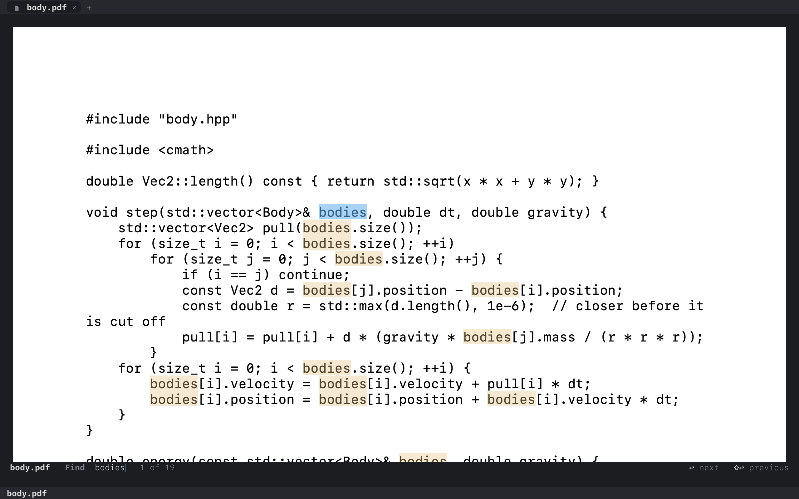

| | |
|---|---|
| Scroll | the wheel or touchpad, `j` `k` and the arrows, Space and `b` (or Page Down and Page Up) a screen, `g` / `G` (or Home / End) the start and the end |
| The next / previous page | `n` / `p` |
| Zoom in / out | `+` / `-` (or Cmd+= / Cmd+-), a pinch, Cmd+wheel (about the mouse) |
| Fit the width / the whole page / its own size | `0` (or Cmd+0) / `9` / `1` |
| Move it | drag it where there is no text; `h` `l` and Left / Right sideways when it is wider than the tab |
| Choose text | drag over it; two clicks a word, three a line; Cmd+A all of it; Esc lets go |
| Copy it | Cmd+C |
| Find | Cmd+F, then Enter / Shift+Enter (or Cmd+G / Cmd+Shift+G) the next / the one before; Esc done |
| Follow a link | click it |
| The outline | `o` shows it in a box at the side, or hides it; click an entry to go there |

A thread of its own reads the document and draws the pages as they come
into view, at the size they are shown (macOS's own PDF drawing; on Linux
poppler's, through cairo, loaded the first time a PDF is opened): a page
not drawn yet is white, and one drawn at another zoom stands in, stretched,
until it is drawn again. A page is drawn whole up to 4096 pixels on a side;
zoomed in further, the part of it on show is drawn again, sharp, over it.
Pages more than three away from the view are let go. A PDF whose file
changes is read again (keeping the page) when blit comes back to the front.

The same thread reads each page's text as it comes into view (PDFKit's,
or poppler's):
where each character and line is, and the links on it. What is chosen is
washed in the theme's selection colour, a box a line; Cmd+C copies it
(the thread puts it together, from pages on show or not). **Cmd+F** opens a
field in the row at the bottom: what is typed is found in all the pages
(A to Z in either case), on the thread a few milliseconds at a time between
the pages it draws; the row says which of how many is the current one, the
matches on the pages on show are washed in the theme's warning colour and
the current one in its accent, and the view moves to it. A **link** within
the document goes to its place; one to the web opens in the browser (the
system's own opener). The **outline**, when the document has one, is a
list in a box at the left, each entry indented by how deep it is, the one
the view is in lit; the wheel scrolls it.

A PDF **locked with a password** asks for it in its tab (a dot a letter):
Enter tries it on the reading thread, and the tab says so if it does not
open it. The password is not written anywhere, said in any message, kept
in the session, or kept in memory once tried (its bytes are wiped).

## Waves

A simulation's dump (`.vcd`) opens in a tab of its own, as its waves, not
its text: from Go to file, the file tree, a link or the command line. Its
signals are listed down the left with their values at the cursor beside
them; their waves run to the right under a ruler of times. The row at the
bottom says the file, the stretch of time it covers, how many signals it
has and how large it is, how much of it is read while it is being read,
and how much time the view spans.

The dump is read on a thread of its own (as fast as the disk gives it,
about 600 MB a second), and what has arrived shows while the rest comes.
Opened for the first time, the list is each scope's signals (up to 64)
under the scope's name, a signal seen under another name (an alias, as
`tb.clk` and `tb.u_cnt.clk`) once; a dump of one scope has no headings.

| | |
|---|---|
| Pan a tenth / a screen | `h` `l` (or Left / Right) / `H` `L` (or Shift+Left / Shift+Right); the wheel sideways, or Shift+wheel |
| Zoom in / out about the cursor | `=` (or `+`) / `-`; Cmd+wheel and a pinch about the mouse |
| The whole run | `0` |
| The next / previous row | `j` `k` (or Down / Up); the wheel scrolls the rows |
| Move the row down / up | `J` / `K` |
| The next / previous change of the row | `n` / `N` (a bus's next value; a bit of one opened, where that bit changes) |
| Add a signal | `/`: every signal of the dump by its path, found as Go to file finds; Enter adds it after the row chosen (one listed already is chosen) |
| A marker at the cursor / the cursor to a marker | `m` and a letter / `'` and the letter |
| Choose a stretch of time | `v` from the cursor, then move it (`n`, `N`, `'`, a click); Esc lets go |
| Zoom to it | `z` (with no stretch chosen: from the cursor to the last marker set) |
| The row's next radix | `r` |
| Open a bus into its bits, shut it; shut or open a group | Enter |
| Choose rows / group them | `V`, then `j` `k`; `g` `G` makes a group of their signals (or of the row) |
| Remove the row / undo a change to the rows | `d` `d` / `u` |
| Copy the signal's path / its value at the cursor | `y` `y` / `y` `v` |
| The cursor | a click on the waves (which chooses its row too); drag to move it |
| Zoom to a stretch | drag along the ruler |

Each of these is a command whose name begins "Waves:", so Command search
(Cmd+Shift+P) finds them, with their keys; three are commands only:
**Waves: name the row's values…** (`IDLE START DATA STOP` from 0 on, or
`0=IDLE 4=DATA`, values in decimal, `0x` hex or `0b` binary), **Waves: the
row in fixed point…** (`Q8.8` signed, `UQ4.12` unsigned, the two numbers
adding up to the signal's width) and **Waves: rename the group…**.

**Values.** One bit is `0`, `1`, `x` or `z`. A bus starts in hex (an
integer signed, one bit binary), and `r` goes round hex, unsigned, signed,
binary, octal, ASCII, the names given to its values, fixed point (once its
Qm.n is given) and IEEE float (for 16, 32 and 64 bits), leaving out those
it has not got. A digit wholly x or z is `x` or `z`, one partly so `X` or
`Z`; in a radix with no digits of its own, a value with any x is `x`
(all z: `z`). A value with no name given is written in hex. Reals and
strings are written as the dump has them.

**The waves.** A bit is a line high or low; z a dashed line through the
middle (in the theme's information colour); x a band filled in the
warning colour. A bus is a run of hexagons, each value written in its own
when it has room. An event is a tick. Where two or more changes fall in
one pixel, the row is a hatched band across its height (a fast clock seen
from far off): the view is asked about once per pixel column, so drawing
costs the same however many changes are under it. The **cursor** is a line
in the accent colour, with its time at the top left; **markers** are
lines in the hints' colour, named on the ruler's second row with how far
each is from the cursor; a stretch being chosen is washed in the
selection colour, and its length shown under the cursor's time.

The waves are drawn in tiles of 1024 pixels across and 16 rows down, on
two to four threads of their own: a tile drawn at another zoom stands in,
stretched, until its sharp one comes, and panning moves tiles (the ones
either side are drawn ahead). Tiles not drawn lately are let go past 128
MB. The cursor and markers are drawn as lines over the tiles, so moving
them draws no tile again. Nothing is drawn while nothing changes.

**The view is kept** beside the project, in `.blit/waves/` of the folder
worked in (or, for a dump outside it, of the dump's own folder), as
`DUMP.json` (data, not Lua): the rows by their paths, groups, radixes,
fixed points, the names given to values, markers, the cursor and the
stretch on show. It is written once the view has been changed by hand,
and it comes back when the dump is opened again; a row whose signal the
dump no longer has is left out, and the bottom row says how many were.

A dump on **another machine** is fetched whole while it is no larger than
4 MB; larger ones are not shown yet (the tab says so).

## How it is fast

**Text is never copied.** The file is memory mapped and the document is a
tree of pieces, each a pointer and a length into the mapped file or into an
append-only block of typed text ([src/buffer.hpp](../src/buffer.hpp)). The tree
carries byte and newline counts, so finding a line, inserting and deleting
are O(log n) on any size of file. A 1 GB file opens in 18 ms and its tree
takes 4 MB.

**A frame is one draw call.** The CPU turns the visible text into a grid of
32-bit cells ([src/grid.cpp](../src/grid.cpp)), uploads it, and draws a single
triangle. The fragment shader ([shaders/grid.frag](../shaders/grid.frag)) finds
each pixel's cell, reads the glyph slot, and blends from a glyph atlas. For
ASCII the cell value is the byte itself, so filling the grid is close to a
widening copy: about 1 µs for a full 4K window.

**The looks are paid for only where they show.** Round corners, shadows
and rounded highlights are drawn by the same two shaders, each built more
than once: a view with nothing selected and a box with nothing rounded get
the plain build, which is the shader as it was. Where a selection's
outline turns, and where a lit row starts and ends, is marked in spare bits
of the cells by the CPU, so that no pixel has to look at its neighbours. A
box that casts a shadow is written straight and only the strips of shadow
around it are blended. With the default look a scrolling frame costs 3.8%
more than with square corners and no shadows; with the look switched off
it costs what it did.

**Nothing happens unless something changed.** The loop blocks in the OS
until an event arrives. Idle is zero frames and zero CPU. Scrolling eases
toward its target and stops drawing when it gets there.

**Never more frames than the display shows.** While something is moving,
blit draws one frame per refresh of the monitor the window is on (it asks
again when the window changes monitor) and no more. Normally the window
system does the holding back; where it does not, blit waits out the rest of
the refresh itself. A frame costs well under a millisecond, so the rest of
each refresh the program is asleep.

**A key is on the screen in about 15 ms.** The window has two images to draw
into, not the usual three, so that a frame drawn after a pause (a key typed,
the cursor moved) is shown at the next refresh or the one after, not two
later: 15 against 40 ms from the frame being handed over to it being on
the screen. While the view scrolls it has three again, so that frames drawn
one after another keep the display's pace. And the wait for the display
comes before input is read, not after, so a key typed while something
moves is in the frame drawn next.

**An operation on many lines is a few edits, not one a line.** A `:%s`,
`>`, `<` or `J` over thousands of lines changes them a megabyte at a time
(lines close together in one edit), so that a whole large file is hundreds
of edits and undo records, not millions.

**Undo keeps pieces, not text.** Removed text stays where it was in memory;
undo and redo swap piece lists in and out of the tree.

**Highlighting never runs on the main thread.** A worker thread owns the
tree-sitter parser. After an edit the main thread hands it a snapshot of the
document, which is just a copy of the piece list (the text itself is never
copied, and never changes under the worker). The worker reparses, recolours
the lines on screen first, and sends back a list of style runs. Until that
arrives, a millisecond or so later, the previous colours are kept lined up
with the text. Typing and scrolling cost the same with highlighting on.

**A language server cannot slow the editor down.** Each server is a child
process, and a thread of its own does all the talking to it: starting it,
writing messages, reading and parsing the answers
([src/lsp.cpp](../src/lsp.cpp)). The main thread queues a small message per
edit (under a microsecond) and picks up results that are already parsed,
from every server at once with one lock. A server that takes a second to
answer, or never does, costs nothing; the popup just arrives later or not
at all. The servers are started after the first frame is on screen, so
launch time is the same with or without them. The document in front goes
over as the list of pieces it is made of and is turned into JSON on that
thread, so opening a large file does not copy it on the main thread either
(the other tabs' files are copied once, when they are opened). A column
counted in UTF-16, as most servers want, is counted on from the last one
worked out on the same line, so typing far along a long line does not walk
it from its start at every key. Inlay hints are put between the characters
after the grid is filled, and the servers' colours are laid over
tree-sitter's for the lines on show only, so neither costs the fill
anything.

**Popups are more cell grids.** A completion list is a small grid of cells
drawn by one more triangle, cut to the popup's box, reading its cells from
the same buffer as the text. The text view's shader is untouched by them:
squiggles ride on the "this cell needs more than a glyph" bit the cursor
already used, so a pixel of ordinary text does the same work as before.

**The tab bar and the line numbers are grids too.** Each is one more
triangle over its own strip of the window, and the text view is cut to what
is left, so again no pixel is shaded twice. The tab bar's cells are rebuilt
when a tab changes; the numbers when the top line does. The numbers' grid is
shifted by the same part of a row as the text is scrolled by, which keeps
the two level while scrolling smoothly. A file in a tab that is not in front
costs nothing per frame: its text is a memory-mapped file and a small tree,
and its highlighter is asleep.

**Git costs the editor nothing.** Every `git` runs on one background
thread, which also does the comparing: a document's text is handed over as
its list of pieces (not copied), turned into a number per line and compared
with the committed text's numbers (18 µs for a 1 MB file with twenty
changes). The editor asks one question at a time per document and draws a
frame only when an answer changes something on screen. Idle in a repository
is still zero frames.

**A split is one more text view.** Each split's text is its own grid of
cells in the same buffer, drawn by the same triangle and the same shader as
an unsplit window's, cut to the split's rectangle. Nothing is composited and
no pixel is shaded twice, so four splits draw within a few percent of the
speed of one. What a
frame makes for each split is kept apart (which lines are long, how they are
indented), and each file's colours come from its own worker, so the splits
do not get in each other's way.

**Indent lines cost a third of a microsecond.** A line's indentation is read
off the cells the frame has just made (leading spaces are cells holding a
space), not from the text, and a cell that carries a line is flagged with the
"more than a glyph" bit that the cursor and squiggles already use. The
shader's path for ordinary text is unchanged.

**The widest line is found when it is wanted.** Limiting sideways scrolling
needs the width of the widest line in the file. Nothing measures it until
the view is first scrolled sideways; then a small file is measured on the
spot (30 µs for 100 KB) and a big one on a thread of its own (a 1 GB log in
90 ms) while scrolling carries on.

**The side panel is one more grid.** It is drawn like a popup, by one extra
triangle, and the text view is cut to the area beside it, so no pixel is
shaded twice. Its cells are rebuilt only when something it shows changes.
Folders are read on a thread of their own: opening one with ten thousand
entries does not hold up a frame. Closed, the panel costs one comparison a
frame.

**Ligatures stay on the grid.** A ligature font draws `->` as a blank glyph
followed by one wide glyph reaching back over it. blit cuts such a glyph into
cell-wide slices in the atlas, so a cell still shows exactly one slot and the
shader does not change. Only runs of characters the font says can join are
shaped, and each distinct run is shaped once and then served from a cache.

**Long lines stay cheap to edit.** Finding display column N of a line
means walking it from its start; on a minified file, millions of columns
long, that walk would be every frame's and every key's. The grid remembers
a place every 65,536 columns of the long lines it has drawn, and the editor
where it last counted the cursor's column (and a place at least 4 KB
before that). An edit keeps everything before it, so typing at the far end
of a 64 MB line costs what it does on a short one (4.4 ms a key before, now
under 0.3 ms).

**A screen always fits the glyph atlas.** The atlas has 8,191 slots, as
many as a cell can name: a screen of distinct wide characters (CJK) at a
usual size on a 2560-pixel display fits. A frame that runs out starts the
atlas over and is made again; that second time the atlas is held, and a
glyph that still does not fit is drawn as a box, never in a slot another
glyph had earlier in the frame.

**Italic and bold are free in the frame.** Each style has its own block of
128 atlas slots after the regular one, so an ASCII character in style `s` is
slot `byte | s << 7`. The grid already ors a colour into each run of cells;
the style rides in the same value, and the shader does not know styles exist.
The extra faces are loaded on the font thread during startup, which finishes
long before the window is up. A line under or through text is a style too:
its glyphs are the face's with the line drawn over them, in slots of their
own (a space has the line alone, so it runs on between words), looked up as
the run is filled; a cell still shows one slot, and the cell's bits and the
shader are as they were.

## Layout

```
src/buffer.*    piece tree, loading, saving
src/editor.*    cursor, selection, movement, edits, undo
src/scan.hpp    newline and ASCII scanning (portable vector code)
src/config.*    settings: their defaults, checking what init.lua sets, built-in themes
src/font.*      finding fonts, FreeType glyph atlas, italic/bold faces, ligature slices
src/shape.*     HarfBuzz, loaded on demand
src/json.*      JSON reader and writer
src/lsp.*       language server client: processes, messages, every open document's sync
src/applsp.cpp  squiggles, completion list, popups, references and the other places a name leads, the outline, project symbols, uses, header/source, rename, formatting, code actions, hints, colours
src/tree.*      the file tree: reading folders in the background, new, rename, trash, icons
src/apppanel.cpp  the side panel: tabs, the tree, the problems list
src/apptabs.cpp   the open files: the tab bar, switching, closing, reordering; line numbers
src/appsplit.cpp  splits: placing them, dividers, dragging tabs, groups and files between them
src/tabbar.hpp    a split's tab bar and line numbers as cells
src/vim.*         modal editing: modes, counts, operators, motions, text objects, registers, marks and jumps, the command line
src/appvim.cpp    keys on their way to Vim, what it asks of the application, the bottom line, search matches, the block selection
src/git.*         git: running it on a thread of its own, reading what it prints, comparing lines
src/appgit.cpp    the Git tab, marks beside changed lines, blame, diff tabs, files read again
src/textbox.hpp text as cells, for popups and the panel
src/grammars.*  fetching and building tree-sitter grammars
src/syntax.*    tree-sitter worker: loading grammars and queries, parsing, highlighting
src/highlight.hpp  style runs, shared between the worker and the renderer
src/match.*     Lua-pattern and regex matchers for query predicates
src/grid.*      visible text -> cell grid
src/render.*    a frame: the cells of each view and box, the uniforms and the draws
src/gpu.h       the GPU interface (C): window or offscreen image, atlas, cells, draws
src/gpu_metal.m the Metal side (Objective-C, built by Apple's clang)
src/gpu_vulkan.cpp  the Vulkan side (Linux): the window's swapchain or an offscreen image, the pipelines and their cache
src/app.*       window, input, scrolling, the frame loop
src/appfx.cpp   looks and motion: radii and shadows, what the mouse is over, fades, the cursor's glide
src/fuzzy.*     the fuzzy matcher: scores a name against the letters typed, and the closer match by words' starts; finding a word with its rarest byte
src/threads.*   work spread over several threads, for code that would rather not include <thread>
src/qos.hpp     how soon a worker thread's work is wanted, told to the scheduler
src/finder.*    the list of files under a folder (.gitignore heeded), names ranked, text searched; on its own threads
src/appfind.cpp the box that finds files and text (and everything, Search everywhere), and the path typed where file dialogs used to be
src/appstatus.cpp  the status bar: the repository, the file, the cursor, problems, the language
src/appstart.cpp   the start screen, and the files and folders opened lately
src/appsession.cpp sessions: each project folder's tabs, splits, cursors and side panel, kept and brought back
src/remote.*       another machine's files over ssh: the connection, starting blit's agent there, its calls
src/appremote.cpp  files from another machine in the editor: read on a thread, the tab there at once
src/profile.*      profiles: recording with perf or xctrace (here or on another machine), reading what they record
src/appprofile.cpp the Profile tab, a profile's tab (flame graph, functions), inline performance labels
src/term.*         a terminal's screen: an xterm-compatible parser, colours, the history
src/pty.*          programs under a pseudo-terminal (built into the agent too)
src/appterm.cpp    terminal tabs: the shell (here or remote), drawing, keys, selection, scrollback; the split along the bottom
src/appcommands.cpp every command and its keys: the command search, the keys for what had none
src/dap.*          the Debug Adapter Protocol: the debugger's process (here or remote) and its messages
src/appdebug.cpp   debugging: breakpoints, the session, the Debug tab, the stopped line
src/build.*        what a folder builds with: CMake, Meson, make, autotools, Ninja, uv and pip, and their tasks
src/appbuild.cpp   the Build tab, the Run button, the output terminal; the folder looked at on a thread
src/project.*      new projects: the kinds (C++, HIP, C, Python), their fields, the files and commands they make
src/libraries.*    where libraries are looked up: vcpkg's ports and usage notes, ROCm's packages, pkg-config, PyPI
src/fsio.*         files and small commands, here or on another machine
src/markdown.*     Markdown parsed and laid out as rows of styled cells (blocks, inline styles, tables, lists)
src/diagram.*      Mermaid diagrams as pictures: the drawing (shapes, text), the text measured and drawn from the font's outlines, shapes, arrowheads, curves
src/flowchart.cpp  flowcharts and state diagrams laid out in layers (ranks, crossings, balance, subgraphs as blocks with ports), as drawings; the same layout for other kinds (diagram_layered)
src/classdiagram.cpp  class diagrams and entity relationship diagrams: boxes of members, tables, relations' ends (triangles, diamonds, crow's feet)
src/sequence.cpp   sequence diagrams laid out: participants, lifelines, messages, activations, notes, frames, as drawings
src/pie.cpp        pie charts laid out: wedges, their shares, a legend, as drawings
src/gantt.cpp      Gantt charts (dates read and written, after/until, days left out, the axis's ticks) and timelines, as drawings
src/mindmap.cpp    mindmaps laid out as a balanced tree from the root, as drawings
src/raster.*       the diagrams' rasterizer: exact-area anti-aliased fills, strokes with joins, caps and dashes
src/appmarkdown.cpp the Markdown preview's tab: drawn again as the file changes, following its cursor, links, pictures
src/appimage.cpp   pictures: read on threads of their own and put on the GPU; an image file's tab (zoom, move)
src/picture.h      image files and PDF pages read into pixels (C); src/picture_mac.m does it with macOS's ImageIO and CoreGraphics,
                   src/picture_linux.cpp with libpng, libjpeg-turbo, giflib, libwebp, and librsvg and poppler loaded when first wanted
src/apppdf.cpp     a PDF's tab: pages drawn on a thread of their own as they come into view, zoomed, scrolled
src/agent/         the agent: what it and blit say to one another, the program, its build for Linux (Docker), the builds
src/keymap.*    key mappings: Vim's key notation, the table of mappings, what keys typed so far add up to
src/job.*       programs run in the background for scripts, on threads of their own
src/engine.*    engines run with no terminal tab, here or on another machine: pipes or a pseudo-terminal, lines and JSON lines on the run's thread, a time limit, a cancel, `which` kept per machine
src/buildprogress.cpp  a flash's or an FPGA load's progress read from its engine's output (each engine's shapes as a table), for the Run button and the task's row
src/applua.cpp  scripts: the Lua state, mappings, commands, events, timers, plugins, boxes and messages
src/luaapi.cpp  the functions scripts call (the table `blit`, all of it C++: blit ships no Lua of its own)
src/applua.hpp  what those two share: helpers, the events, the state kept for scripts
src/appbench.cpp  in-app benchmarks, scripted input, screenshots (Debug builds)
src/instance.*     one blit takes the files: a later `blit file` hands them over through a socket (and waits, with -w)
src/appinstance.cpp the files handed over, and folders dropped on the window, opened; the blit command put on the PATH
src/loginpath.*    started from the Dock: the PATH a login shell has, kept from the last time
src/macapp.*       the application around blit on macOS: coming to the front (Objective-C)
res/               blit.app: Info.plist, the icon and the script that draws it (icon.py)
third_party/libfst/ libfst, which reads FST files (compiled in as C, for blit and the Linux agents), at the commit its config.h names
Formula/           the Homebrew formula (this repository is its own tap)
.github/workflows/ tests on every push (macOS), the formula built and installed when it changes, blit.app on the Releases page for a tag
shaders/        GLSL sources (grid: the text; popup: boxes over it; image: pictures), build script, compiled blobs (gen/)
bench/          benchmark tools; see BENCH.md (Debug builds)
tests/          fuzz and unit tests, and a language server that answers predictably (Debug builds)
```

## Shaders and GPU backends

blit draws through a GPU interface of its own (`src/gpu.h`): a window or
an offscreen image, the glyph atlas, the frame's cells, and a list of
draws, each the one triangle that covers the window cut to a rectangle,
through one of eight pipelines, and pictures, each a texture of its own. SDL has the window, the keyboard, the mouse
and input methods.

- **Metal** (macOS, `src/gpu_metal.m`): Objective-C, compiled by Apple's
  clang next to GCC's C++ and reached through a C interface, so the two
  compilers' C++ libraries never meet. The cells are written straight into
  memory the GPU reads (a buffer for each frame under way: two for a
  window, three offscreen), uniforms go into the commands, the atlas is
  copied to only when glyphs are added, and compiled pipelines are kept in
  `~/Library/Caches/blit` (a Metal binary archive), so only the first run
  after the shaders change compiles them. The window's layer is set up as
  SDL_GPU set it (8-bit BGRA in sRGB, three images), and frames are the
  same pixel for pixel.
- **Vulkan** (Linux, `src/gpu_vulkan.cpp`): C++ like the rest, linked to
  the Vulkan loader, the window's surface made through SDL. The same shapes
  as Metal's: a frame's cells are written where the GPU reads them (memory
  both see, cached for the CPU, which reads them back while making them),
  its uniforms go into a buffer of their own (one block per draw, picked by
  an offset), the atlas is copied to only when glyphs are added, pictures
  are images with their mipmaps, and compiled pipelines are kept in
  `~/.cache/blit` (a pipeline cache's data, under `$XDG_CACHE_HOME` if it
  is set), so only the first run after the shaders or the driver change
  compiles them. The window's images are 8-bit BGRA written as the shaders
  give them; FIFO is vsync and the other modes are the driver's IMMEDIATE
  and MAILBOX. Fewer images under way (`blit_gpu_set_images`) does not make
  the swapchain again: a frame is begun once the one before it (or the one
  before that) has reached the screen (`VK_KHR_present_wait`; without it,
  three images always). A frame not drawn after all keeps its image for the
  next, since Vulkan has no giving one back. Offscreen (the tests) is
  RGBA.

The shaders are written once in Vulkan GLSL. `shaders/build.sh` compiles
them to SPIR-V (for Vulkan) and cross-compiles that to MSL (for Metal),
and, with Xcode's Metal compiler (found in `/Applications/Xcode.app` even
when the Command Line Tools are the active developer folder), compiles the
MSL into Metal libraries (`.metallib`). A build embeds those when they are
there, as they are in `shaders/gen`, and the MSL otherwise, which blit then
compiles when it starts. The two fragment shaders are each
built more than once from the one source: the text's as it stands, with
`BLIT_FX` (round corners on what is selected) and with `BLIT_DIM` as well
(dimming); the boxes' as it stands and with `BLIT_FX` (round corners,
shadows, rounded highlights). A view or a box is drawn by the build that
does no more than it asks for, because on a shader this small every
operation a pixel does not need can be measured in the frame rate. The
picture shader is one pipeline blended over what is there and one written
straight, for a picture with nothing see-through: the GPU then leaves out
the pixels under it, which blending would have it draw. The
results are checked in and baked into the binary with `#embed`, so a
normal build needs no shader tools.

Built and tried on macOS (Apple silicon, Metal) and on Arch Linux (an AMD
GPU on Mesa's RADV, under Wayland).

## Testing

Tests and benchmarks are development tools and exist only in a Debug build.
A Release build has neither them nor the `--bench`, `--shot` and `--script`
options.

```bash
cmake -S . -B build-debug -G Ninja -DCMAKE_CXX_COMPILER=g++-16 -DCMAKE_BUILD_TYPE=Debug
cmake --build build-debug
ctest --test-dir build-debug  # random edits and undo against a model, settings,
                              # token styles, pattern matchers, highlighting kept
                              # up to date across edits against highlighting
                              # from scratch, JSON, and the language server
                              # client against a test server (its copy of the
                              # document must match after random edits, in both
                              # column encodings and both ways of sending changes)
./build-debug/blit --offscreen 1400x440 --shot out.bmp \
    --script 'key:End;text:hello;key:shift+Home' file.txt
tests/splits.sh build-debug/blit   # tabs and splits, by scripted mouse and keys (also run by ctest)
tests/git.sh build-debug/blit      # git end to end, in scratch repositories with a "server" beside them
tests/modal.sh build-debug/blit    # modal editing through the real key and text events
tests/look.sh build-debug/blit     # the looks and the motion: frames compared pixel for pixel
tests/status.sh build-debug/blit   # the status bar's parts and clicks, a language with no colours and getting its grammar (a curl that fails), the window's title
tests/langs.sh build-debug/blit    # which language a file is, a grammar's parser alias, filenames, comment and name, a server's language_id; the built-in languages' names, comments, servers and colours (where installed)
tests/find.sh build-debug/blit     # finding files and text, opening, saving and choosing a folder by a typed path; finding and replacing in the file and in files (one open, others not, and through tests/fake-ssh.sh)
tests/lua.sh build-debug/blit      # scripts: settings, mappings, commands, events, programs, pickers, plugins
tests/start.sh build-debug/blit    # the start screen and the list of what was opened lately (a scratch one)
tests/session.sh build-debug/blit  # sessions: kept on quit and when the folder changes, brought back by each way of opening a folder, with each file's chosen language
tests/remote.sh build-debug/blit   # another machine's files, git and language server, through tests/fake-ssh.sh (BLIT_FAKE_SLOW=SECONDS makes it a slow host; BLIT_AGENT_LEVEL=1 acts as an old agent)
tests/agent.sh build-debug/blit    # the agent outlives the connection: what it keeps running taken back, connecting again by itself (and its limits), when the agent ends
tests/profile.sh build-debug/blit  # profiling tests/profile/spin.c here and through tests/fake-ssh.sh (skipped with no profiler)
tests/term.sh build-debug/blit     # terminals: a shell's output, size, keys, copy and paste, here and through tests/fake-ssh.sh;
                                   # the split Ctrl+` shows and hides, and the questions about programs still running
tests/keys.sh build-debug/blit     # the command search, the new keys, Back and Forward through the jumps, and every command run from the search
tests/debug.sh build-debug/blit    # debugging tests/debug/count.c here and through tests/fake-ssh.sh (skipped with no debugger); a .py program and a pytest test under debugpy (blit's copy fetched from a wheel of the tests' own; live with uv's, where it has them)
tests/python.sh build-debug/blit   # the project's Python: each project and subproject's, found again when a venv comes or goes, pinned, chosen and kept, in the status bar, the console's and the language server's (stand-in Pythons)
tests/validation.sh build-debug/blit  # Vulkan's and Metal's validation messages as problems, the spec's statements of VUIDs
tests/lsp.sh build-debug/blit      # language servers against the test server: several at once, Problems across files, references, rename, formatting, code actions, hints, colours
tests/build.sh build-debug/blit    # the Build tab (each kind of folder, init.lua's systems, running), a fake build's problems (F8, Cmd+click) and new projects (a stand-in vcpkg)
tests/problems.sh build-debug/blit # problems from init.lua's own patterns (the manual's for Questa, Xcelium and UVM) and the tasks that name them, a failed run's, and from SARIF, GCC's JSON and logs
tests/markdown.sh build-debug/blit # the Markdown preview: tests/markdown/*.md against what they should draw, Mermaid, typing, Cmd+Shift+V, coloured code
tests/notebook.sh build-debug/blit # a notebook's view: each kind of output, from the command line, following the cursor, clicks, Cmd+Shift+V, broken notebooks; cells run in its kernel: outputs shown and saved, errors, an interrupt, a restart, run all, on another machine (a slow one too), IPython where python3 has it, a long output taken in as it comes, NaN, the terminal's width, the status bar, the picture cache pruned, no process left
tests/unicode.sh build-debug/blit  # characters made of several code points: the cursor over them, their widths, accents drawn over their letter
tests/images.sh build-debug/blit   # pictures and PDFs (tests/images): the tabs, their pixels, zoom, pages, too large, broken, changed, over ssh, in the preview
```

On Linux the suites run the same way. They pin the cell to the 16 x 31
pixels macOS's own font has at 13 pt (`BLIT_CELL`, which CMakeLists.txt
sets for them there), so that a machine's fonts do not move their mouse
positions and rows; where blit reads no pictures (`blit --info` says
"none") the picture and PDF cases say they are skipped; profiling uses `perf` and
debugging `gdb` (14 or later) or `lldb-dap`. A case that names a command's
keys asks blit for them (`keyof:Close the tab` in a script presses the
command's key that works there and then), or says which a Mac has and
which the rest.

The tests never connect to a real host: `$BLIT_SSH` names the program used
in place of `ssh`, and `tests/fake-ssh.sh` runs what blit asks of "the
host" on this machine, in a scratch home, so the agent is copied and
started as it would be there.

A run with no window of its own (scripted, offscreen, or a benchmark)
neither reads nor writes the list of files and folders opened lately;
`$BLIT_RECENT_FILE` gives it one to use (the tests' scratch file).

`--script` replays input through the real event handlers and `--shot` saves
what the renderer drew, with no window involved.

A Debug build can check itself as it runs. Configured with
`-DBLIT_SANITIZE=ON` it is built with AddressSanitizer (memory read or
written out of bounds, or after it was freed), UndefinedBehaviorSanitizer
(overflows and the like, each of which stops it) and libstdc++'s checks
(an index past a vector's end); `blit_fuzz` and the suites run on it as on
any other build, a few times more slowly:

```bash
cmake -S . -B build-san -G Ninja -DCMAKE_CXX_COMPILER=g++-16 -DCMAKE_BUILD_TYPE=Debug -DBLIT_LTO=OFF -DBLIT_SANITIZE=ON
cmake --build build-san
(cd build-san && ctest -j3)
```

A plain Debug build is unoptimized, so its benchmark numbers mean nothing.
The benchmarks are run from a Debug build that is compiled exactly like a
release, in `build-bench/`:

```bash
cmake -S . -B build-bench -G Ninja -DCMAKE_CXX_COMPILER=g++-16 -DCMAKE_BUILD_TYPE=Debug -DBLIT_OPTIMIZE_DEBUG=ON
cmake --build build-bench
bench/run.sh my-label
```

`bench/profile.sh SCENARIO FILE` runs one of the in-app benchmarks under
macOS's `sample` and prints where the main thread's time went, function by
function.

Do not add `-g` to that build. With GCC on macOS, `-g` together with
link-time optimization makes the link run `dsymutil`, which on these programs
does not finish and takes all the memory the machine has.

## Limits

- Monospace fonts only.
- A character the italic or bold face lacks is drawn upright in the regular
  face (or a fallback font).
- Highlighting covers one language per file: code blocks inside Markdown
  (in the editor: the preview colours them) and scripts inside HTML are not
  coloured. Files over 32 MB (configurable) stay
  plain, and a large file opened far from its start is plain until its first
  parse finishes (about 13 MB of C++ a second).
- Ligatures form between ASCII characters only, and are not split apart
  where the cursor sits.
- Characters missing from the font fall back to a few system fonts. Emoji
  draw in colour, from the system's colour font (Apple Color Emoji on a
  Mac, the one fontconfig names for emoji elsewhere, such as Noto Color
  Emoji), over their two cells, in the text and in boxes alike; past
  U+1F000 the colour font is asked first, and an older pictograph (a
  heart, an aeroplane) stays text where a font has it. The text shader
  draws them, from a colour atlas of their own (the glyph atlas's last
  rows), so an emoji costs nothing more than a letter. A character is what Unicode says one is to the eye:
  a letter with its accents, an emoji with its skin tone or variation
  selector, a sequence joined by zero-width joiners, a flag, a Hangul
  syllable written in jamo, an Indic conjunct (consonants joined by a
  virama), a prepended sign with what follows it (Unicode 18.0's rules).
  The arrows, Backspace and Delete take it whole, and so do Vim's
  commands; it takes the cells Unicode's widths say (an accent none, drawn
  over its letter and lifted clear of a capital; an emoji two). An emoji
  sequence (a family joined by zero-width joiners, an emoji with a skin
  tone, a flag) draws as the one picture the colour font has of it, in its
  first emoji's two cells: shaped by CoreText on a Mac, by HarfBuzz with
  the colour font elsewhere. One the font has no single picture of (or
  one that starts with a character one cell wide, as the rainbow flag
  does) draws as its first emoji. A syllable in jamo and a
  conjunct draw part by part, each in its own cells (blit does not shape
  text beyond ligatures).
- Language servers: underlines and completions show in the split that
  has the keyboard; the other splits get hints and colours. A snippet in a
  rename's or a fix's edits is put in as plain text (a completion's has its
  tab stops). Inlay hints are not drawn on the cursor's line,
  and a click on a line with hints lands as if they were not there. A
  rename or fix that creates, renames or deletes a file does its edits and
  says what it left undone. Not available on Windows yet. Tried most with
  clangd, basedpyright, Ruff and the test server; less with
  lua-language-server, taplo, bash-language-server,
  vscode-json-language-server and verible.
- Another machine: over ssh, or `docker exec` into a running container, to
  Linux on x86-64 or ARM64 or a Mac like this one. Files up to 1 GB. The
  finder lists the whole folder again when it opens (as above), across the
  connection. A language server's own output there is not kept
  (`BLIT_LSP_LOG` is for local ones). Programs a script starts run on this
  machine, not that one. The project folder for a file opened there on its
  own is its own folder (opening the project's folder sets it).
- Debugging: with gdb the program's output reaches the Debug tab a line at
  a time where `stdbuf` (coreutils) is there, and when it flushes it where
  not.
- Pictures: on Linux PNG, JPEG, GIF and WebP only (no BMP, TIFF, HEIC or
  AVIF), with no colour profiles applied. An SVG's picture shows the file
  as saved, not as it is being typed.
- PDFs: for reading. On Linux a link's place is right on pages that are
  not turned (a turned page's links may be off). Find ignores case for A to Z only;
  choosing text does not scroll the view past its edge; the outline box
  is for the mouse and the wheel.
- Waves: a VCD dump is read whole, in one pass (about 600 MB a second on
  an M5 Pro), and an FST file whole through libfst (about 40 million
  changes a second: Verilator's 180 MB of a million cycles in 3.3
  seconds), every variable's changes kept in memory (one or two
  bytes a change of a one-bit signal, five or six of a 32-bit bus), up to
  `blit.opt.timeline.max_mb` (2048 MB): past that, reading stops, keeps
  what it read, and says how far into the run it got. An FST file is
  read only once its simulation has closed it (until then it has no list
  of its signals); one cut short is said to be, and one damaged is said
  to be with what libfst could read of it kept.
- The wave tab: VCD only (not FST yet); a dump is not read again when its
  file changes; one on another machine is fetched here whole, in parts
  with its progress on the bottom row (where a click stops it), up to
  `blit.opt.wave.remote_fetch_mb` (512 MB), and a larger one is not shown; a
  bus wider than 64 bits has no fixed point, float or names of values
  (hex); analog rows, colours a row and `*` `#` (the next time a row has
  the value under the cursor) are not there yet.
- Terminal: no ligatures. A screen with more than 32 text colours or 6
  background colours at once draws the rest in the nearest of those (5
  while a search's matches are lit). Its search (Cmd+F) looks at the lines
  as they were at the last key typed in the box, and gives no key to go on
  with once the box is shut; its lines as text are a copy taken once, and
  have no key of their own (keys pressed in a terminal are the program's).
- Profiling: one run at a time. Memory first touched is pages, not
  allocations (blocks reused from the heap do not show); Every allocation
  samples them, on this machine only and not for a program the system
  protects. Waiting on Linux needs `kernel.perf_event_paranoid` at 1 or
  lower. A function's label goes on the nearest line at or above the first
  of its lines with time on it that names it with a bracket after it, or
  on that first line if none does.
- Git: what is listed above and no more. No editing of a hunk before it
  is staged, and no way to answer a question git asks on a terminal (a
  password, a passphrase): set up a credential helper or an ssh agent, as
  for any program that runs git for you. The changed-line marks compare
  with the last commit, not with what is staged (a staged change keeps its
  mark, a thinner one; its offer is to unstage it). Not on Windows yet.
- Regular expressions: Vim's, without `\z(` and the `\%` items about the
  cursor, the Visual area, marks and display columns (see [Modal
  editing](#modal-editing)); a pattern that would take more steps than its
  budget (64 a byte, as `\(.*\)\1` on long lines can) stops with E363, and
  search in files says so when it found nothing. On another machine a
  look-behind that reaches into the line before is not checked. Search in files reads a line at a
  time for words, and the whole file for a phrase or a pattern; a pattern
  on another machine is asked of it by the plain text every match must
  have (two letters or more; a pattern without such text is not looked for
  there), and its lines are looked through here, so a match that runs
  across lines is not found there. Replacing in files stops at the 3,000
  lines a search keeps, and passes over a file over 8 MB. The count in the
  in-file box ("3 of 12") is left out in a file over 64 MB (8 MB with
  regular expressions on).
- There are at most sixteen splits. Tabs and splits are remembered for a
  folder opened to work in (its session), not for files opened on their
  own.
- Linux: the Vulkan renderer and the keys above; no momentum after a
  flick (as below), and the blit started from a
  desktop's launcher has the PATH the desktop has (no login shell is asked,
  as a Mac's Dock start does). Windows has no renderer.
- Scripts: mappings are for every buffer (none of one buffer's own), and
  their right-hand side is keys or a function (no `<expr>` mappings).
  Marks stay on their line and column when the text around them changes:
  a script that marks things marks them again (on `TextChanged`). Floating
  boxes show text and never take the keyboard. There is no API for the
  language server, the side panel or git yet (a script can run git with
  `blit.system`). `blit.system` is not on Windows yet.
- Momentum after a touchpad flick comes from the system and is macOS only;
  elsewhere a touchpad stops when the fingers do, unless the system adds a
  glide of its own.
- The side panel: names too long for it are cut short (ending in "…");
  a folder on another machine is not watched (it is read again when the
  window gets focus, on Cmd+R, after the tree's own changes, and when a
  task, debug session or notebook cell run there ends); hidden
  files other than `.git` and `.DS_Store` are always shown.
- A line longer than 4 billion columns will not display correctly.
- If another program truncates the open file, the missing part reads as
  blanks instead of crashing the editor.
