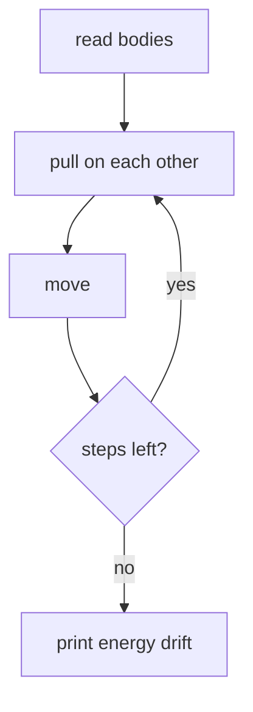

# orbits

A few bodies pulling on one another, stepped with semi-implicit Euler.


| Body | Mass | Distance |
|------|-----:|---------:|
| sun | 1000 | 0 |
| earth | 1 | 1.00 |
| moon | 0.01 | 1.05 |



```cpp
for (int i = 0; i < steps; ++i) step(bodies, dt, gravity);
```

- [x] gravity
- [ ] collisions
- [ ] a picture of the orbits
