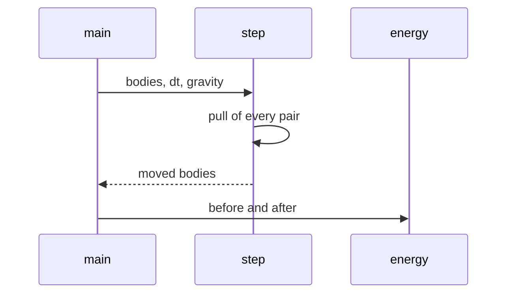
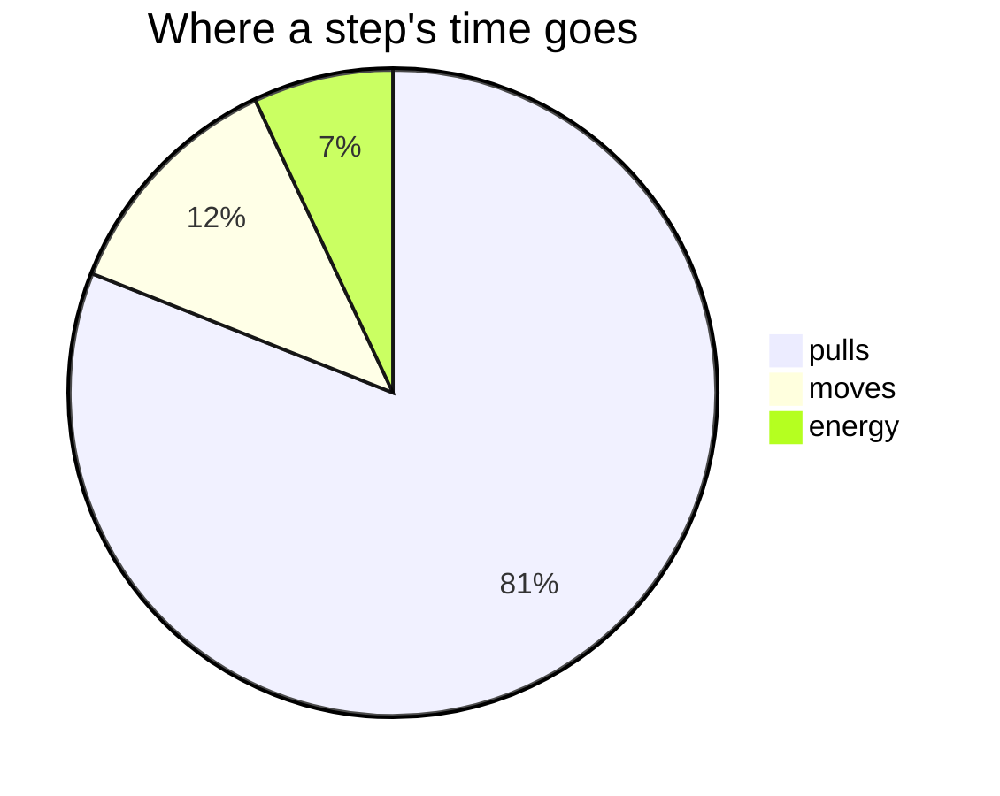

# Notes on the step

Each step every body pulls on every other, then each moves. With `dt` small
enough the energy stays put; the drift printed at the end says how small.

> Semi-implicit Euler keeps orbits closed where plain Euler spirals out.



| dt | steps | drift |
|---:|------:|------:|
| 0.01 | 100 | 3.1e-3 |
| 0.001 | 1000 | 2.9e-5 |
| 0.0001 | 10000 | 2.9e-7 |

```cpp
const Vec2 d = bodies[j].position - bodies[i].position;
pull[i] = pull[i] + d * (gravity * bodies[j].mass / (r * r * r));
```


