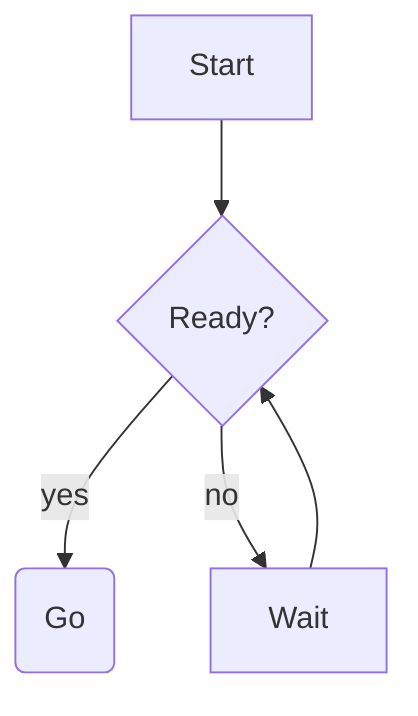

# blit notes

Some **bold**, *italic*, `code`, ~~gone~~ and a [link](https://example.com).
A second line that runs on.

## A list

- one
- two with `code`
  - nested
- [x] done
- [ ] not done

1. first
2. second

> A quote that says something
> over two lines.

| Name | Size | Kind |
|:-----|-----:|:----:|
| main.cpp | 12 | source |
| README.md | 3 | docs |

```cpp
int main() { return 0; }
```

---


